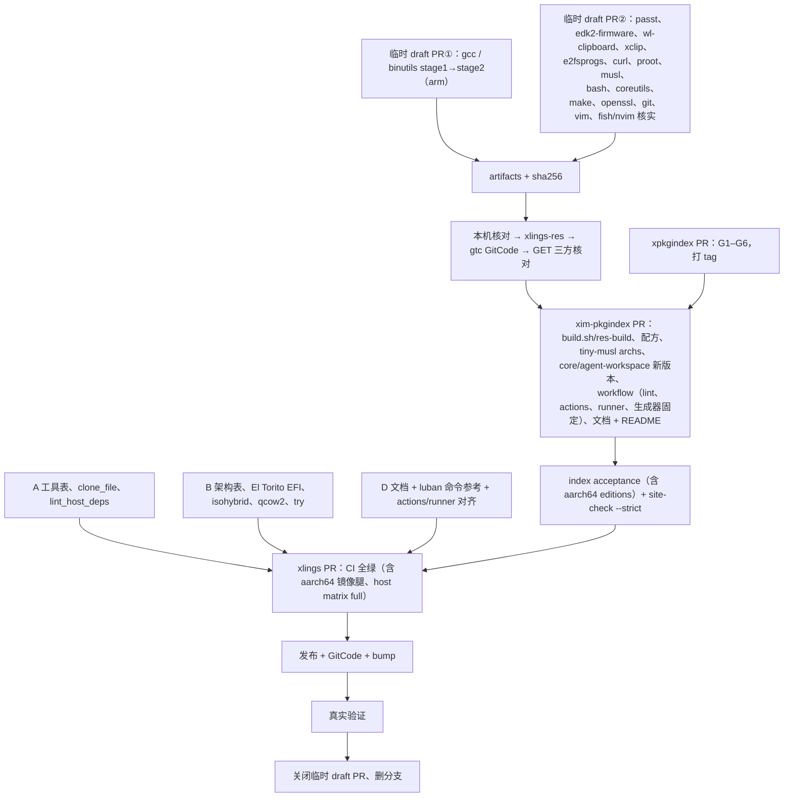

# Luban 平台补全、宿主依赖收敛与两仓库文档重构 设计方案

> 日期：2026-10-11 | 基线：xlings 2026.10.11.2、xim-pkgindex main、xpkgindex main | 状态：第四版，已吸收三轮 review，待 review

## 0. 已定的决定

| 来源 | 决定 |
|---|---|
| 第一轮 | aarch64 的 ISO、core、agent-workspace 本轮都做；文档默认英文；不留桩文件；每个仓库一个 PR |
| 第一轮 | 所有依赖都走 xlings 生态，不依赖系统包管理器；宿主依赖收敛到最小、且是必须的 |
| 第二轮 1 | ISO 的 UEFI USB 启动（isohybrid）**本轮必须做到** |
| 第二轮 2 | vim 和 git 改为自己构建，新的 core 版本中 vim 从 8.1 升到 9.1 |
| 第二轮 3 | 生态里已经有 aarch64 的 gcc 15.1，可以利用（§4.2） |
| 第二轮 4 | `xsel` 保留链接名，由 bridge 翻译参数 |
| 第二轮 5 | 资源构建可以在固定版本的容器里用 apk，但**文档要注明以后改为自举** |
| 第二轮 6 | xlings 和 xim-pkgindex 的文档都按 mcpp-community/mcpp 的布局重构：默认英文，独立的 `docs/zh/` 目录，按章节分类；xim-pkgindex 的 README 改为英文默认，更简洁 |
| 第三轮 1 | **gcc 等构建必须做成，补齐 xlings 生态，不设"推迟 core"的降级**。资源多，可以用 xlings 和 xim-pkgindex 的临时 draft PR 的 Actions 并行构建（§5.3） |
| 第三轮 2 | `specs/` 只出英文 |
| 第三轮 3 | 中文 README **统一为 `README.zh.md`**（两个仓库都用这个名字；mcpp 用的是 `zh-CN`，这里有意不同） |
| 第三轮 4 | 站点本来就支持多语言（index.xlings.org 已经能按浏览器语言自动切换）；站点生成工具 xpkgindex 需要对齐，main 上的告警也要处理（§6.6） |
| 第三轮 5 | V0、V1 规范归入 `specs/legacy/`，不翻译 |
| 第四轮 | 站点根路径改为英文（自动切换承接中文）；生成器新增 `docs.tree`；**actions 升级和 runner 标签以后再做**（G1、G2 移出本轮） |

## 1. 现状（实测）

### 1.1 产品运行时调用的外部程序

| 工具 | 用途 | 现状 | 问题 |
|---|---|---|---|
| bwrap | 沙箱 | root 所有的副本，或 host，或包；`xim:bwrap` 两个架构都有 | 无 |
| pasta (passt) | `net=nat` | 工具表写的包 `passt` 在 index 里**不存在**；CI 用 apt 装 | 缺包 |
| proot | 没有 userns 时的退路 | 只有 x86_64 | 缺 aarch64 |
| mkfs.ext4 | drive 的根分区、image 存储 | `e2fsprogs` 只有 x86_64 | 缺 aarch64 |
| curl | 通过代理查出口时区 | 只有 x86_64 | 缺 aarch64 |
| qemu-system-* | `luban try` | 工具表写的包 `qemu` 在 index 里不存在，实际是 `qemu-x86` / `qemu-arm` | 映射错误 |
| UEFI 固件 | try、测试 | `qemu-x86` 只带 `.fd.bz2`（压缩的，`-bios` 不能直接用）；测试用的是 apt 装的 OVMF | 不能直接用 |
| qemu-img | `--qcow2` | 没有任何包提供 | 缺 |
| xorriso | ISO 的 UEFI 启动 | index 里没有 | 缺 |
| mksquashfs | — | 代码里没有调用 | 死条目 |
| cp | fork 时的写时复制 | 宿主的 `/bin/cp` | 可改为进程内实现 |
| wl-copy、xclip 等 | clipboard 在宿主一侧 | 只用宿主自带的，Ubuntu 默认不装 | grant 开了也可能用不上 |

### 1.2 不可替代的宿主依赖（T0）

| 依赖 | 原因 |
|---|---|
| 内核及其能力（userns、Landlock、seccomp、KVM） | 它本身就是宿主 |
| sudo | 只用于一次性设置和 `--system`；提权只能由宿主授予 |
| apparmor_parser | 宿主 LSM 的加载器 |
| mount、umount、chown（经 elevation） | 宿主的基础系统，以 root 身份运行 |
| macOS / Windows 自带的 pbcopy、clip、powershell、wsl.exe | 操作系统自带 |

### 1.3 CI 对系统包管理器的使用

**xlings：**
- unit lane：apt 装 bubblewrap、passt；
- image lane：apt 装 qemu-system-x86、e2fsprogs、ovmf、xorriso、fdisk、build-essential；
- 各构建步骤：apt 装 curl、git、build-essential、jq；
- host-matrix 的 VM 腿：apt 装 qemu-system-x86、qemu-utils、cloud-image-utils；
- 容器腿和 VM 内部：python3、curl、sudo 等。

**xim-pkgindex：**
- res-build：flex、bison、bc、libelf-dev、libssl-dev；
- luban-agent-workspace：qemu-system-x86。

**合理的例外**：`aur_package_test.sh` 用 pacman，被测对象就是 pacman 打包。

### 1.4 edition 的架构覆盖

- nano、tiny：两个架构都有。
- tiny-musl：缺 aarch64 的 musl。
- core 和 agent-workspace 缺以下包的 aarch64 版本：bash、fish、vim（第三方的 8.1 静态包）、git（第三方静态包）、coreutils、gcc、binutils、make、openssl、nvim（只有 macOS 的 aarch64）。
- gcc 的实际情况：
  - **`gcc` 包（目标 glibc）只有 x86_64**：xlings-res/gcc 15.1.0 和 16.1.0 的 release 里都只有 linux-x86_64 的资产；
  - **`musl-gcc` 15.1.0 两个架构都有**：原生的 aarch64 编译器，目标是 musl。

### 1.5 文档

**xlings：**
- 28 份文档，正文几乎全是中文；
- 写作规范（skill）规定用中文；
- 目录分类不清（`quick-start/` 实际是深入指南、`theme.md` 与 `spec/themes.md` 重复、`superpowers/` 是 agent 草稿）；
- 有链接指向 `.agents/docs`；
- 文档检查只覆盖 6 个文件。

**xim-pkgindex：**
- 默认中文，用 `.en.md` 作为翻译；
- README 是中文，混着徽章、规范细节和发布门禁，偏长；
- `docs/README.md` 链接到 `.agents/docs`；
- V0、V1、V2 三代规范并列；
- 站点的 `languages` 第一项（即默认语言）是 `zh`。

**参照 mcpp-community/mcpp：**
- `docs/NN-title.md`（英文章节，用编号表示所属部分和阅读顺序）；
- `docs/zh/NN-title.md`（中文镜像）；
- `docs/specs/`（规范性文档，只有英文，每条规则标注实现状态）；
- 根目录 `README.md` 加 `README.zh-CN.md`；
- `docs/README.md` 的结构：每类文档放在哪里、从哪里开始（任务 → 读哪些 → 跑哪些）、按编号分部的章节、按词条反查；
- 章节只写**已经实现的**功能；设计理由和被否决的方案留在 `.agents/docs`，用户文档不引用它们。

## 2. 原则

### 2.1 宿主依赖分三层

| 层 | 内容 | 规则 |
|---|---|---|
| T0 宿主 | §1.2 | 工具表写 `os = true` 并附原因；只有这一层允许没有对应的包 |
| T1 生态 | 其他所有程序和数据 | 必须是 index 中的包，两个架构都要有。先找包，后找宿主（只有 bwrap 先找 root 所有的副本，出于安全）。提示语永远是 `xlings install <包>` |
| T2 进程内 | ISO 9660 和 El Torito（BIOS + EFI）、isohybrid 的 MBR/GPT、GPT、FAT、qcow2、文件克隆 | 能用几百行写完、与 OS 无关的格式，放进程内，这样就没有依赖 |

**宿主依赖在字面上无法做到 100% 为零**（sudo、mount 也是宿主装的）。所以定义为：产品不调用、也不提示任何包管理器，只依赖 T0 清单。T0 的状态由 `luban status` 和 doctor 报告。

### 2.2 多视角取舍

| 视角 | 取舍 |
|---|---|
| 架构 | 每类事实只有一个来源：工具 → 工具表；按架构不同的引导参数 → `luban.image` 的架构表；固件也走同一套查找。三条规则由测试守住 |
| 稳定性 | x86_64 的 BIOS 和 UEFI 测试腿保留；ISO 的变化只是新增（EFI 启动项、isohybrid），并且加一条"ISO 当磁盘启动"的测试腿 |
| 简洁 | 少一个宿主工具，就少一类"在我机器上不行"的问题；两个架构共用一条代码路径 |
| 用户体验 | 提示语都能装上；clipboard grant 开了就能用；一台干净的 Linux 只要有 curl，就能跑完全部 Luban 功能 |
| 兼容 | 已发布的 manifest 不改；core 和 agent-workspace 出新的日期版本，已有环境用 `upgrade` 迁移；文档路径变了，就在同一 PR 里改完全部站内链接 |
| 跨平台 | 镜像的架构就是本机架构；macOS 和 Windows 的 T0 各列一份清单 |
| 一致性 | 两个仓库的文档采用与 mcpp 相同的布局和写作规则（三个仓库一致）；`luban` 命令也由 CI 校验；宿主依赖由 lint 守住 |
| 无感升级 | aarch64 用户 `self update` 之后直接就能 `luban new … core`；x86_64 用户 `luban upgrade`，自己改过的包保持不变 |

## 3. 轨道 A：工具来源与宿主依赖

### 3.1 xlings 的工具表

- qemu 映射到实际的包：`qemu-system-x86_64` → `qemu-x86`，`qemu-system-aarch64` → `qemu-arm`。
- `pasta` 映射到新包 `passt`。
- 删除 `qemu-img`、`xorriso`、`mksquashfs`、`cp`。fork 的写时复制改为 `platform::clone_file`：Linux 用 FICLONE，macOS 用 clonefile，其他情况回退到复制。
- clipboard 在宿主一侧：先找包（`wl-clipboard`、`xclip`），再找宿主自带的。sandbox 里 `xsel` 的链接名保留，bridge 把 xsel 的参数（`-b/-p`、`-i/-o`）翻译后交给同一个 broker。
- `Entry` 加两个字段：`os`（T0 时为 true，并附原因）、`archs`。
- `install_hint` 只输出 `xlings install <包>`。
- 测试 `TOOLS-PROVENANCE`：
  - xlings 单元测试：非 T0 条目必须有包；
  - index acceptance 的静态部分：包必须在 index 中存在，并且 archs 覆盖条目声明的架构。

### 3.2 固件

- 新增数据包 `edk2-firmware`：从 qemu 9.2.4 源码包（核对 sha256）的 `pc-bios/` 中解出 `edk2-x86_64-code.fd`、`edk2-aarch64-code.fd` 和许可证文件。固件与宿主架构无关，一个包覆盖两个架构。
- xlings 的查找顺序：先找 `edk2-firmware`，再找模拟器包自带的；不找宿主的。

### 3.3 index 新增或补齐的包

所有包都在 res-build 中、在原生 runner 上、在固定 digest 的构建容器里静态构建，构建时真跑检查。然后发布到 xlings-res，用 gtc 补 GitCode，GET 下载后核对 sha256。

| 包 | 动作 |
|---|---|
| passt（pasta） | 新增，两个架构 |
| edk2-firmware | 新增，两个架构 |
| wl-clipboard、xclip | 新增，两个架构 |
| e2fsprogs 1.47.3、curl、proot、musl 1.2.5 | 补 aarch64 |
| core 用到的包 | 见 §5.2 |

### 3.4 CI 与测试走 xlings

- **unit lane**：bwrap 和 pasta 用 xlings 安装；root 所有的 bwrap 走产品自己的 `self doctor --isolation --fix`。
- **image lane**：
  - 用 xlings 安装 qemu-x86 或 qemu-arm、edk2-firmware、e2fsprogs、limine；
  - 删掉 xorriso、ovmf、fdisk（改为测试自带的 GPT/MBR 读取器）、build-essential（改用 xlings 装的 gcc）。
- **构建步骤**：`curl git build-essential jq` 逐项审计。runner 镜像本来就有的不再安装；真正需要的改由 xlings 提供。
- **host-matrix 的 VM 腿**：
  - qemu 和固件由 xlings 安装；
  - 覆盖层改用 qemu 的 `-snapshot`；
  - 种子盘改用 cloud-init 的 NoCloud-Net（通过 SMBIOS 传地址，测试端起一个 http 服务）；
  - runner 上只剩 `/dev/kvm` 的权限设置（T0）。
- **host-matrix 的容器和 VM 内部**：发行版准备步骤只装 curl、sudo 和建用户的工具；python 改为 `xlings install python`。
- **`tools/lint_host_deps.sh`**（两个仓库都加）：
  - 出现 `apt-get`、`dnf`、`yum`、`pacman`、`apk`、`brew`、`choco`、`pip install` 就失败，除非该行带 `host-dep-ok: <原因>`；
  - 合法的原因只有：被测对象就是这个包管理器、构建容器内部、发行版引导准备；
  - xim-pkgindex 其他 workflow（lua5.4、patchelf、pytest）先列入白名单，登记为后续项。

### 3.5 资源构建环境（工厂）与自举

- **本轮**：每个构建跑在固定 digest 的容器里，容器内的 apk 是配方的一部分，记录在 `README.provenance` 中；runner 宿主只需要 docker。
- **自举方向**（写进 xim-pkgindex 的资源文档，作为后续路线）：工厂里的编译器和构建工具逐步换成 xlings 生态自己的包（musl-gcc、gcc、make、cmake……），最终目标是"index 用 index 构建"。
- **本轮已经迈出第一步**：gcc aarch64 由生态内的 musl-gcc 15.1.0 自举（§5.2）。

## 4. 轨道 B：镜像在 aarch64 上补齐（xlings）

### 4.1 按架构查的表（`luban.image`）

| 键 | x86_64 | aarch64 |
|---|---|---|
| UEFI 引导文件 | `BOOTX64.EFI` | `BOOTAA64.EFI` |
| 是否有 BIOS | 是 | 否 |
| qemu 程序 | qemu-x86 | qemu-arm |
| 机器参数 | `-M q35` | `-M virt` |
| CPU 参数 | 有 KVM 用 `host` | 有 KVM 用 `host`，否则 `max` |
| 固件 | `edk2-x86_64-code.fd`（只在 UEFI 时） | `edk2-aarch64-code.fd`（必需） |
| 光盘 | `-cdrom` | virtio-scsi 加 `scsi-cd` |

- 架构从 root 记录的 ABI 读，没有记录就用 `build_arch()`。
- `limine_data_` 只要求本架构需要的文件。
- 静态检查的提示语按本机三元组输出。

### 4.2 ISO：EFI 启动项与 isohybrid（本轮必须做到）

- **El Torito**：进程内的 ISO 写入器支持多个启动项。
  - BIOS 项（platform 0x00，`limine-bios-cd.bin`）：只在 x86_64 上写；
  - EFI 项（platform 0xEF，`limine-uefi-cd.bin`，以整个 FAT 镜像的形式）：两个架构都写。
- **isohybrid**：在进程内给 ISO 写一个分区表，让同一个文件 `dd` 到 U 盘后也能启动。
  - 一个 MBR，带一个 0xEF 分区项指向 EFI 镜像所在的扇区区间；再加一个 GPT（保护性 MBR 加主备 GPT 表），其中 EFI 系统分区指向同一区间。这与 xorriso 的 `-isohybrid-gpt-basdat` 等效。
  - ISO 的大小向上对齐，留出备份 GPT 的位置。
  - x86_64 上再执行 `limine bios-install`（xim:limine，T1），写入 MBR 引导代码，保留分区表，这样 BIOS 也能从 U 盘启动。
- **测试**（两个架构）：
  - 当作光盘启动：x86_64 测 BIOS 和 UEFI，aarch64 测 UEFI；
  - 当作磁盘启动（`-drive if=virtio`）：x86_64 测 BIOS 和 UEFI，aarch64 测 UEFI；
  - 单元测试独立解析 El Torito 启动目录、MBR 和 GPT（包括 CRC 和备份表）。
- 删除对 xorriso 的调用和它的条目。

### 4.3 drive 与 qcow2

- **`--drive`**：GPT，含本架构的 FAT 系统分区和 ext4 根分区（mkfs.ext4 来自 xim:e2fsprogs）；只有 x86_64 有 BIOS boot 分区和 `bios-install`。
- **`--qcow2`**：进程内的 qcow2 v3 写入器（cluster 64 KiB，L1/L2 表、refcount 表，全零 cluster 不分配），由 raw 流式转换。
  - 单元测试：用独立的读取器做往返校验；
  - e2e：qemu 直接启动这个 qcow2。

### 4.4 `luban try`

- 两个架构共用一条路径，ISO、drive、qcow2 都能启动。
- 默认的 boot profile 是 `virt`。网络不变。
- 缺工具时的提示：`xlings install qemu-arm edk2-firmware`。

## 5. 轨道 C：aarch64 edition（xim-pkgindex 为主）

### 5.1 tiny-musl

- musl 补 aarch64：`loader = "lib/ld-musl-aarch64.so.1"`，`archs` 加 aarch64，revision 不动。
- `luban-tiny-musl` 的 `archs` 加 aarch64，已发布的 manifest 不变。
- xlings 的 host matrix 中，aarch64 对 tiny-musl 的检查从"被拒绝"改为"能创建、能进入、musl 程序能运行"。

### 5.2 core 和 agent-workspace（新的日期版本，覆盖两个架构）

| 包 | 计划 | 风险 |
|---|---|---|
| bash 5.2.37、coreutils 9.5 | 构建 aarch64，链接 index 的 glibc，与 x86_64 同形 | 低 |
| make 4.3、openssl 3.1.5 | 构建 aarch64，产物布局与 x86_64 一致 | 低 |
| git | 两个架构都自己构建（静态），新 revision | 中：x86_64 的来源改变，需要回归 |
| vim | 两个架构都自己构建 9.1.x 静态版本，新的 core 版本钉住它 | 中：`upgrade` 会显示它在跟进 |
| fish 4.8.1、nvim 0.12.5 | 补上游的 linux aarch64 资产（构建前先核实上游有没有；没有就自己构建） | 低 |
| binutils 2.42.1 | 与 gcc 走同一条流水线（见下），在 stage 1 之后构建 | 中 |
| **gcc 16.1.0** | 见下面的"gcc aarch64：分阶段自举" | 中高：首次在 aarch64 上走这条路径，每个 stage 约 1 小时 |
| claude、ninja、xz、zlib、mcpp、ca-certificates、linux-headers 5.11.1、glibc 2.44.3、patchelf、gcc-runtime 15.1.0 | 已有两个架构 | 无 |

**gcc aarch64：分阶段自举（必须做成）**

已知事实：
- x86_64 的 `gcc@16.1.0` 来自 fromsource 流水线（`openxlings/xim-pkgindex-fromsource`）：在一个 xlings subos 里配置 `--with-sysroot=<subos>`、`--disable-bootstrap`、`--enable-languages=c,c++`，并用 xlings 环境验证。
- 生态里现成的 aarch64 编译器是 `musl-gcc@15.1.0`（目标 musl）。
- glibc、linux-headers、gcc-runtime 已有 aarch64 版本。

产物的形态要和 x86_64 一致：宿主程序（cc1、collect2 等）动态链接 index 的 glibc，目标库（libstdc++、libgcc_s）面向 aarch64-linux-gnu，configure 参数相同。

| stage | 编译器 | 产出 | 用途 |
|---|---|---|---|
| 0 | `musl-gcc@15.1.0` aarch64（xlings 安装，生态内） | — | 引导 |
| 1 | stage 0 | gcc 16.1.0：宿主程序静态链接 musl，目标是 aarch64-linux-gnu，sysroot 是 xlings subos（glibc 2.44.3 + linux-headers 5.11.1）；同时构建 binutils 2.42.1 | 只用来构建 stage 2，不发布 |
| 2 | stage 1 | gcc 16.1.0，与 x86_64 同形同参（宿主程序链接 subos 的 glibc）；binutils 2.42.1 同样重建 | **发布的就是这一版** |

- **stage 0 的备选编译器**：如果 musl-gcc 引导出问题，就换 runner 自带的 gcc 作 stage 0（属于工厂，§3.5 允许）。stage 2 的产物形态不受影响。这是让构建"必须成功"的冗余，不是对产物的降级。
- **验证**（stage 2 在 xlings 的干净环境中安装后执行）：
  - `gcc --version`；
  - C 和 C++23 程序能编译并运行；
  - `import std` 能用；
  - mcpp 构建一个模块项目；
  - `readelf` 检查：INTERP 和 RPATH 指向 subos，宿主程序不引用 runner 的 `/usr/lib`。
- **配方改动**（`gcc.lua`、`binutils.lua`）：
  - 加上 aarch64 的 sha256；
  - shim 列表中 `x86_64-linux-gnu-*` 的名字按架构生成，aarch64 用 `aarch64-linux-gnu-*`；
  - specs 改写时用 aarch64 的 loader（`/lib/ld-linux-aarch64.so.1`）；
  - x86_64 的输出不变，revision 只在 x86_64 行为不变的前提下才不动。这一点用 published 的回归检查守住。
- **fromsource 流水线**：在 `xim-pkgindex-fromsource` 中加 aarch64 的 stage 1/2 配方，或者在 res-build 中调用同一套脚本。最终选择以现有流水线的结构为准，在实现时确定，不在本文中臆测。

### 5.3 构建编排：用临时 draft PR 并行构建

- **构建定义只有一份**：`tools/res/build.sh` 加 `res-build.yml`（矩阵：包 × 架构）。gcc 和 binutils 的分阶段步骤也写成 build.sh 的一项（或调用 fromsource 的脚本），永久留在 xim-pkgindex。
- **执行**：
  - 在 xim-pkgindex 和 xlings 各开一个**临时 draft PR**。分支上有一个临时 workflow，在 `pull_request` 触发时以矩阵调用同一套 build.sh（xlings 一侧 checkout xim-pkgindex 对应的分支），`fail-fast: false`；
  - 产物和 `.sha256` 作为 artifact 上传；
  - gcc 和 binutils 放在一个 PR 中最先启动，其余资源分散到另一个 PR。
- **并发**：GitHub 托管 runner 的并发上限按**组织**计算，xlings 和 xim-pkgindex 同属 openxlings，共用一个池。分两个 PR 的主要作用是让两条长队列并行、失败可以单独重跑，而不是让上限翻倍。
  - arm runner（`ubuntu-24.04-arm`）对公开仓库可用；
  - gcc 的 job 设 `timeout-minutes: 300`（每个 job 最长 6 小时），先检查磁盘并清理 runner 预装的大目录；stage 1 和 stage 2 拆成两个 job，用 artifact 衔接，单个 job 失败只需重跑它。
- **发布**（不在 PR 中自动完成）：
  1. 在本机下载 artifact，核对 sha256；
  2. 用 `gh release` 发布到 xlings-res；
  3. 用 gtc 补 GitCode；
  4. GET 两端后逐字节核对，与 part 2 的流程相同。

  这样 draft PR 不需要发布权限，资源的权威来源仍然是"同一个构建产物，经过三方核对"。
- **收尾**：资源全部发布后，关闭临时 draft PR（不合入），删除分支。永久内容只有 xim-pkgindex 正式 PR 里的 build.sh、res-build.yml 和配方。

**验证**：
- index acceptance 加 aarch64 腿：创建 core 并编译、运行 C++23 程序；创建 agent-workspace。
- host matrix 的 aarch64 腿覆盖 core 和 agent-workspace。
- x86_64 上从 2026.10.11.1 `luban upgrade` 到新版本。

## 6. 轨道 D：两个仓库的文档重构（参照 mcpp）

### 6.1 共同约定（mcpp、xlings、xim-pkgindex 三处一致）

| 项 | 约定 |
|---|---|
| 语言 | 英文为默认：`docs/NN-title.md`；中文在 `docs/zh/NN-title.md`，文件名和结构一一对应 |
| 根 README | `README.md`（英文）加 `README.zh.md`。xlings 已经是这个名字；xim-pkgindex 新增。mcpp 用的是 `zh-CN`，这里有意不同，以 `README.zh.md` 为 openxlings 的约定 |
| 规范 | `docs/specs/` 只有英文，是规范性文档；每条规则标注实现状态 |
| 生成文件 | `docs/generated/` 只有英文（命令参考） |
| 语言切换行 | 英文写 `**English** \| [简体中文](zh/X.md)`；中文写 `[English](../X.md) \| **简体中文**` |
| 编号 | 第一位数字表示所属部分，部分内按阅读顺序编号 |
| 写什么 | 只写已经实现的功能；设计理由、测量和被否决的方案留在 `.agents/docs`，**用户文档不引用 `.agents/`** |
| `docs/README.md` | 依次是：每类文档放在哪里（docs、specs、.agents/docs、skills）；从哪里开始（任务 → 读哪些 → 跑哪些）；按部分列出章节；按词条反查（命令、配置键、概念 → 章节）；规范列表 |
| 隐私 | 不写维护者署名或日期归属，不写个人路径 |

### 6.2 xlings 的目录

```
docs/
├── README.md                     文档地图（§6.1 的结构）
├── 0x  Fundamentals
│   00-what-xlings-is.md          是什么、保证什么、与 apt/nix/docker 的区别（原 comparison）
│   01-getting-started.md         安装、第一个包
│   02-scenarios.md               常见任务分别用到哪些功能
│   03-packages-and-versions.md   install/use/remove/search、多版本、版本视图（原 multi-version 与 xvm 的用户部分）
│   04-projects.md                .xlings.json、项目模式（原 project-env）
│   05-indexes-and-mirrors.md     多个 index、自建 index、镜像（原 custom-index 与 package-index-ecosystem 的用户部分）
│   06-self-management.md         self update、doctor、uninstall
│   09-commands-by-scenario.md    按场景查命令；完整参考见 generated/
├── 1x  SubOS
│   10-subos.md                   内容 × 视图 × carrier；new/use/exec/ls/remove
│   11-sandbox-and-policy.md      预设、grant（含 clipboard）、网络、身份（原 subos-isolation 的用户部分）
│   12-roots-and-generations.md   rootfs 形式的 SubOS、generation、rollback
│   13-subos-on-macos-and-windows.md  carrier（wsl2、vz）及其限制
├── 3x  Extending
│   30-authoring-a-package.md     写一个 xpkg（细节指向 xim-pkgindex 的文档）
│   31-hosting-an-index.md
│   32-authoring-a-subos-template.md  （原 subos-as-xpkg）；edition 指向 luban/
├── 5x  Contracts
│   50-agents-and-machine-interface.md  --agent、--json、NDJSON interface（原 interface-protocol）
│   51-supported-platforms.md     平台矩阵、宿主依赖 T0/T1/T2、版本兼容与 min_client
├── 9x  xlings itself
│   90-build-from-source.md  91-architecture.md（模块、数据布局、内部机制）  92-release.md
├── luban/                        Luban OS（§6.3）
├── specs/                        英文，规范性：xpkg-manifest-v1、xlings-json、interface-ndjson-v1、
│                                 diagnostics、themes、index-distribution、index-version-contract、xpkg-resource-resolution
├── generated/                    command-reference.md、luban-command-reference.md（新增）
└── zh/                           以上所有章节和 luban/ 的中文镜像（不含 specs、generated）
```

- `design/`、`architecture/`、`quick-start/`、`spec/`、`theme.md`、`superpowers/` 全部消失：
  - 内容拆进章节、`specs/` 或 `91-architecture`；
  - `superpowers/` 归档到 `.agents/docs/old/`。
- 旧路径的去向，在 PR 描述中列一张对照表。

### 6.3 `docs/luban/`（及 `docs/zh/luban/`）

```
luban/
├── README.md               Luban 文档地图，加上支持矩阵（宿主 × 架构 × edition × 镜像格式）
├── 00-what-luban-is.md     模型（内核 → nano → edition）；luban 与 xlings 的分工
├── 01-getting-started.md   new / enter / run / ls / status；宿主的一次性设置
├── 02-editions.md          各个 edition、from 链、日期版本、latest、archs
├── 03-environments.md      config、grant、upgrade（从不放松隔离）、rollback
├── 04-agent-workspace.md   私有工作区：persona、只走代理的网络、agent-private 与 agent-confined
├── 05-images.md            export 的各种格式、boot profile、isohybrid、try、写入磁盘
├── 06-machine.md           Luban 作为一台机器的系统：stage-0、启动项、启动时回滚
├── 07-host-support.md      支持哪些宿主、宿主依赖只有 T0、排障
└── 91-architecture.md      给开发者的结构说明（只写已实现的；设计理由留在 .agents/docs）
```

edition 的编写方法指向 xim-pkgindex 的 `12-luban-packages`。`quick-start/luban.md` 删除。

### 6.4 xim-pkgindex 的目录与 README

```
README.md / README.zh.md      简洁的英文默认版（见下）
docs/
├── README.md                 文档地图（§6.1 的结构）
├── 0x  Using
│   00-what-this-index-is.md  官方 index、命名空间、子 index、站点
│   01-getting-started.md     用 xlings 从这里安装（原 quick-start / quick-start.en）
├── 1x  Authoring
│   10-adding-a-package.md    从配方到 PR（原 contributing 加 V1/add-xpackage）
│   11-official-resources.md  xlings-res、每个架构的 sha256、GitCode 镜像、res-build、
│                             provenance、发布门禁（原 README 中的门禁）、
│                             构建工厂与**以后改为自举**的路线（§3.5）
│   12-luban-packages.md      edition、策略、boot profile（原 luban-packages）
│   13-ci-mirror-and-update.md  package.ci：镜像与自动更新
├── 2x  Testing
│   20-testing.md             用法、框架、CI（原 test/usage、design、ci 合并）
├── specs/                    英文，规范性：xpackage-v2.md（当前）、url-template.md、
│   │                         index-distribution.md（与 xlings 的同名文档只保留一份，另一边链接过去）
│   └── legacy/               V0、V1 的规范和模板，标注"已废弃 / 仅兼容"，不翻译
├── migrations/               保留（历史迁移记录，英文标题，按日期）
└── zh/                       章节的中文镜像
```

**README**（英文，约 40 行）：
- 一句话介绍；
- 安装 xlings（两条命令）；
- 用这个 index（3 条命令）；
- 浏览站点；
- 贡献（3 步加链接）；
- 其他 index（表格）；
- 社区；
- 徽章精简为 CI 和站点两个。

规范细节和发布门禁移到 `docs/11` 与 `specs/`。`README.zh.md` 是它的中文版。

**站点**（index.xlings.org，`.xpkgindex.json`）。实测情况：
- 站点是多语言的，有 `/`、`/en/`、`/zh-Hant/` 三套页面；
- **每一页**都带有 hreflang，并且会按 `navigator.languages` 自动 `location.replace` 到对应语言；
- 不带语言前缀的根路径提供的是 `languages[0]`，目前是 `zh`。

本轮的做法：
- 保留多语言和自动切换，不改变机制。
- `languages` 改为 `["en", "zh", "zh-Hant"]`：没有 JS 的访问者和爬虫默认看到英文，与"默认 en"一致。中文浏览器在任何页面都会被自动切到 `/zh/`，所以原来根路径上的中文链接对中文用户依然有效。
- 文档的指南模型不用改：`path` 指向英文章节；`translations.zh` 指向 `docs/zh/`，生成器对 `zh-Hant` 按 `split("-")[0]` 回退到 zh 的译文。
- 由 site-check 验证：每种语言的每个文档页都生成出来，切换链接成对出现，相对链接都能解析。

### 6.5 校验（两个仓库）

- **`test_docs`**：xlings 放在 `tests/scripts/`，作为 lint suite 的一部分；xim-pkgindex 放在 `tests/`，标记为 static。检查项：
  1. 每个英文章节在 `docs/zh/` 下都有对应文件，反之亦然（specs、generated、legacy 除外）；
  2. 语言切换行正确；
  3. 中英文的标题数量相同，代码块逐块完全相同；
  4. 相对链接都能解析；
  5. xlings：所有章节的代码块中，`xlings …` 和 `luban …` 按各自的命令树校验；
  6. 禁止出现：`.agents/`、`/home/<user>`、旧命令、系统包管理器的安装命令。
- 给 luban 加隐藏选项 `--command-reference-json`，用它生成 `docs/generated/luban-command-reference.md`，并由 CI 检查是否最新。
- 写作规范（skill）改写为 mcpp 的规则（§6.1）。xim-pkgindex 也加一份对应的 skill，或者在 AGENTS 中写明。AGENTS.md 只留指向 skill 的一行，另外写入 T0/T1/T2 规则。

### 6.6 站点生成工具（xpkgindex）对齐

实测：
- xpkgindex main 的 CI 是绿的；
- xim-pkgindex 部署站点时生成器没有报错（320 个包，3 种语言）；
- 先前修复的"译文链接留在本语言"已经包含在 main（#10）中。

main 上的"报错"是两类 **GitHub annotation**，在 xlings、xim-pkgindex、xpkgindex 三个仓库都存在：
- **Node 20 被弃用**，涉及 `checkout@v4`、`setup-python@v5`、`upload-artifact@v4`、`download-artifact@v4`、`cache@v4`、`deploy-pages@v4`、`upload-pages-artifact@v3`，以及一处 `checkout@v2`；
- **`ubuntu-latest` 将在 2026-10-19 开始迁移到 Ubuntu 26**。三个仓库共有约 30 处使用了这个标签，其中包括 xlings 的 release、host-matrix 和 gitee-sync。

对齐项（xpkgindex 一个 PR，另外两个仓库的部分并入各自的 PR）：

| # | 项 | 做法 |
|---|---|---|
| G1 | actions 升到 Node 24 的大版本 | 三个仓库的 workflow 统一升级（实现时按各 action 当时的最新大版本核实）；`checkout@v2` 一并升级 |
| G2 | runner 标签显式化 | 行为依赖发行版的 job（release、host-matrix、镜像、构建）改用 `ubuntu-24.04` / `ubuntu-24.04-arm`；只有无所谓发行版的 job 才保留 `ubuntu-latest`。是否迁移到 Ubuntu 26 作为单独的决定，届时在 host matrix 中加一条 26 的腿再切换 |
| G3 | 生成器版本固定 | xim-pkgindex 的 deploy 和 site-check 都 `pip install git+…xpkgindex.git` 取 main 的 HEAD，生成器的改动会悄悄改变站点。改为固定到 tag 或 commit，升级时显式改动并由 site-check 验证 |
| G4 | 按目录发现文档 | 新增配置 `docs.tree = {"root": "docs", "translations": {"zh": "docs/zh"}, "exclude": ["specs/legacy", "migrations"]}`：按编号自动收集章节，标题取 H1，`docs/README.md` 作为文档首页，`specs/` 作为一组。这样十几个章节乘三种语言不必逐条写进配置，mcpp 式的布局（mcpp、xlings、xim-pkgindex）在站点上得到同样的呈现。原有的 `docs.entries` 继续支持 |
| G5 | 文档的语言切换行 | `_strip_language_line` 已经按"所有链接都指向本文的译文"来识别，`zh/X.md` 和 `../X.md` 这两种写法都在 siblings 中，不需要改；补一个测试覆盖 `docs/zh/` 的布局 |
| G6 | 生成器自身的检查 | `--strict` 已经存在，site-check 也在用，但它只覆盖"增长曲线的核对"（`_verify_growth`）。把它扩展到指南的警告：断链、缺译文、指向仓库外的链接、`docs.tree` 中不存在的目录，都按错误处理 |

### 6.7 内容审计

- 每一章都按当前行为核对一遍，只写已经实现的。
- SubOS 的叙述统一为"内容 × 视图 × carrier"。
- 所有"apt install …"之类的提示改为 xlings 的包。
- 本轮新增功能（aarch64 镜像、isohybrid、qcow2、新的 core）只在代码完成后写进支持矩阵。

## 7. 依赖与交付



一共三个正式 PR，每个仓库一个：
- **xpkgindex**（G1–G6）：最先合入并打 tag，因为 xim-pkgindex 要固定到这个 tag。
- **xim-pkgindex**：资源发布完成后合入。
- **xlings**：最后合入。在 index PR 合入之前，xlings 的 CI 通过 `index_repository` 指向 index PR 分支联调。版本按发布当天日期取 `.1`。

另有两个临时 draft PR，只用来跑构建，结束后关闭。

**发布与验证**：
1. squash 合入（`--admin`）；
2. 取消 main 上的 CI；
3. 发布 release，用 gtc 补 GitCode；
4. 合入版本 bump PR；
5. 重新触发 CI；
6. 真实验证：
   - x86_64：用 xlings 装的 qemu 和固件跑 `try`；ISO 当光盘和当磁盘、BIOS 和 UEFI 都能启动；qcow2 能启动；从 core 2026.10.11.1 `upgrade` 到新版本；
   - aarch64（借 host matrix 和 index acceptance）：tiny 的 drive、iso（光盘和磁盘）和 try；tiny-musl、core、agent-workspace 能创建；在 core 里用 gcc 16.1.0 编译并运行 C++23 程序（含 `import std`）；
   - 站点：index.xlings.org 在 `/`、`/zh/`、`/zh-Hant/` 下的文档页都能打开，切换链接成对，按浏览器语言自动切换仍然有效。

## 8. 测试与需求映射

| 需求 | 测试 |
|---|---|
| TOOLS-PROVENANCE（新增） | 工具表的单元测试，加 index acceptance 的静态检查 |
| HOST-DEPS-T0（新增） | 三个仓库的 `lint_host_deps.sh`；host matrix 的容器只装最小引导集合 |
| LUBAN-ISO-UEFI、LUBAN-ISO-HYBRID（新增） | El Torito、MBR、GPT 的解析单元测试；四种启动方式（光盘或磁盘 × BIOS 或 UEFI），aarch64 只测 UEFI |
| LUBAN-QCOW2（新增） | 往返单元测试；qemu 启动 qcow2 |
| LUBAN-ISO、LUBAN-DRIVE、LUBAN-TRY、LUBAN-BOOT-PROFILE | 扩展到 aarch64：镜像测试腿在 ubuntu-24.04-arm 上跑（TCG，单独超时） |
| LUBAN-EDITION-ARCHS（新增） | tiny-musl、core、agent-workspace 在 aarch64 上能创建；core 在 aarch64 上能编译 C++23 |
| GCC-AARCH64（新增，index） | stage 2 的验证清单（§5.2），在 res-build 和 acceptance 中各执行一次 |
| SUBOS-CLIPBOARD | 宿主没有自带工具时，能解析出包里的 wl-copy 和 xclip；xsel 参数翻译的单元测试 |
| DOCS-I18N（新增，xlings 和 xim-pkgindex） | `test_docs` |
| SITE-I18N（新增，xpkgindex） | `docs.tree` 的单元测试（编号顺序、译文配对、排除项）；`--strict` 覆盖指南警告；`docs/zh/` 布局下语言切换行的识别 |

## 9. 自我 review（多视角，第四版）

| # | 视角 | 发现 | 处理 |
|---|---|---|---|
| R1 | 范围 | 约 17 个资源，其中 gcc 和 binutils 各要两个 stage；两个 edition 新版本；三条 xlings 代码轨道；两个仓库的文档重写（xlings 约 5000 行，xim-pkgindex 约 550 行加规范）；三个仓库的 actions 和 runner 对齐；生成器新功能。规模大约是 part 2 的两倍多 | 两个 draft PR 并行构建，gcc 最先启动；构建期间写代码和文档；按依赖图推进，每完成一步都做真实验证 |
| R2 | 可交付性 | gcc 要求必须做成，但在 aarch64 上从 musl-gcc 引导是第一次 | stage 0 有两个编译器可选（musl-gcc 或 runner 自带的 gcc），最终产物的形态都一样；stage 1 和 stage 2 拆成两个 job，可以单独重跑；验证清单是硬门槛。**不再设"推迟 core"的产物降级** |
| R3 | 一致性 | 产物要和 x86_64 同形同参。如果 aarch64 的宿主程序与 x86_64 不同（静态 musl 对动态 glibc），`gcc.lua` 的配置钩子（specs、elfpatch）会走不同分支 | stage 2 专门用 stage 1 按 x86_64 的参数重建，宿主程序链接 subos 的 glibc；`readelf` 检查放进验证 |
| R4 | 兼容 | `gcc.lua` 加上按架构生成的 shim 名和 loader 后，可能改变 x86_64 的配置输出 | x86_64 分支的输出必须逐字不变，用回归测试比较两版配置钩子在 x86_64 上的输出；不变就不升 revision |
| R5 | 资源与并发 | 两个仓库同属 openxlings，并发上限是组织级共享的，两个 draft PR 并不能让上限翻倍 | 方案里如实写明；靠拆 job 和可单独重跑来提高效率；矩阵设 `max-parallel`，给 host matrix 留出余量 |
| R6 | 安全 | 临时 draft PR 的 workflow 在 `pull_request` 下运行。同仓库的分支有 secrets，但构建 job 不需要 | 构建 job 设 `permissions: contents: read`，不使用 secrets；发布在本机完成，并经过三方核对 |
| R7 | 稳定性 | isohybrid 加上 El Torito EFI 会改变 x86_64 ISO 的字节布局；`limine bios-install` 与我们写的 GPT 共存，需要实测 | 四种启动方式全测；单元测试独立解析 MBR、GPT（包括 CRC 和备份表）和启动目录 |
| R8 | 时间窗 | `ubuntu-latest` 从 2026-10-19 开始迁移到 Ubuntu 26，迁移可能落在本轮 CI 期间，造成无关的失败 | G2 先把行为依赖发行版的 job 改为 `ubuntu-24.04`，放在三个 PR 中最先做 |
| R9 | 站点 | 根路径改为英文后，没有 JS 的旧中文链接会显示英文 | 每一页都会自动切换，中文浏览器不受影响；hreflang 齐全，爬虫可以发现中文页；发布说明中写明 |
| R10 | 一致性 | README 命名与 mcpp 不同（`zh` 对 `zh-CN`） | 按决定统一为 `README.zh.md`，作为 openxlings 的约定写进两边的文档规范；mcpp 是否跟进由它自己决定，不在本轮范围 |
| R11 | 宿主依赖 | 构建容器里的 apk、runner 预装的 python、docker 和 gh 属于工厂或 T0 | lint 标注原因；自举写进路线（§3.5），gcc 由 musl-gcc 自举是第一步 |
| R12 | 跨仓库 | 三个 PR 的合入顺序 | xpkgindex 的 PR 是独立的；index acceptance 只用已发布的 xlings 功能；镜像的新功能在 xlings 的 CI 中测。依赖是单向的：xpkgindex → xim-pkgindex → xlings |
| R13 | 文档 | 支持矩阵必须是最终状态 | 矩阵在代码完成后写；`test_docs` 守住命令和链接；review 核对矩阵 |
| R14 | 用户体验 | 文档改名、拆分后，旧书签失效（不留桩文件） | PR 描述中给出对照表；README 和站点导航指向新入口 |
| R15 | 隐私 | 文档、发布说明、provenance 中可能出现署名或个人路径 | `test_docs` 检查 `/home/`；provenance 只写上游 URL、sha256 和容器 digest |

## 10. 本轮不做（登记在案）

- aarch64 真机的通用内核（`luban-boot-generic` 的 aarch64 版）：要在 SystemReady/ACPI 与设备树两条路线之间单独设计。
- desktop（预览）的 aarch64 版本。
- `xlings-vm`（macOS 的 vz helper）的发布：工具表中标记为 planned，并附 issue。
- 工厂的完全自举（§3.5 的后续部分）；xim-pkgindex 其余 workflow 的宿主依赖审计。
- 是否迁移到 Ubuntu 26（G2 之后，单独加 host matrix 腿再决定）。
- 私有工作区的 mountinfo 仍会暴露宿主路径，agent 在命名空间内仍是 root（neutral store 加非 root agent）。
- 跨架构镜像、riscv64。

## 11. 需要 review 决定的点

1. 站点根路径（`languages[0]`）改为英文，中文由自动切换和 `/zh/` 承接（推荐）？还是根路径保留中文，只把文档源改为英文默认？
2. 生成器新增 `docs.tree`，按目录自动发现文档（推荐），还是继续在 `.xpkgindex.json` 中逐条写 entries？
3. 三个仓库的 actions 升级和 runner 标签显式化并入本轮（推荐，迁移窗口是 10-19），还是单独做？

## 12. 实施计划与任务依赖（第四轮定稿）

### 12.1 实施中对方案的修正（事实驱动）

| 项 | 原方案 | 修正 | 原因 |
|---|---|---|---|
| X11 剪贴板包 | xclip | **xsel**（静态） | xclip 依赖 libXmu/libXt，Alpine 没有它们的静态库；xsel 只需 libX11/xcb（都有静态库）。沙箱内 `xclip` 名字仍由 bridge 翻译 |
| curl | 补 aarch64 | **新增 Linux 平台块**（两架构，静态 8.22.0） | index 的 `curl` 只有 Windows 块 |
| gcc stage 0 | musl-gcc 15.1 | **固定 digest 的 Debian 12 的 gcc** 作 stage 0，单阶段产出（与 x86_64 的"预编译 gcc 构建新 gcc"同法），sysroot 由 xlings 从 index 装（glibc 2.44.3 + linux-headers 5.11.1） | 产物形态与 x86_64 一致、路径最短、可重跑；musl-gcc 自举作为工厂自举路线的下一步（§3.5） |
| git | 2.53.0 自建 | 版本键 `2.53.0-1`（两架构自建，静态，RUNTIME_PREFIX） | 已发布的 `2.53.0`（第三方）字节不改 |
| vim | 9.1.x | **9.2.1172**（上游最新 tag），静态，运行时文件在 `share/vim`，配方设 `VIM` | 上游已是 9.2 |
| 资源构建入口 | 临时 draft PR | 正式的 xim-pkgindex draft PR（#959）的 res-build 即并行构建全部 29 项；临时 PR 只在需要单独重跑长任务时使用 | 构建定义只有一份，PR 本身就是 runner |

### 12.2 任务与依赖

| ID | 任务 | 仓库 | 依赖 |
|---|---|---|---|
| R1 | res-build：29 项构建（§3.3、§5.2） | xim-pkgindex | — |
| R2 | 发布到 xlings-res + gtc GitCode + 三方核对 | 本机 | R1 |
| I1 | 配方：passt、edk2-firmware、wl-clipboard、xsel、curl(linux)、e2fsprogs/proot/musl/make/bash/coreutils/openssl/binutils/gcc 的 aarch64、git 2.53.0-1、vim 9.2.1172、fish/nvim aarch64 | xim-pkgindex | R2 |
| I2 | edition：tiny-musl archs；core、agent-workspace 新日期版本（两架构）；published fixture | xim-pkgindex | I1 |
| I3 | `lint_host_deps`、luban-agent-workspace.yml 走 xlings、res-build 无 apt | xim-pkgindex | — |
| I4 | 文档重构（mcpp 布局）+ README（en）+ README.zh.md + `.xpkgindex.json`（languages、docs.tree）+ test_docs | xim-pkgindex | G1 |
| G1 | xpkgindex：`docs.tree`、`--strict` 覆盖指南、`docs/zh` 布局测试；打 tag | xpkgindex | — |
| A1 | 工具表：qemu 映射、passt、wl-clipboard/xsel、删除 qemu-img/xorriso/mksquashfs/cp、`os`/`archs` 字段、install_hint | xlings | — |
| A2 | `platform::clone_file`（FICLONE/clonefile/回退） | xlings | — |
| A3 | `lint_host_deps.sh`；CI 改走 xlings（unit/image lane、host-matrix VM 腿 `-snapshot` + NoCloud-Net） | xlings | I1（包要在 index 里） |
| B1 | `luban.image` 架构表；drive 按架构；ISO El Torito BIOS+EFI + isohybrid（MBR+GPT）；qcow2 写入器；单元测试 | xlings | — |
| B2 | `luban try` 两架构；固件查找；镜像测试 aarch64 腿 | xlings | B1、I1 |
| C1 | host matrix：tiny-musl / core / agent-workspace 在 aarch64 上可建 | xlings | I2 |
| D1 | 文档重构（mcpp 布局）+ docs/luban + luban `--command-reference-json` + test_docs + skill/AGENTS | xlings | B、C 完成后写矩阵 |
| V | 发布、GitCode、bump、真实验证（§7） | 全部 | 以上 |

关键路径：R1（gcc）→ R2 → I1/I2 → C1 → xlings CI 全绿 → 发布。A、B、D、G 与 R1 并行。

### 12.3 实施中的第二批修正

| 项 | 修正 | 原因 |
|---|---|---|
| qemu | 工具表的两个模拟器都指向新的 **`qemu-system`**（9.2.4，静态 musl，x86_64 与 aarch64 两个 softmmu，libslirp 4.8.0 与 libfdt（dtc 1.6.1，qemu 9.2 的 dtc.wrap 所指）静态，固件解压在 `share/qemu`），不再用 `qemu-x86` / `qemu-arm` | 实测：xPack 的 qemu-arm 与 index 的 qemu-x86 都没有编译 `user` 网络后端，`luban try --proxy`（`-nic user,restrict=on,guestfwd=...`）在两个架构上都起不来；一个包同时给出两个模拟器和固件，`luban try` 只需要 `xlings install qemu-system` |
| 容器构建的失败传播 | `alpine()` / `debian()` 用 `trap ... EXIT` 交还文件，不再在 `$1` 之后接 `; chown` | `sh -e` 下 `a && b; chown` 中 `a` 失败不退出，构建失败被报告为成功，直到下游找不到产物 |
| 站点 | `docs.tree` 增加 `untranslated`（只有英文的 `specs/` 不报缺译文）；显式 entry 在目录中保留原位与 slug（`quick-start`、`contributing`、`xpackage-spec` 的旧 URL 不失效）；生成器固定到 xpkgindex `v0.3.0` | `--strict` 把缺译文当错误；改用目录发现不能让已被引用的页面 404 |
| 未初始化 home 的 patchelf | `patchelf_reachable` 最后查 home 自己的 `xim-x-patchelf` 载荷并把它的 `bin/` 放上 PATH | bare 宿主（host matrix 的 fedora 腿）上，同一计划先装了 patchelf，python 仍报"宿主没有 patchelf"：未 `self init` 的 home 没有 shim |
| Windows 上的 ISO 写入 | `archive_entry_sourcepath` 去掉 `\\?\` 长路径前缀后再求相对路径；不在根下的路径是错误 | Windows 的 libarchive 读盘给出带前缀的路径，条目名变成 `..\..` 形式，El Torito 找不到引导镜像 |
| WSL 的 e2e | 没有 WSL2 时接受退出码 2（一次性设置被提出、无人确认）或 125 | 新行为是提出设置而不是直接拒绝 |
| `subos new` 在 Windows 需要重启 | 退出码 3，文档写明 | 3010 是 Windows 要求重启，此时创建不能继续 |

### 12.4 登记的后续项

- xim-pkgindex 中 11 个配方与 2 个 `libs/` 模块的注释仍指向旧文档路径（`docs/V2/xpackage-spec.md`、`docs/contributing.md §5.x`）。改注释会让 ci-test 在三个平台上重装这些包（含 android-ndk、qt），本轮不动；各配方下次修改时顺带更新。新路径：`docs/specs/xpackage-v2.md`、`docs/10-adding-a-package.md`。
- 用 `docs.tree` 的其他站点（mcpp）迁移时同样用显式 entry 保留旧 slug。

### 12.5 安装/切换一个包的耗时随 SubOS 增长（用户报告，本 PR 从根上修复）

现象：`xlings update mcpp -y` 打印 "is in the store" 后数分钟无输出，CPU 约 74%，大量
`mmap/munmap`，逐项检查 SubOS 的 `usr/include` 链接（glibc、alsa、tiff……），且持有全局状态锁。
mcpp 只是解压加 xvm 注册，耗时本不该与 home 大小相关——这是设计问题，不是锁等待。

根因：SubOS 的投影（sysroot 中指向载荷的链接）是"激活了什么"的函数；但三个改变激活的地方——
`xvm::cmd_use`、安装时的注册发布（`process_xvm_operations_`，对当前 SubOS 和每个钉住该版本的
SubOS）、移除时的发布（`publish_removal_state_`）——都通过**重新计算整个投影**来求变化：对 SubOS
中每个激活包以 `ClaimSource::Present` 递归展开它的文件树，再把全部 claims 作为 changes 交给
preflight 逐项核对、重放。切换一个没有任何资产的包，工作量也等于整个 SubOS 的头文件数。

修复：`materialize::prepare_projection_change`，三处共用的一条规则——变化只由"移动的名字"决定：
激活版本或已安装集合在前后不同的名字，加上被重新注册/被 use 的 release（它自己的资产重新放置，
`use` 仍能修复自己的链接）。其余激活包只以记录的 claims 参与（每个声明的目录一条，不展开）：
作为 preflight 的所有权证明，以及共享目的地的保留依据。整体漂移的修复仍由 `self doctor --fix`
负责。

实测（真实 home 的 3986 个目标的版本库 + 2688 个激活目标、2545 个 sysroot 链接的 SubOS）：

| 操作 | 修复前 | 修复后 |
|---|---|---|
| `use mcpp <v>` | 72.5 s | 0.92 s |
| `install mcpp --use --reconfig` | 147 s | 2.9 s |
| `install mcpp --use`（已配置） | — | 1.1 s |

余下的约 1 s 来自整份版本库（3.8 MB JSON）的解析与写回：版本库仍是一个文档，按目标拆分是单独的
设计，不在本 PR。

测试：单元 `AProjectionChangeMovesOnlyTheNamesThatMove`（XVM-PROJECTION-DELTA）；e2e
xvm_library_switch S4c；以及 declared file assets、group/library switch、install/use 语义、
pinning 刷新、多 SubOS doctor 等 14 个 sysroot 相关 e2e 全部通过。

## 13. 发布前的自我 review（多视角，2026.10.12.1）

| 视角 | 结论 | 依据 / 余项 |
|---|---|---|
| 架构 | 宿主依赖收敛为 T0/T1/T2，工具表是唯一来源；镜像格式全部进程内写出（GPT、FAT、El Torito + hybrid GPT、qcow2）；SubOS 投影的变化由一条规则（`prepare_projection_change`）计算 | `lint_tools_provenance`、`lint_host_deps` 在 lint suite 与 CI |
| 稳定性 | x86_64 BIOS/UEFI、aarch64 UEFI 的 ISO（CD 与驱动器）、drive、qcow2 都在 CI 中真实启动；`luban try --proxy` 在两个架构上验证 | UEFI 在 PC 上以 pflash（代码 + 每次新建的变量库）启动 |
| 优雅简洁 | 删除 xorriso、qemu-img、mksquashfs、cp、xclip 依赖；一个 `qemu-system` 包给出两个模拟器、用户态网络与固件 | — |
| 用户体验 | `luban try` 缺什么就给出 `xlings install qemu-system`；Windows 第一次 Linux SubOS 自动提出 WSL 一次性设置；`use`/`install --use` 不再随 SubOS 规模变慢（72 s → 0.9 s） | 余项：版本库仍是一个 3.8 MB 文档，约 1 s 的解析/写回 |
| 兼容性 | 已发布资源不改（`-r1` + revision）；nvim 旧版本条目逐字节不变；`gcc-specs-config` revision 1；站点旧 URL（quick-start、contributing、xpackage-spec）保留 | index-compat 下限不变（2026.10.8.1） |
| 跨平台 | Windows 归档路径（`\\?\` 前缀）修复；Windows WSL e2e 接受"提出设置"；macOS/Windows CI 绿 | aarch64 的 tiny-musl、core、agent-workspace 在 arm runner 上构建 |
| 一致性 | 文档 en/zh 同构（标题、代码块逐字节）由 test_docs 检查；命令示例按命令树校验；规范只有英文 | xim-pkgindex 同样的 test_docs（static） |
| 无感升级 | 旧 home：`use` 会把被切换 release 自己缺失的链接放回，其余漂移仍由 `self doctor --fix`；未初始化 home 的 patchelf 由本计划安装的那一份重定位 | 删除过的 patchelf 不会被悄悄复用 |

发布后余项（已登记）：11 个配方与 2 个 libs 的注释指向旧文档路径；版本库按目标拆分；actions 升级与 runner 标签显式化（G1/G2）。
