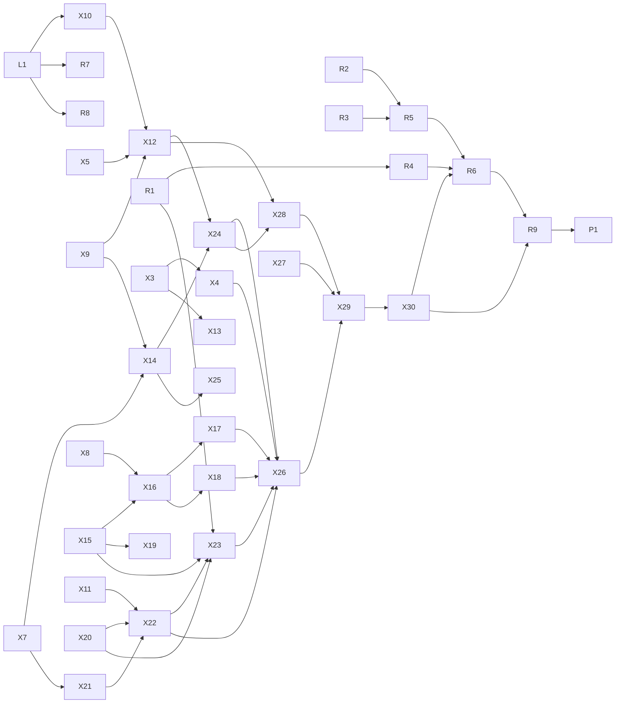

# Luban OS：一个托盘多个窗口、统一的指针与键盘、xdesk 的空间与排布、交互延时、版本差异显式化、新建系统页、通用 i18n、升级可回退，以及 2026.10.18.1 实测的问题

日期：2026-10-19　状态：修订 5，已评审，实施中　缘起：2026.10.18.1 发布后在一台 Linux 宿主上的实测（`desktop-3`、`desktop-4`、`core-1`，Luban OS 应用
2026.10.17.1 与 2026.10.18.1 同时运行），main CI 的一次失败（`LubanOs.TheConsolesPointerIsTheProgramsOrSelects`），上一轮目标留下的两个后续问题，
以及围绕 xdesk 的交互讨论。

范围：`modules/i18n`（从 `modules/ui` 抽出的通用 i18n）、`modules/platform`（Windows 的本地 socket）、libxpkg（配方的 `extensions`）、
xlings（`src/core/subos` 的版本选择、domain 转发与 index 快照、只读命令、`package_info` 与搜索的输出、xpkg 规范）、
luban（服务层、`luban ls`、`luban search`、`luban status`、`history`/`rollback`/`upgrade`）、
Luban OS 应用（`apps/luban-os`：托盘进程、窗口、指针、键盘、新建页、i18n 迁移）、`luban/specs/opensal`（`Cursor` 2 级、`PointerLock`）、
`luban/specs/opencaps`、`luban/kits/xdesk-*`（空间与排布、拖动、标题栏菜单、指针形状、应用名）、`luban/kits/opensal-wlr`、`modules/subos` 的自检，
xim-pkgindex（`luban:cursors`、桌面组件的依赖与 `extensions`、xpackage 规范与 Luban 包约定）。
前置设计：`2026-10-18-luban-os-distribution-ecosystem-design.md`（下称 **D**，尤其 §0.6 图形分级、§9 能力契约、§15 升级），
`2026-10-12-luban-os-architecture-design.md`（下称 **A**）。

**交付**：每个仓库一个 PR（libxpkg、xlings、xim-pkgindex），commit 作为检查点；本文的全部内容在这一轮完整实现，不拆 PR、不留到以后。

**修订记录**
- 修订 5（本版）：**指针**的根因（wlroots headless 后端假装支持硬件指针，F15）与跨平台统一设计（宿主用原生接口画、Luban 指针主题、`'c'`/`'C'`，§15）；
  **键盘**锁定从未调用（F16）与统一的快捷键语法（§16）；**xdesk 的"空间 × 排布"统一模型**——平铺、层叠、画布与画布上的平铺组、列内切分、
  按工作区设置、可逆切换、Super+m 切换浮层、拖动预览与吸附（§17）；**标题栏菜单**与置顶、在所有工作区显示、应用规则，按应用名显示窗口（§18）；
  Luban OS 窗口标题（F17）；系统里只读的 xlings 命令不再切换 home 与提示 sudo（F18、§19）；列表改为 `luban ls [<名字模式>]` 与新的
  `luban search`（§6）；系统自己的 home **复制**宿主的 index 快照、离线可用（§9.3）。评审后补充：像素风的 `luban:cursors`；兼容代码集中在 `luban.compat`（§15.3）；F19 定因（§18.3）；Ctrl+Alt+K（§16.1）；
  core 补充 cmake、xmake、yazi、procps-ng（§20）；全局自审与风险（§26）。
- 修订 4：托盘进程；交互延时；`luban ls <什么>`（本版取代）；通用 i18n；不退化清单。
- 修订 3：`extensions` 定名与规范；托盘存活用锁；`__capabilities` 不初始化显示；CLI 与 agent 同一份事实；多视角自审。
- 修订 2：F4 按实测重新定因；F13；新建页的视觉与交互；来源"官方 / 社区 / 本地"；升级可回退；版本摘要。
- 修订 1：初稿。

## 0. 核心点

1. **一个托盘进程，多个窗口进程**：托盘是独立的 `luban-os __tray`（不加载图形栈，每个 home 一个），窗口各自是进程，经本地 socket 通信；托盘随时可以换成新版本，
   窗口崩溃互不影响；现有托盘的 13 项行为逐项对应并有测试（§3）。
2. **指针统一**：宿主用操作系统的指针接口来画（零延迟，移动时不产生画面帧），系统里的合成器只说"是什么指针"（opensal `'c'` 形状名、`'C'` 自定义图像）；
   所有平台与所有 Luban 程序用同一套 `luban:cursors` 主题、同一组形状语义与大小规则；旧宿主退回"画进帧里"（§15）。根因：F15。
3. **键盘统一**：进入桌面即锁定键盘（Ctrl+Alt+K 切换锁定，单按 Ctrl+Alt 开菜单），三平台按各自的机制实现、限制写明；Super 系列快捷键用同一种语法（按住 Super、点按切换、松开确定）（§16）。
4. **xdesk 的"空间 × 排布"**：空间是屏幕或画布，排布是平铺或层叠；三个预设——平铺、层叠、画布（画布上可以有平铺组）——由一棵树表示；
   按工作区设置、切换可逆（切回来原样复原）；Super+m 弹出带实时缩略图的切换浮层；拖动时半透明预览、高亮、吸附，停留出现尺寸选项；
   列内上下切分；"最大化"按钮上弹出常用布局；desktop 默认平铺（§17）。
5. **窗口**：标题栏菜单（最大化、浮动、置顶、在所有工作区显示、移到工作区、应用规则、关闭）；置顶在画布上同时固定在视野里；
   面板与标题栏按应用名显示（nvim 显示 Neovim）；Luban OS 窗口标题 `Luban OS (desktop-4)`（§18）。
6. **交互延时有预算、有 CI**，并有反馈规则：可能超过 2 秒的操作 2 秒内说第一句、之后每 10 秒至少一句、等网络有超时（§4）。
7. **显示的版本就是要建的版本**；系统自己的 home **复制**宿主的 index 快照，建系统不再联网，导出的归档自带 index，导入不联网，断网有 CI（§9）。
8. **版本差异一处可查**：`luban status` 的版本摘要与 `--json` 的 `versions`（§11）；能力对账补到交接点（§10）。
9. **新建系统页四组**、来源、T 级、版本、可滚动面板、六格阶段（§5）；**`luban ls [<名字模式>]` 看本地，`luban search` 看 index**（§6）。
10. **通用 i18n**：`modules/i18n` 机制 + 各程序的 catalogue；luban-os 的 214 处全部迁移；技术名词用英文、悬停解释（§7）。
11. **配方的 `extensions`**：写进 xpkg 规范并有变更记录（§8）。
12. **旧系统照常运行，升级不强制、可回退**；修好 F13；布局迁移可回退（§12）。
13. **core 的新版本补充工具**：cmake（完整的官方包）、xmake（x86_64；aarch64 暂不带）、yazi（配方补 linux-aarch64）、
    procps-ng（新包，覆盖 BusyBox 的同名命令）；desktop 与 agent-workspace 一并得到；卡片的大小与内容改由 edition 的 `extensions.luban` 提供（§20）。
14. **包与目录**：`modules/i18n`、`xdesk-layout`、`luban/os/compat` 成为独立的包；luban-os 与 xdesk-compositor 按区域分子目录；`home` 与 `store` 合并；规则写进架构文档（§21）。
15. **文档**：README 的 Quick Start 分 xlings 与 Luban OS（`xlings install luban luban-os` 后创建并进入）；Luban OS 的 quick start 同步（§24）。
16. **任务与依赖**：L1、R1–R9、X1–X30 与依赖图、六个阶段（§25）。
17. **其余**：官方桌面都有光标主题（§13）；busybox 误报、三击测试、工匠动画（§14）；系统里只读的 xlings 命令不提示、不提 sudo（§19）。
18. **系统里的网络与用户 home**（评审追加，§27）：网络策略在 sandbox、machine、直接引导里同一个含义（默认"和宿主一样"）；machine 由内核 DHCP 建网、宿主回环上的代理映射到 NAT 网关；用户自己的 home 从系统的 index 快照与配置开始、第一次写入确认一次、已有同版本不重复装；fish 的提示符标识。

## 1. 实测与定因

| 编号 | 现象 | 定因 | 依据 |
|---|---|---|---|
| F1 | 开多个窗口后状态栏有多个 Luban OS 图标 | 每个窗口是独立进程（菜单"新窗口"、`luban enter --display window`、`luban run --display window` 都启动一个 `--attach` 的新进程），每个进程在 `ensure_tray_` 各建一个图标，进程之间没有协调 | `apps/luban-os/src/app.cpp:41`、`common.cpp:401`、`luban/os/vm/src/host.cpp:830`、`luban/os/cli/src/cli.cpp:767` |
| F2 | 更新到 10.18.1 后，托盘里仍是 10.17.1 | 托盘让进程一直活着（关窗口只是隐藏）；没有任何地方比较"正在运行的版本"和"已安装的版本" | 实测：两个 10.17.1 进程，一个早于 10.18.1 的安装；`luban status --json` 没有版本信息 |
| F3 | desktop-3 是 `subos:luban-desktop@2026.10.15.1`，进入后鼠标有问题 | 10.15.1 早于光标主题（`subos:luban-desktop` 从 10.16.1 起才带）。10.17.1 的应用把 `desktop` 解析成冻结的 `subos:luban-desktop` 且不带版本（`edition_ref`）；10.18.1 选 `luban:desktop@2026.10.18.1`：实测 `luban new probe --edition desktop --dry-run` 给出 `Luban desktop 2026.10.18.1`，基于 `core 2026.10.18.1` | `luban status desktop-3 --json`；dry-run 输出 |
| F4 | 为什么是 10.15.1 | 修订 1 的推断（index 答不出时静默用已安装的最新版本）被实测否定：本地只装了 10.13.1，`xlings info` 选 10.16.2；`min_client` 只在清单里、不在 xpm 版本条目上，也不会让 xlings 退到 10.15.1。剩下的解释是 desktop-3 建于 latest 还是 10.15.1 的时候（10.16.1 发布于 10-16），或建它的进程读的是旧的 index 快照。建它的时间本该由 `luban history` 回答，而它是空的（F13） | `xlings info subos:luban-desktop`：`latest -> 2026.10.16.2`；`xpkgs/subos-x-luban-desktop/` 只有 `2026.10.13.1` |
| F5 | 新建页点"更多选项"后，下面的选项看不到、不能滚动 | 宽窗口（不小于 860）时右边面板直接画在整页窗口上，整页窗口带 `NoScrollbar | NoScrollWithMouse`，超出部分被裁掉；窄窗口时面板在可滚动的 `cards` 里 | `apps/luban-os/src/launcher.cpp:551`、`common.cpp:139` |
| F6 | 新建页没有 LXQt、KDE | `quick_start_offers` 查到了 `luban-desktop` 分类的 lxqt、kde、labwc、compositor、xdesk，但只在"更多选项"最下面的"桌面"按钮里，正是 F5 裁掉的那一块。桌面组的两张卡片写死，都是 xdesk，"Classic desktop / 经典桌面"其实是 xdesk 经典 | `launcher.cpp:400-427`、`apps/luban-os/src/core.cppm:300` |
| F7 | 点卡片看不到系统的版本号 | 面板只显示大小与描述；`edition_availability` 已拿到 `latest`，没有显示 | `launcher.cpp:323-330` |
| F8 | 能力检测"没生效" | 10.18.1 只做了：系统的 `needs`（`root-layout`、`luban-manifest`）对 luban/应用的 `provides`；xlings 接口协议不低于 1.9（单向）。没做：应用自报能力、`--display window` 前的对账（只看程序在不在）、系统的 `provides`（`desktop-cursor` 只在登记表里）、机器 agent 的 `provides`（发了没人读）、luban 与 luban-os 互相的最低要求、运行中与已安装的比较。10.17.1 的进程早于 opencaps | `luban/os/service/src/service.cpp:360`、`luban/os/vm/src/guest.cpp:209`、`luban/specs/opencaps/SPEC.md` |
| F9 | 左边小人"上下动的时候像断了" | 是工匠和锤子（`art.cpp:93`）。落下帧锤柄与手之间隔一格描边；锤头贴画布右边缘、没有右描边；只有两帧 | `apps/luban-os/src/art.cpp:94-101` |
| F10 | tiny 的 `luban status --check` 有一条 `busybox starts` 的提示 | 自检用 `--version` 探测程序能否启动，退出码 126、127 或大于 128 算失败；BusyBox 以未编入的 applet 名被调用时答 `applet not found`、退出码 127，被当成加载失败 | `modules/subos/src/views/root/root_check.cpp:106,313` |
| F11 | tiny 加 LXQt 没有光标主题 | 光标主题只在 desktop edition 的包列表里（`xim:adwaita-cursors@49.0`），桌面组件自己不带 | `xim-pkgindex/pkgs/luban/desktop.lua:59`；`lxqt.lua`、`kde.lua`、`labwc.lua` 的 deps |
| F12 | main CI：三击后剪贴板是单词不是整行 | 测试在同一格先双击再三击；计数在 400 ms 或 2 帧内连续累加，两次之间约 8 帧。机器快时 5 下连成一串（第 3 下选行并归零，第 5 下回到单词），机器慢时才重新计数。产品行为与 xterm 一致，测试的前提错了 | `tests/e2e/test_luban_os.cpp:633`、`apps/luban-os/src/system_views.cpp:86` |
| F13 | `luban history desktop-3` 什么都不输出（第 41 代的系统） | domain 里的系统，`xlings subos rollback <name> --list` 由 `run_domain_operation_` 转给 domain 里的 xlings，以 `domain_producer::run(..., lines = 空)` 运行：子进程是普通命令（不是 `interface`），它的 `subos_generations` 数据和错误都变成继承来的 stdout 上的文字；luban 经 `xlings interface` 调用时只认 NDJSON，读不到数据，`rows` 保持空数组，退出码 0。`cmd.cpp:993` 的 `run_domain_relayed_` 正是为此写的（注释："The one path for every routed command"），但 `root_cmd.cpp:311` 绕过了它。经同一入口的 `rollback`、`run`、`configure` 的部分路径，在 luban 里同样看不到错误 | `src/core/subos/root/root_cmd.cpp:289-314`、`root_upgrade.cpp:368,385`、`src/core/subos/cmd.cpp:989-1030`、`luban/os/service/src/service.cpp:885-895` |
| F14 | 关掉旧托盘后在 10.18.1 的应用里建 core-1：版本对了（10.18），但界面停在"解析"，日志为空，一直不动 | **待确认**（推断）。新系统建在私有 domain 里，建之前在 domain 里运行 `self init`；它用 `CatalogAccess::InstallReady` 查默认运行时，全新的 domain 没有 index，于是联网同步 xim 与三个子 index；这一步的输出被丢弃（`root_cmd.cpp:240` 传的是空回调），这条带回调的运行路径也没有超时（不带回调的路径才有 30 分钟）。界面在收到第一条能识别的事件之前一直亮着"解析"（`launcher.cpp:626`） | `src/core/subos/root/root_cmd.cpp:228-262`、`src/core/xself/init.cpp:249-276`、`src/core/subos/domain/domain_producer.cpp:363-373`；确认：卡住时 `ps -eo pid,etime,args --forest` 的进程树 |
| F15 | 最新的 xdesk classic（`luban:desktop` 2026.10.18.1，已带光标主题）仍然没有鼠标指针 | **已复现并定位**。xdesk 用 wlroots 的 headless 后端，它的 `set_cursor`、`move_cursor` 什么也不做却返回成功（wlroots 0.20.2 `backend/headless/output.c:82-89`），于是 wlroots 把指针当作硬件平面：软件指针绘制跳过它（`types/output/cursor.c:98`），移动也不产生重绘区域。xdesk 把画好的帧传给宿主，没有真正的硬件平面，指针从不出现在帧里；宿主在画面上方又隐藏了自己的指针（`system_views.cpp:543`）。gdb 证实 Adwaita 指针纹理已创建成功，只是没被画；与光标主题无关。opensal 的 `'c'`（指针形状）消息只写在规范里（`wire.cppm:13`），两端都没实现。没有测试检查指针被画出来 | 本地：假宿主驱动 xdesk，移动后零帧、强制整帧后指针处像素不变；gdb：`output_cursor_set_texture` 得到纹理而渲染时 `hardware_cursor == cursor` |
| F16 | 进入桌面后按 Super 等键，响应的是宿主系统 | 宿主窗口有 `grab_keyboard()`（`luban/os/desktop/src/host.cpp:385`），提示文字也写了"Ctrl+Alt 释放键盘"，但应用代码从未调用它 | `grep grab_keyboard apps/ luban/os` 只有定义与读取 |
| F17 | 进入 desktop-4 时窗口标题只有 "Luban OS" | `title_for(name)` 只在部分路径调用；至少 4 处直接设成 "Luban OS"（`state.cpp:306`、`system_views.cpp:238`、`app.cpp:104/244`），进入桌面那条路径没有设 | 代码；实测截图 |
| F18 | 系统里普通用户执行 `xlings --version` 也提示"装进你自己的 home……`sudo xlings install --system`" | 判断写在配置初始化里（`src/core/config.cpp:706-716`），任何命令在 `~/.xlings` 不存在时都切换 home 并打印；系统里没有 sudo，AGENTS.md 也要求管理员权限只走一个入口 | 实测输出；代码 |
| F19 | 从 apps 打开 nvim，标题显示 foot | **已定位**。机器里那个 foot 的参数是 `foot --config=… nvim`，没有 `--title`、`--app-id`；nvim 没改标题（`notitle`、`titlestring` 为空），也没有个人配置。已发布的 `apps/xdesk/share/xdesk/classic.ini`（与 `canvas.ini`）写着 `terminal = foot`，于是 `terminal_argv` 走"配置了终端"的分支，直接把命令接在后面、不加标题与身份参数（`server.cpp` 的 `terminal_argv`）；E21 的修复（从默认终端条目读 `X-TerminalArg*`）只在没配置终端时生效，因此从未起作用 | 机器内 `ps -o pid,args`；`nvim --headless` 的选项输出；`classic.ini` |
| F20 | xdesk classic 与 canvas 是两个会话，进入后不能换；平铺里不能"左一个、右边上下两个" | 同一个合成器，`--profile` 在启动时决定模式与主题（`server.cpp:211-213`）；布局有 `set_mode()` 但没有入口，模式整个桌面共用一个；平铺是"横向滚动的列"，列内不能切分 | `xdesk-base/src/layout/layout.cppm` |
| F21 | `luban run desktop-4 -- …` 的默认输出多一行 `[xlings] subos desktop-4: 1 env var(s) from 1 package(s)` | 过程细节进了默认输出（AGENTS.md：默认输出是结论与下一步） | 实测输出 |
| F22 | desktop 系统里 `ps -C` 不可用 | 系统的 `ps` 是 BusyBox 的；core 与 desktop 没有 procps | 实测输出 |

补充：机器运行时 `luban run` 是另开的沙箱会话、看不到机器里的进程（F19 的确认在 `luban enter` 进入的 shell 里做）。

已核实没有问题：apps 搜索时的上下键（xdesk 与 luban-os 两层实测都正常，用户确认）。F14 的现象出现过两次：一次卡住几分钟，一次 30 秒内完成，与"快慢取决于镜像"一致。

## 2. 原则

1. **隐式的版本差异是缺陷**：谁和谁一起工作，由能力对账决定；对不上时停下或提示，说清是哪一方、太旧还是太新、下一步。
2. **正在运行的程序也是一方**：已安装的版本不等于在跑的版本；托盘让这件事变成常态，必须显式处理。
3. **显示的就是要做的**：界面、预览与 `--json` 里的版本、来源，就是交给 xlings 的那一个。
4. **"读不到"不是"没有"**（AGENTS.md）：index 读不了、domain 里的子进程没回数据、`__capabilities` 或托盘没回答，都要说出来。
5. **系统不被强制升级**：应用可以自己换新版本；系统只在本人要求时升级，之前能预览，之后能回退。
6. **快是功能**：常用交互有延时预算并在 CI 里守住；结构上的改动（多进程、通信）不能让交互变慢到能感觉出来。
7. **不退化**：结构换了，原有的每一项行为都要在新结构里有对应和测试。
8. **官方之外不写死**：传统桌面、社区系统从 index 列出；分级与显示名由配方的 `extensions` 声明。
9. **xlings 不认识 Luban**：Luban 需要的配方信息经通用机制（`categories`、`extensions`）传递。
10. **人和 agent 看到同一份事实**：界面上的分组、来源、版本、提示，CLI 与 `--json` 都有；agent 模式从不等待输入。
11. **一个机制，各自的内容**：i18n、能力对账、domain 转发都只有一套机制；各程序只提供自己的内容（catalogue、`provides`）。
12. **派生状态可重建**：托盘锁、窗口登记、socket 都在 `<home>/run/`，丢了重建，不进 home 的格式。

## 3. 托盘与窗口：一个托盘进程，多个窗口进程

### 3.1 结构的选择

多窗口必须支持（现在就支持：每个窗口一个进程）。要解决的是"只有一个托盘"，以及托盘与升级、内存、崩溃的关系。

| | A. 窗口进程之间选托盘拥有者（修订 3） | B. 单进程多窗口 | **C. 托盘进程 + 窗口进程**（采用） |
|---|---|---|---|
| 只有一个托盘 | 抢锁，拥有者退出后别的窗口接手 | 天然 | 托盘是单独的进程，锁保证每个 home 一个 |
| 一个窗口崩溃 | 只影响它 | 所有窗口一起没了 | 只影响它，托盘不受影响 |
| 应用升级 | 拥有者只能在隐藏时换 | 要关掉所有窗口 | 托盘随时自己换；窗口下次打开即新版本 |
| 后台时的内存 | 隐藏的窗口进程为守托盘而留着（约 100 MB） | 一个进程 | 托盘不加载图形栈，几 MB；没任务的窗口可以退出 |
| 复杂度 | 拥有者交接、"全部退出"广播、版本交接 | `App` 处处假设单窗口，要拆成每窗口状态与共享状态，每窗口一套 ImGui 上下文与渲染器 | 一个小协议；没有交接逻辑 |
| 回归风险 | 中 | 高 | 低到中：窗口代码基本不动，托盘逻辑搬进托盘进程 |

macOS 上多进程窗口在 Dock 里是多个图标：这是现在就有的情况，不是本轮带来的；只有 B 能根治，记为以后评估 B 的理由（§25 "以后"）。
C 的窗口登记与协议，以后做 B 时可以直接当注册表与内部消息用。

### 3.2 角色

| 进程 | 启动方式 | 做什么 | 不做什么 |
|---|---|---|---|
| 托盘 `luban-os __tray` | 第一个窗口启动时发现没有托盘就以后台方式启动它；`keep_in_tray` 时随登录启动（已有设置） | 状态栏图标与菜单；读 home 的运行状态；收窗口上报的任务进度；发系统通知；唤起或启动窗口；关机；协调"退出" | 不初始化显示与 GPU；不显示对话框（需要确认的事交给一个窗口） |
| 窗口 `luban-os [--attach X …]` | 本人、`luban enter/run --display window`、托盘 | 现在的一切：启动器、新建、控制台、桌面、设置、确认对话框、任务 | 不再建托盘图标 |

- 同一个程序、同一个包，`__tray` 是 plumbing（不进帮助与补全）。
- 托盘的单一性：`<home>/run/luban-os/tray.lock`（`platform::FileLock`）。几个窗口同时启动托盘时，只有拿到锁的托盘留下，其余立即退出。
- 存活：每个进程持有自己的锁（`<home>/run/luban-os/windows/<pid>.lock`、`tray.lock`），试锁成功说明它已不在（崩溃时系统放开锁）。不靠 pid。

### 3.3 协议

- 托盘监听 `<home>/run/luban-os/tray.sock`（本地 stream socket，仅属主可连，`modules/platform` 的 `unix_listen_stream`）；窗口连上它，断了就重连。
- 帧：每行一条 JSON（与 `xlings interface` 的 NDJSON 同一风格）。第一条是握手：`{"hello": {"role", "version", "pid", "provides"}}`；
  双方用 opencaps 对账，`provides` 含 `tray-protocol <级别>`。级别只升不降，新的一方兼容旧的级别。

| 方向 | 消息 | 用途 |
|---|---|---|
| 窗口 → 托盘 | `register`（`attach`、`view`、是否隐藏） | 托盘知道有哪些窗口、各连着哪个系统 |
| 窗口 → 托盘 | `job`（标题、百分比、完成与否、结果） | 图标的"正在执行 / 出错"与提示里的进度 |
| 窗口 → 托盘 | `notify`（标题、正文、点击后的动作） | 任务完成等系统通知 |
| 窗口 → 托盘 | `changed` | 窗口里启动或停止了系统，托盘立刻刷新 |
| 窗口 → 托盘 | `quit-all`（已确认） | 本人在窗口里确认了退出 |
| 托盘 → 窗口 | `raise`（可带视图：启动器、新建、设置、管理某系统、进入某系统、控制台） | 托盘菜单与通知的点击 |
| 托盘 → 窗口 | `confirm-quit` | 请一个窗口显示退出确认 |
| 托盘 → 窗口 | `close` | 退出所有窗口 |

- 窗口由一个线程读 socket，收到消息立即调用已有的 `wake()`（与 `tray` kit 的 `on_wake` 同一方式），隐藏的窗口不必等到 `begin_frame` 的超时（最长 1 秒）才处理。
- 托盘崩溃：窗口发现断开后重连；没有托盘就由一个窗口重新启动它（锁保证只有一个）；1 分钟内崩溃 3 次就不再重启，窗口提示条说明并给出日志位置。
  托盘持有 `tray.lock` 后先删掉旧的 socket 文件再监听。
- 托盘读运行状态：窗口的 `changed` 立即刷新；窗口以外的变化（`luban enter` 在终端启动了机器）由托盘每 1 秒读一次 home 的运行状态（几个文件，便宜）。
- 托盘菜单动作的去向：

| 菜单 / 通知 | 有合适的窗口 | 没有 |
|---|---|---|
| 打开 Luban OS | `raise` 启动器窗口 | 启动 `luban-os` |
| 某系统 → 打开 | `raise` 连着它的窗口 | 启动 `luban-os --attach X` |
| 某系统 → 控制台 | `raise`（视图：控制台） | 启动 `luban-os --attach X --view console` |
| 某系统 → 管理 / 新建 / 设置 | `raise`（对应视图） | 启动 `luban-os --view …` |
| 某系统 → 关机 | 托盘直接调 `vm::stop`（与现在相同，不确认） | 同左 |
| 退出 | `confirm-quit` 给一个窗口 | 启动一个窗口显示确认 |
| 通知"已建好 X"被点 | `raise`（进入 X） | 启动 `luban-os --attach X` |

### 3.4 生命周期

- **窗口关闭**（本人关、或机器的 on-close 选了"后台"）：
  - 窗口里有**正在跑的任务**：隐藏，不退出，任务做完照常通知；托盘提示里能看到进度，"打开"会唤起它。（现在就是这样，必须保留。）
  - 没有任务：进程退出。机器照常运行；沙箱会话随窗口结束（与现在相同）。是否改为"保留一个隐藏的窗口以便快速打开"，由 §4 的冷启动测量决定。
- **托盘退出**：没有窗口、没有运行中的系统、也没有 `keep_in_tray` 时退出（等同现在"最后一个窗口关闭且无事可做时退出"）。
- **退出 Luban OS**：托盘把 `confirm-quit` 交给一个窗口（没有就启动一个），窗口显示现有的确认（继续运行 / 全部关机，并写明会结束的沙箱会话）；
  确认后窗口发 `quit-all`，托盘向所有窗口发 `close`，最后自己退出。
- **第一次进后台**的"仍在运行"通知由托盘发一次（与现在相同）。
- **没有状态栏的桌面**：托盘进程建不出图标时，把原因写进 `<home>/run/luban-os/tray.json`（`error`），保持运行以便窗口之间协调；
  窗口读到后照旧"最小化而不是隐藏"（现在的 `tray_error` 行为）。

### 3.5 应用升级

- 托盘每 2 秒看一次 `luban_os_app(home)`：路径或修改时间变了，就运行一次 `<app> __capabilities --json`（§10.2）读版本。比自己新：
  以新版本重新执行自己（`exec`；Windows 上启动新进程后退出），窗口自动重连，图标闪一下。窗口不受影响。
- 新版本的托盘与旧版本的窗口：按协议级别兼容；旧窗口在提示条上写"这是旧版本 X，已安装 Y：关闭后再打开即是新版本"。
- 新启动的窗口比托盘新（托盘还没来得及换）：窗口在握手时告诉托盘，托盘立刻换。

### 3.6 过渡

10.18.1 及更早的窗口进程自己带托盘图标，不认识托盘进程。10.19.1 照常启动自己的托盘进程；旧进程的图标留到它们退出为止。
10.19.1 的窗口在 Linux 上发现同一用户的旧 luban-os 进程（经 `modules/platform` 扫描）时显示提示条："还有一个旧版本的 Luban OS 在运行
（状态栏里另一个图标）：从它的菜单退出"；不替人关掉它。`luban status` 同样列出（§11）。release notes 写明一次。

### 3.7 平台

| | Linux | macOS | Windows |
|---|---|---|---|
| 托盘图标 | StatusNotifierItem（已有 `tray` kit） | 菜单栏（已有）；托盘进程以 accessory 方式运行，不占 Dock | 通知区域（已有）；托盘进程以无控制台方式启动 |
| 本地 socket | `unix_listen_stream`（已有） | 同左（已有） | **新增**：`modules/platform` 的 `unix_*_stream` 在 Windows 10 1803 起用 AF_UNIX stream socket 实现（现在返回 -1） |
| 锁 | `flock` | `flock` | `LockFileEx`（`FileLock` 同一契约） |
| 单调时钟（§4） | `CLOCK_MONOTONIC`，跨进程可比 | `mach_absolute_time`，跨进程可比 | `QueryPerformanceCounter`，跨进程可比 |
| 扫描未登记的旧进程 | 有 | 无（`-v` 里写明） | 无（`-v` 里写明） |

### 3.8 不退化清单

| 现有行为 | 新结构里 | 测试 |
|---|---|---|
| 图标的三种状态（运行数、正在执行、出错） | 托盘读 home 状态 + 窗口的 `job` | 托盘状态 dump |
| 提示文字："N 个系统运行中 · 任务 40 %" | 同上 | 托盘状态 dump |
| 菜单：每个系统的打开 / 控制台 / 关机 / 管理，新建、打开、设置、退出 | §3.3 的去向表 | 每一项一个 e2e（注入菜单动作，检查结果） |
| 任务完成时窗口不在前台则通知；点通知进入建好的系统 | 窗口 `notify`，托盘发；点击按去向表 | e2e |
| 第一次进后台的"仍在运行" | 托盘发一次 | e2e |
| 机器的 on-close：ask / background / poweroff | 不变（窗口里） | 现有用例 |
| 有系统运行时退出要确认，可"全部关机" | 窗口显示同样的确认 | e2e |
| 没有状态栏时最小化而不是隐藏 | `tray.json` 的 `error` | 现有 `tray.error` 用例改读托盘进程 |
| 窗口里有任务时关窗口，任务继续，完成后通知 | 窗口隐藏不退出 | 新 e2e |
| 多个窗口 | 不变 | 新 e2e：3 个窗口只有 1 个托盘 |
| 托盘"打开"后窗口出现得快 | 已有窗口：`raise`；没有：启动 | §4 的预算 |
| `keep_in_tray`（常驻状态栏） | 托盘不随最后一个窗口退出 | e2e |
| 测试脚本的 `tray <动作>` | 托盘进程也读 `--script`（只有 `tray`、`state`、`sleep`、`wait` 几条） | 现有用例改用托盘进程 |

## 4. 交互延时：预算与 CI

### 4.1 预算

在 CI 的固定 lane（Linux，软件渲染，无 GPU）上测，取多次的 p95；本地有 GPU 时只会更快。

| 交互 | 从 → 到 | 预算（p95） |
|---|---|---|
| 窗口内的选择（卡片、按钮、"更多选项"、底座） | 输入 → 显示结果的那一帧 | 下一帧，且 ≤ 50 ms（已有 `input_to_next_frame_ms`） |
| 滚动面板 | 滚轮 → 面板移动的那一帧 | 下一帧 |
| 打开新建页 | 点击 → 第一帧（不等 index） | ≤ 100 ms |
| 新建页的 index 内容 | 打开 → 传统桌面组与版本出现（本地 index，不联网） | ≤ 1 s；之前显示"正在读 index…" |
| 托盘唤起已有窗口 | 托盘收到点击 → 窗口可见的第一帧 | ≤ 150 ms |
| 托盘开新窗口（冷启动） | 托盘收到点击 → 新进程的第一帧 | ≤ 1 s |
| 托盘反映窗口里的变化 | 窗口启动或停止系统 → 托盘菜单与提示更新 | ≤ 300 ms |
| 托盘反映窗口外的变化 | 终端里 `luban enter` 启动机器 → 托盘更新 | ≤ 1.5 s |
| 任务进度 | 窗口任务进度变化 → 托盘提示更新 | ≤ 300 ms |
| 退出 Luban OS | 确认 → 所有窗口与托盘退出 | ≤ 2 s |
| 托盘出现 | 第一个窗口启动 → 托盘进程就绪 | ≤ 1 s |
| 托盘升级 | 新版本安装 → 新托盘接上所有窗口 | ≤ 5 s |
| `luban search` | 命令 → 输出（本地 index） | ≤ 1 s |
| 指针形状变化 | 合成器发出 `'c'` → 宿主显示新形状 | ≤ 1 帧 |
| 指针移动 | 移动 → 宿主画面 | 0 帧（操作系统合成） |
| 拖动预览 | 指针移动 → 预览框跟上 | 下一帧 |
| Super+m / Super+Tab 浮层 | 按下 → 浮层出现 | 下一帧 |
| 排布切换动画 | 每一帧 | 软件渲染下不掉到 30 帧以下 |
| 键盘锁定 | 桌面获得焦点 → 锁定生效 | ≤ 1 帧 |
| `luban status` 的版本摘要 | 额外开销 | ≤ 100 ms（`__capabilities` 只在应用文件变化后运行，结果缓存在 `<home>/run/`） |
| 托盘进程的常驻内存 | 运行一小时后 | ≤ 30 MB（不初始化显示；GL 驱动只在建窗口时加载） |

冷启动若超过 1 s：窗口关闭时改为保留一个隐藏的窗口（§3.4），由测量决定，不预先做。

### 4.2 测量

- 两个进程用同一个单调时钟打点（§3.7），写进各自的状态 dump：托盘记"收到动作""发出消息""菜单更新"，窗口记"收到消息""该帧可见"。
  测试从两份 dump 算差值。
- 托盘与窗口都接受 `--script`；托盘的脚本能注入菜单动作（`tray open`、`tray sys:X:open` 等），与现在窗口里的 `tray` 命令同名同义。
- 每项至少测 5 次取 p95；第一次（冷缓存）单独记录，不进 p95，但冷启动那一项本身就是测第一次。

### 4.3 CI

- 新增 `tests/e2e/test_luban_os_latency.cpp`，`covers = {"LUBAN-OS-LATENCY"}`，在跑 luban-os 测试的 Linux lane 上运行（实施：unit lane 的 e2e 家族里，与 `test_luban_os` 同处）。
  实施时的取舍：窗口与托盘的打点放在同一个进程能测的地方——托盘唤起以"窗口发出选择 → 显示结果的那一帧"测（含托盘转发的往返，偏大即偏严）；
  新建页的 index 内容因此改为先读 index、后做能力自检，两类搜索并行（实测本地约 0.5 s）。
- 断网的用例不另开 lane：在有用户命名空间的 lane 上用 `unshare -rn` 跑（unit lane 的 e2e：导入、建系统；fresh 套件用发布客户端：进入），见 `tests/lanes.toml`。
- 每项超过预算即失败，失败信息写出实测值、预算与那一次的两份 dump（artefacts）。
- 每次的实测值进 `xdev report` 的趋势（已有 "Timing trends"），比中位数变慢超过 50% 时在报告里标出，即使没超预算。
- Windows 与 macOS：托盘与窗口的通信是新代码（Windows 的 socket 尤其是），在它们的 runner 上跑通信与托盘的功能用例，以及"唤起已有窗口""托盘反映变化"两项延时（无 GPU 渲染时的帧时间不在这两项里）。


### 4.4 反馈：没有一段沉默超过 2 秒

延时预算管的是"做完要多快"；还有一类问题是"做的过程中什么都不说"（F14）。规则：

- 任何可能超过 2 秒的操作，在 2 秒内说出第一句话（它在做哪一步），之后至少每 10 秒更新一次（进度，或"仍在等：<在等什么>（已 25 秒）"）。
- 子进程的输出不丢：给人看的走事件，给日志的进 `<home>/logs/`；一个子进程若没有事件通道，也要把它的阶段名报出来。
- 等待外部（网络、镜像、下载）的步骤有超时，超时后说清在等谁、给出下一步（换镜像、`xlings update`、重试）。
- CI：用一个故意很慢的本地 index 服务（每个请求延迟 20 秒）建一个系统，断言 2 秒内有第一条事件、之后每 10 秒内都有事件、界面阶段不停在"解析"不动。

## 5. 新建系统页

### 5.1 分组、视觉与交互

```
新建系统
  控制台 · 精简，自己定制
   [nano] [tiny] [tiny-musl] [core] [agent workspace]                   像素徽章，按 edition 着色

 ▌xdesk · Luban 自己的桌面                                      xdesk    左侧色条与标识（xdesk 的品红）
   [xdesk 经典]  [xdesk 画布 · 探索]

  传统桌面                                        轻 ─────────────▶ 完整
   [Compositor ▮▯▯▯ T1] [labwc ▮▮▯▯ T2] [LXQt ▮▮▮▯ T3] [KDE Plasma ▮▮▮▮ T4]  [某桌面 · 未分级]
    官方 · 稳定            官方 · 稳定      官方 · 稳定     官方 · 预览           社区 · awesome:…
                                                          GPU 更好

  更多系统
   [新的官方 edition]  官方 · 新          [myos]  社区 · awesome:myos
```

- **组的区分**：每组一个区块和标题。控制台用 edition 徽章；xdesk 组有左侧色条和 `xdesk` 标识；传统桌面组标题旁有"轻 → 完整"的刻度；更多系统放其余的系统。
- **卡片**：图、名字、一行描述、chip 行——轻重（格数加文字 `T1`–`T4`，未分级写"未分级"）、来源（官方 / 社区 / 本地，社区与本地附坐标前缀）、
  状态（稳定 / 预览，`deprecated` 不列出）、GPU 提示（`better`：GPU 更好；`needed`：需要 GPU，无可用 GPU 时灰掉并可读原因）、短版本号。
- **排序**：控制台、xdesk 组的顺序写在应用里（官方）。传统桌面按 T 级升序，同级官方在前、再按名字，未分级最后。更多系统：官方的新 edition 在前，社区按名字。
- **交互**：←→ 组内，↑↓ 换组，Enter 创建；悬停 chip 与技术名词显示解释（§5.4）。默认选中不变（core）。
- **状态**：index 在查时写"正在读 index…"；读不了时写"读不了 index：`xlings update`"，不显示成空组；没有社区包时更多系统组不出现。
- **面板**：选中传统桌面时两行写"系统 core 2026.10.18.1""桌面 LXQt 2.4.0-r3"（D §4.5 不用 `+`），下面是可改的底座。

### 5.2 建什么

- **xdesk 组**：现在桌面组的两张卡片，改名"xdesk 经典 / xdesk classic""xdesk 画布 / xdesk canvas"；仍是官方 edition `luban:desktop`。
- **传统桌面组**：`luban-desktop` 分类里除 `luban:xdesk` 外的每一个；建 `--edition core --desktop <名字>`，默认 `mode = machine`、`enter = desktop`；
  第三方的按 D §5 用 `--xpkg <坐标>`，首次确认。
- **底座**：默认 `core`；"更多选项"里可改为 tiny、core、desktop。与 CLI 的 `luban new --edition <底座> --desktop <名字>` 同一机制。
- 原"更多选项"里的"桌面"按钮保留给控制台组和 xdesk 组；选了传统桌面卡片时不显示。

### 5.3 来源：index 与命名空间

- **index** 是一个包仓库（官方的 `xim`，用户加的 `awesome`、`scode`、`d2x`，本机的 local index）；**命名空间**是包坐标的前缀（`luban:lxqt` 的 `luban`）。
  官方 index 保留 `xim`、`luban`、`subos`、`config`（`index-compat.json`）；其他 index 的包用它自己的命名空间（通常就是 index 名）。

| 来源 | 条件 | 卡片上写 |
|---|---|---|
| 官方 | 官方 index 里的 `luban:`（以及冻结的 `subos:luban-*`） | 官方 |
| 社区 | 其他 index 的包，或官方 index 里 `luban:` 以外命名空间的桌面 | 社区 · `<坐标前缀>`（面板里写 index 的地址） |
| 本地 | 本机的 local index | 本地 · `<坐标前缀>` |

### 5.4 分级、名字与解释

都来自配方的 `extensions.luban`（§8），应用不写死：

| 键 | 类型 | 含义 | 没有时 |
|---|---|---|---|
| `tier` | 整数 1–4 | D §0.6 的 T 级：T1 Compositor（只有合成器，Luban OS 窗口作外壳）、T2 labwc、T3 LXQt、T4 KDE Plasma；xdesk 不在这条轴上 | "未分级"，排在本组最后 |
| `gpu` | `"better"` / `"needed"` | 对宿主 GPU 的期望 | 不提示 |
| `title` | 多语言表 `{ en = "...", zh = "..." }` | 卡片上的名字；技术名词在各语言里都写英文（`Compositor`、`KDE Plasma`） | 包名 |
| `summary` | 多语言表 | 卡片上的一行描述 | 配方的 `description` |

- 技术名词的解释由应用的术语表提供（§7.5），悬停显示。例：Compositor —— 中文"Compositor（合成器）：管理窗口、把窗口画到屏幕上的程序。
  这里只有它，没有面板和桌面，Luban OS 的窗口就是外壳。"
- 范围外的值按"没有"处理，`luban search --desktops -v` 说明忽略了什么；文字按纯文本渲染、按宽度截断；来源 chip 由 §5.3 算出，与 `title` 无关。

### 5.5 面板可滚动

- 宽窗口时右边面板放进自己的 `BeginChild("panel")`，可滚动；"创建"和"从文件导入"固定在面板底部。窄窗口不变。
- 布局测试 `KeyPagesHoldTheirLayoutAtEveryScaleInBothLanguages` 加上"打开更多选项并选一张传统桌面卡片"，检查"创建"在窗口内、面板内的控件能滚动到。

### 5.6 版本

- 面板副标题写选定的版本（§9.1），不是 `latest`；有 `passed_over` 时写"2026.10.16.2（最新的 10.18.1 需要更新 xlings：`xlings self update`）"。卡片写短版本号。
- 选中的卡片立即问，其余可见卡片在后台问（与现在的 `availability_job` 同一个后台任务），不阻塞界面。

### 5.7 建的过程（F14）

- 阶段条改为六格：**准备**（规划、确认、系统自己的 home）、下载、解压、配置、自检、完成；"解析"不再在什么都没发生时亮着。
- 当前一步的文字一直显示（来自阶段事件与 §4.4 的心跳），日志区显示子进程的事件，不再为空。

## 6. 列表与搜索：`luban ls` 与 `luban search`

沿用 xlings 生态已有的分工：`ls` 是本地已有的，`search` 是 index 里能找到的（与 `xlings ls`/`xlings search`、apt、brew 的习惯一致）。

| 命令 | 列出什么 |
|---|---|
| `luban ls [<名字模式>]` | 这个 home 里已经建好的系统；`luban ls a` 按名字模糊匹配。不带参数时输出与 `--json`（`{"place", "environments"}`）一字不变 |
| `luban search [<关键字>]` | index 里能找到的：可以建的系统（官方 edition 与社区发行版，按新建页的分组）与可以装的桌面组件，带来源、状态、T 级、版本、GPU 提示、能否在这里建 |
| `luban search --distributions` / `--desktops` | 只看其中一组（名字与配方分类 `distribution`、`luban-desktop` 对应） |

- 关键字匹配名字、标题（`extensions.luban.title` 的各语言）、描述与关键词；不带关键字列出全部。
- `--json`：`{"groups": [...]}`，每项 `ref`、`version`、`source`（official/community/local）、`status`、`tier`、`gpu`、`available`（否时带 `reason`、`next`）；
  `-v` 加上 index 地址与被忽略的 `extensions` 值。
- 人读示例：
```
$ luban search --desktops
desktops   give one to a system: luban new <name> --desktop <it>, or luban config <name> --desktop <it>
  T1  compositor    2026.10.18.1   official   stable    Compositor: windows only, no desktop
  T2  labwc         2026.10.18.1   official   stable
  T3  lxqt          2.4.0-r3       official   stable
  T4  kde           ...            official   preview   GPU better
  -   awesome:foo   1.0            community  stable    not tiered
```
- 与新建页**同一个服务函数**。`luban new --help` 里 `--edition` 的说明改为指向 `luban search --distributions`。
- `search` 是新的顶层命令（AGENTS.md：先讨论——本轮已讨论确定）；`ls` 新增名字模式参数。按规则更新 `luban.cli`、`docs/generated/`、补全与测试。
- 兼容：`luban ls` 不带参数不变（fresh 测试与读载体里 luban 的旧宿主不受影响）；宿主读载体里的系统时仍调用不带参数的 `ls --json`，名字模式在宿主这边过滤，
  不需要对方认识新参数。

## 7. 通用 i18n：`modules/i18n`

### 7.1 现状

- xlings 有正规的机制：`xlings.i18n`（在 `modules/ui` 里），按稳定的 key 查、每种语言一份 catalogue（`i18n/en.cppm`、`zh.cppm`），找不到回退英文，再回退到 key 本身；
  "auto" 经 `modules/platform` 的系统语言探测解析；有"英文 catalogue 完整"的测试。17 个模块在用它。
- luban-os 没用它：214 处 `tr(en, zh)` 把中英文写在调用处，`kEditions` 里还有 `title_en/zh` 等成对字段；判断语言是它自己的一份（`common.cpp:40`）。
- luban CLI 只有英文；来自 index 的文字只有英文。

### 7.2 结构

| 层 | 放在哪 | 内容 |
|---|---|---|
| 机制 | `modules/i18n`（新包，模块名沿用 `xlings.i18n`，17 个使用者不用改 import） | 语言解析（设置、覆盖用的环境变量、系统语言）；BCP 47 回退链（`zh-CN` → `zh` → `en`）；按**域**注册的 catalogue；`tr(key)`、`trf(key, args...)`；来自数据的多语言表 `pick(json)`（同一条回退链）；术语表接口；完整性检查 |
| xlings 的文字 | 留在 `modules/ui/src/i18n/`（它们是 xlings 前端的文字），作为域 `xlings` 注册 | 现有 catalogue，不变 |
| luban 的文字 | `luban/os/service/src/i18n/words.cpp`，域 `luban`（实施时定：service 的提示（notes）与 CLI 共用，luban 与 Luban OS 启动时注册） | 本轮把 CLI 接上机制；CLI 默认仍为英文（§7.4）；`tools/lint_i18n.sh` 检查 `luban/os` 里说的每个 key 都在英文表里 |
| Luban OS 的文字 | `apps/luban-os/src/i18n/{en,zh}.cppm`，域 `luban.os` | 214 处与 `kEditions` 的成对字段全部迁入 |

- `modules/ui` 只剩主题与 xlings 的 catalogue，依赖 `modules/i18n`。分层不变：`luban/` 与 `apps/` 可以 import `modules/`（`tools/lint_layer_deps.sh`）。
- `luban/kits` 不 import `xlings.*`（规则），所以 kit 里没有自己的可见文字；需要文字的 kit（例如 `tray` 的菜单项）由调用它的程序传入已翻译的文字（现在就是这样）。
  机制只依赖标准库，以后要给 xdesk 这类独立项目用，可以单独发布，不在本轮。
- catalogue 是编译期的表（与现在一样），启动没有额外开销；注册是程序在 `main` 里显式调用，不靠静态初始化顺序。

### 7.3 key 与文字的规则

- key 稳定、带域前缀、点分：`luban.os.quick.group.desktops`、`luban.os.tray.quit.confirm`。
- 英文 catalogue 对它的域是完整的；其他语言只写它翻译了的，缺的回退英文。
- 参数用 `std::format` 的 `{}`，翻译可以调整顺序时用 `{0}`、`{1}`。
- 测试：每个域英文完整；其他语言的 key 都在英文里存在（没有孤儿）；格式参数个数一致；luban-os 里不再有 `tr(en, zh)`（删掉这个函数，再加一条 lint 防止回来）。

### 7.4 本轮做的与不做的

- 做：抽出 `modules/i18n`；xlings 改为按域注册（行为不变）；luban-os 全部迁移、删掉 `tr(en, zh)` 与自己的语言判断，改用机制（`LUBAN_OS_LANG` 作为覆盖变量注册给机制，优先级不变）；
  luban CLI 接上机制并把本轮新增的输出（`ls` 的新名词、版本摘要、两条路的提示）写成 key，英文；来自 index 的 `title`、`summary` 用 `pick`。
- 不做：luban CLI 的中文（CLI 文字被 `docs/generated/` 与 fresh 测试断言，翻译要和它们一起设计）；配方 `description` 的多语言（xpkg 规范字段）；更多语言。

### 7.5 术语表

- 一张表（在机制里定义接口，内容由各域提供），列出在所有语言里都写英文的词与它的解释 key：Compositor、Wayland、GPU、xdesk、labwc、LXQt、KDE Plasma、T1–T4、
  edition 名（nano、tiny、tiny-musl、core）。界面悬停时显示解释；文档的中文版同样写英文原词。
- 已经是产品概念、并有成熟中文的词保持中文："沙箱 / 机器"（sandbox / machine）。术语表只管技术名词。

## 8. 配方的 `extensions`

### 8.1 语义

- **按命名空间区分的扩展字段**：配方顶层的 `extensions` 表，第一层键是**读它的程序**（命名空间，如 `luban`），值是该程序定义的内容。
- libxpkg 与 xlings **原样保存、原样输出**，从不解释；不认识某个命名空间的程序忽略它。与 X.509 证书扩展、glTF 的 `extensions`、
  OpenAPI 的 specification extensions 同一含义。
- 它是**包级元信息**（与 `description`、`categories` 同级），不影响安装什么，所以只改 `extensions` 不 bump 任何版本条目的 `revision`。
- 不能用来改变 xlings 的行为：一个需要 xlings 理解的字段属于规范本身，要进规范 §3 的字段表，而不是放进 `extensions`。

### 8.2 规则

| 项 | 规则 |
|---|---|
| 命名空间 | 小写字母、数字、`-`；在 xpkg 规范的登记表里登记（名字、读它的程序、它的键写在哪份文档）；未登记的照样原样保存，但官方 index 的静态检查只接受已登记的 |
| 值的类型 | 字符串、数字、布尔、数组、表（可嵌套）；函数与 userdata 在加载时丢弃并给出警告 |
| 大小 | 每个包的 `extensions` 序列化后不超过 4 KiB；超过时 libxpkg 丢弃整个 `extensions` 并警告（不截断，以免半份数据被当成完整的） |
| 输出 | `package_info` 与 `search_packages` 的结果里作为 JSON 对象 `extensions` 原样带出；`xlings info` 的人读输出不显示它（`-v` 时显示一行"extensions: luban"） |
| 兼容 | 旧 libxpkg 按名字取已知字段，没有未知键的校验（`src/xpkg-loader.cppm`），读到带 `extensions` 的配方会忽略它；新增一个测试守住这一点 |

### 8.3 登记表（首批）

| 命名空间 | 读它的程序 | 键的定义 |
|---|---|---|
| `luban` | luban、Luban OS 应用 | `xim-pkgindex/docs/12-luban-packages.md`（§5.4 的 `tier`、`gpu`、`title`、`summary`） |

### 8.4 规范与记录

- `xlings/docs/specs/xpkg-manifest-v1.md`：§3 字段表加 `extensions`；新增一节"Extensions (xlings 2026.10.19.2, libxpkg 0.0.66)"：语义、规则、登记表、示例。
- `xim-pkgindex/docs/specs/xpackage-v2.md`：同一字段与规则（V2 是 V1 的超集，只写新增）；`xpackage-v2-changelog.md` 记一条
  （日期、字段、需要的客户端版本、旧客户端的行为）；`xpackage-template.lua` 加一段注释示例。
- `xim-pkgindex/docs/12-luban-packages.md` 与中文版：`luban` 命名空间的键（§5.4），每个键的类型、取值、没有时的行为。
- `xlings/docs/30-authoring-a-package.md` 与中文版：写配方时何时用 `extensions`、何时该提规范字段。
- `xlings/docs/specs/interface-ndjson-v1.md`：`package_info` 与 `packages` 数据里的 `extensions`、`status`。
- libxpkg：`docs/architecture.md` 的 `Package` 结构加字段；README 的字段表。

### 8.5 配方

- `luban:compositor`（`tier = 1`）、`luban:labwc`（2）、`luban:lxqt`（3）、`luban:kde`（4，`gpu = "better"`），都写 `title`、`summary` 的多语言表（技术名词写英文），由 `xlings.i18n` 的 `pick` 按界面语言取。
- 静态测试：`luban-desktop` 分类的官方包都有合法的 `extensions.luban.tier`；`extensions` 只用已登记的命名空间、不超过 4 KiB。


## 9. 版本：显示的就是要建的

### 9.1 luban 选定版本

- `luban new`、`luban search` 与新建页经服务层的同一个函数选版本：对坐标问 xlings `package_info`（`platform = linux`），取 `selected version` 与 `passed_over`。
- 以 `ns:name@version` 交给 `xlings subos new --from`；预览、确认记录（D §5）、`luban status` 的 `edition` 都是这个版本。
- 用户给了版本就用它；给了范围由 xlings 解析，结果同样先显示。
- 实测（F3）：关掉旧托盘后，10.18.1 的应用建出的是 10.18 的系统，符合预期；本节让这件事在任何版本组合下都可见、可预期。

### 9.2 xlings 不改用本地旧版本

- `src/core/subos/create.cpp` 的 `resolve_base_package_`：不带版本、index 答不出时，现在改用已安装的最新版本且不说明（实测没走到这条路，F4；但违反原则 4）。
  改为：catalog 没加载就停下，"index 读不了：`xlings update`"；index 里没有、本地有，就用本地最新版本，并发一条与 `passed_over` 同形的 `installed_only`，luban 转告。

### 9.3 系统自己的 home 复制宿主的 index 快照，离线可用（F14）

- 现在：新系统的私有 domain 是一个全新的 home，`self init` 用 `InstallReady` 查默认运行时，于是**联网同步 index**（xim 与三个子 index），
  输出被丢弃（`root_cmd.cpp:240` 的空回调），这条路径也没有超时。宿主断网时建系统会卡住且不说话。
- 改为：
  1. 建系统时把宿主这次用来选定版本的那份 index 快照**复制**给系统，作为它自己的起始 index，并记下快照的版本（`.xlings-index-version`）。
     宿主选定的版本与 domain 里解析的来自同一份 index；系统内部的 `xlings` 离线也能用；之后系统里 `xlings update` 照常更新它自己的那份。
  2. 导出的 `.luban` 归档与 ISO 带上这份 index 快照，拿到别处直接可用，不依赖原来的宿主。
  3. 导入 `.luban` 只用归档自带的 payload、谱系与 index，不访问网络（实施前核对现在的导入路径，补上缺的）。
  4. 宿主自己也没有 index、必须联网时，经 `run_domain_relayed_` 运行，阶段与进度原样转回（"准备 core-1 自己的 home：读 index…"）；
     每一步有超时与 §4.4 的心跳，超时后说清在等哪个 index、哪个镜像。
- **一致性**：系统记录的是确切的谱系版本与每个 payload 的 sha256，index 只用来挑版本；复制快照让"挑选"与"解析"用同一份 index，消除了现在两份 index 不同时刻的可能。
- **断网 CI**：在没有网络的环境（`unshare -n`）里，用本地已有的 payload 建系统、导入归档、进入系统，都必须成功；缺东西时说清缺了什么。

### 9.4 F4

F13 修好后 `luban history desktop-3` 给出每一代的创建时间，用来确认 F4；在此之前可在终端运行 `xlings subos rollback desktop-3 --list`。

## 10. 版本差异：五方与能力对账

### 10.1 各方

| 方 | 版本从哪来 | 和谁交接 |
|---|---|---|
| xlings | `xlings --version`；接口协议 `xlings interface --version` | luban、luban-os 经 `xlings interface` 驱动它 |
| luban（宿主） | 它的 `kVersion`；编进去的 `luban.service` | 启动 luban-os（`--display window`） |
| luban-os 托盘 / 窗口（已安装 / 运行中） | 它的 `kVersion`；编进去的 `luban.service`，版本独立于 luban | 托盘与窗口互相握手（§3.3）；窗口调系统里的 `/xlings/bin/luban`；与机器的 agent 握手 |
| 系统 | 谱系、根布局、系统里的 luban 与 agent | 被 luban、luban-os 读 |
| index | 快照（`.xlings-index-version`） | 决定可选的版本与 `min_client` |

luban 和 luban-os 之间**没有包依赖**，也不加：luban 不需要窗口也能用，luban-os 用编进去的服务层。关系由交接点的能力对账决定。

### 10.2 `luban-os __capabilities --json`

- plumbing。**在初始化显示与 GPU 之前处理**（SSH、CI 上可用），立即退出；输出 `{"version", "protocol", "provides", "needs"}`。
- 调用方带 5 秒超时；超时、退出码非 0、输出不是 JSON：结果是"问不到"，不当成兼容，说明并给出 `xlings install luban-os`。
- 结果按应用文件的路径与修改时间缓存在 `<home>/run/luban-os/capabilities.json`。

### 10.3 交接点

| 交接点 | 对账 | 不满足 |
|---|---|---|
| `luban enter/run --display window` 启动应用前 | 应用的 `provides` 对系统的 `needs`；应用的 `needs` 对 luban 与 xlings | 停下，"Luban OS 应用太旧：`xlings update luban-os`"，或"这个 luban 太旧：`xlings update luban`" |
| 应用打开桌面前 | 系统的 `provides`（由根读出：会话文件、`desktop-cursor`）；机器 agent 握手里的 `provides`（`agent-display`） | 会话找不到、agent 不支持显示：不打开并说明；没有光标主题：照常打开，提示两条路（§12.2） |
| 托盘与窗口握手（§3.3） | `tray-protocol` 级别 | 新的一方兼容旧级别；对不上时窗口照常工作、托盘里不列它，提示条说明 |
| 宿主显示系统里的合成器 | 宿主是否声明 opensal `Cursor`（1：形状名，2：自定义图像） | 没有时合成器把指针画进帧（§15.2） |
| `xlings update luban` 之后 | luban 读 luban-os 的 `__capabilities`，对它的 `needs` | 提示"一起更新：`xlings update luban-os`" |

- 登记表（`luban/specs/opencaps/SPEC.md`）补 `app-capabilities 1`、`tray-protocol 1`，并给系统侧能力加"由哪个包提供"一列（`desktop-cursor` → `luban:cursors`）；opensal 的 `Cursor` 2 级与 `PointerLock` 写进 opensal 规范。
- **方向**：新的 luban 与应用必须能读旧系统；对账只在"读的一方太旧"时停下，不会因为系统旧而拒绝它。
- 同一份检查进入 `luban status X --check`。

## 11. 一处可查：`luban status` 的版本

```
versions   xlings 2026.10.19.2 · luban 2026.10.19.2 · luban-os 2026.10.19.2 · index c779f51
```
不一致时展开，并给出下一步：
```
versions   xlings 2026.10.19.2 · luban 2026.10.19.2 · index c779f51
  luban-os 2026.10.19.2 installed; 2026.10.17.1 is running (its own tray icon) -- quit it from that icon's menu
```
- `-v` 与 `--json` 有完整的 `versions`：各方版本与协议；托盘进程与每个窗口进程（pid、版本、是否已登记）；各方的 `provides`；`mismatches[]`（`what`、`why`、`next`）。
- 运行中的进程读 §3.2 的登记；Linux 上另扫描未登记的旧进程；macOS 与 Windows 只列已登记的，并在 `-v` 里写明。
- 应用的"设置 → 关于"读同一个服务函数。按 AGENTS.md 更新 `luban.cli`、`docs/generated/`、测试；fresh 测试按新输出更新（`tests/fresh-install/`）。

## 12. 旧系统与升级：不强制、可预览、可回退

### 12.1 原则

1. 旧系统配它自己那套组件**永远可以运行**；新的 luban 与应用负责读懂它（§10.3 的方向）。
2. 只提示，不阻断；提示写"可以……"，列在 `luban status X` 的 notes 里；应用里每个系统每个版本只提示一次，可关闭。
3. 升级前能预览（`luban upgrade X --dry-run`，已有）；升级后能回退。

### 12.2 两条路

```
desktop-3 has no cursor theme
  add it    luban run desktop-3 -- xlings install luban:cursors            only this package; a new generation
  upgrade   luban upgrade desktop-3 --dry-run                              to luban:desktop 2026.10.19.1, see what changes first
```
- "只补缺的"装一个包、生成新的一代、可回退，不改 edition 与谱系；实施时验证 root 里装包确实生成新的一代，否则改用会生成代的入口。
- 包名来自 opencaps 登记表的"由哪个包提供"，应用不写死。应用里是两个按钮；`--json` 里是 `next[]` 两条命令。

### 12.3 已有的回退机制

每次升级是新的一代；升级后自检不通过自动回到上一代（`luban/os/service/src/service.cpp:855`）；`luban history X`、`luban rollback X --to N`；
本人改过的 `desktop`、`enter`、`mode` 在升级后保留（D §15.2）；用户数据（`persist`）不在代里，升级不动它。

### 12.4 两个缺口

1. **F13**：`run_domain_operation_` 在非交互时改走 `run_domain_relayed_`，数据、进度、错误原样转回；luban 的 `history` 收不到 `subos_generations` 时报错，不打印空。
2. **布局迁移不可回退**（`relayout_`：导出 → 删除 → 重新导入，成功后删掉归档）。改为：迁移成功后保留归档（`<home>/state/luban/relayout/<name>.luban`，
   含用户数据，只随确认删除该系统一起删除）；`luban history X` 最前面一行"迁移前（归档，大小）"；`luban rollback X --to relayout` 确认后恢复到迁移前
   （agent 模式没有 `-y` 时失败并给出确切命令）；`luban status X` 写明归档占用的空间。只在 Linux 上发生。

### 12.5 回归测试

- 冻结名的旧系统 → `luban upgrade` 到 `luban:` → `luban rollback` → edition 记录、设置、桌面回到原样，系统照常进入。
- 旧布局的系统 → 升级（含迁移）→ `rollback --to relayout` → 旧布局、旧历史，用户数据不变。
- domain 里的系统：`luban history --json` 有每一代；`rollback` 到不存在的代时，错误在 luban 里可见。
- 新的 luban 与应用对旧系统：`luban status X --check` 不因系统旧而报不满足。

## 13. 光标

- `luban:cursors`（§15.2 的 Luban 指针主题）进 `luban:labwc` 和 `luban:xdesk` 的 deps；`luban:lxqt`、`luban:kde`、`luban:compositor` 都依赖 `luban:labwc`，任何底座加任何官方桌面都有默认光标主题。
  `luban:cursors` 提供 `share/icons/default/index.theme`（继承 Luban 主题），只有它写这个文件；desktop edition 现有的 `xim:adwaita-cursors` 在新版本里换成它。
- 依赖变了，安装的内容就变了：`luban:labwc`、`luban:xdesk` 的版本条目 bump `revision`。
- 已建的旧系统由 §10.3 的提示引向 §12.2 的两条路。

## 14. 小修

- **busybox 误报（F10）**：输出里有 `applet not found` 说明 BusyBox 已经运行，算启动成功；单元测试覆盖。
- **三击测试（F12）**：三击改在同一行的另一格（`cell 0 2 triple`）；另加一个用例写明"同一格 400 ms 内连点 5 下是单词"。
- **工匠（F9）**：重画两帧并加一帧水平的锤子：锤头完整在 16×16 内、四边有描边，三帧里锤柄都从手里连续伸出、绕手转动；`rows_` 按 0、2、1、2 循环；
  托盘图标同步；`LUBAN-OS-VISUAL` 的基线更新。
- **应用图标（评审追加）**：`apps/luban-os/share/luban-os.svg` 换成像素风的工匠——与应用里拿锤子的像素人同一个形象，作为 Luban OS 过渡期的 logo。
  由同一份文本网格（`art.cpp` 的工匠，举锤那一帧）生成（`tools/luban_os_icon.py` 写出每格一个方块、`shape-rendering="crispEdges"` 的 SVG），
  一份源；应用里改了工匠，图标随之重新生成，一条测试比对两者一致。桌面条目、托盘与发布包里用的都是它。

## 15. 指针：跨平台统一

### 15.1 要统一的是什么

| 方面 | 统一成 |
|---|---|
| 跟手 | 零延迟：指针由宿主的操作系统直接合成，不等画面帧传回 |
| 形状的含义 | 同一组形状名（opensal `kCursors`，CSS 名）：箭头、文字上 I 形、链接上手形、窗口边缘调整大小、拖动时抓手…… |
| 外观 | 同一套 Luban 指针主题：Linux、macOS、Windows 宿主上与 Luban OS 直接装在机器上时都一样 |
| 大小 | 跟随屏幕密度，逻辑 24 px |
| 显示与隐藏 | 打字时隐藏、一动就出现（可设置），各处一致 |
| 应用自定义的指针 | 应用自己的指针图像原样显示，同样零延迟 |
| 范围 | Luban OS 应用自己的界面、沙箱与机器里的桌面、单应用窗口、xdesk、opensal-wlr 承载的 labwc/LXQt/KDE 会话 |

### 15.2 结构

1. **系统里的合成器只说"是什么指针"**，不把它画进帧：
   - 有名字的形状：opensal `'c'`（已在规范里，本轮两端实现）；
   - 应用自定义的图像：新增 `'C'`（`"<w> <h> <hotspot_x> <hotspot_y> <stride>\n"` + 像素），opensal 的 `Cursor` 能力升到 2 级；
   - xdesk：宿主声明了 `Cursor` 时，`request_set_cursor` 的表面与 `wlr_cursor_set_xcursor` 的形状都改为发给宿主；
   - opensal-wlr：把它承载的会话合成器设置的指针（形状名或图像）转成 `'c'`/`'C'`（实施时按桥接方式实现，与 xdesk 同一份协议）。
     这时会话合成器不再把指针画进帧，否则会出现两个指针；旧的 opensal-wlr 不要 `Cursor`，宿主不显示自己的箭头，会话自己画的指针照旧（与现在相同）。
   - 规则：**握手里要了 `Cursor` 的，不画指针，由宿主画**；没要的（旧版本）自己画——唯一的例外是旧的 xdesk，它没要也画不出（F15），宿主按它启动的会话（`xdesk-*`）
     认出它并显示自己的默认箭头（第 4 条）。这条例外只针对已发布的旧 xdesk，新的合成器一律经握手说明。任何组合都只有一个指针。
2. **宿主用操作系统的指针接口来画**：luban-os 收到 `'c'` 时，用 Luban 主题对应的图像建彩色指针（`SDL_CreateColorCursor`，按密度选尺寸），收到 `'C'` 时用它的像素建；
   SDL 在三平台对应 Wayland/X11、NSCursor、HCURSOR。移动时一帧都不画（`APointerMovingOverAStillDesktopDrawsNothing` 改用真的 xdesk 守住）。
3. **主题**：`luban:cursors`（xpkg），Luban 自己设计的**像素风指针**，与应用里的像素徽章、工匠同一种风格；覆盖 `kCursors` 的全部名字。
   - 源是文本网格（与 `apps/luban-os/src/art.cpp` 的 `Rows` 同一种写法：每个字符一个像素，颜色表、热点坐标写在旁边），放在 xim-pkgindex `tools/res/cursors/`，
     由资源工厂生成 xcursor 文件与给宿主用的 PNG；唯一的源，宿主与系统里用的是同一份。
   - 在 12×12 的网格上设计（1 格黑色描边、白色填充、强调色点缀），按最近邻放大"密度 × 2"倍：密度 1 → 24 px、2 → 48 px、3 → 72 px，逻辑上都是 24 px；
     只做整数倍，不出现模糊边。非整数密度（1.5）向上取整到下一个整数倍。
   - 自己的作品，许可证 Apache-2.0，不再涉及 Adwaita 的 CC-BY-SA。
   - 每个形状一张预览图进 `LUBAN-OS-VISUAL` 的基线；文档里放一张全部形状的对照表。
   - 宿主的 luban-os 依赖它；Luban 系统里也装它，作为 `/usr/share/icons/default` 继承的主题（§13 的 `adwaita-cursors` 改为它）。
   - 设置里可选"跟随宿主系统的指针"（`SDL_CreateSystemCursor`）；默认 Luban 主题。
4. **旧的系统**：系统里的合成器在握手时没有要 `Cursor`（10.18.1 及更早的 xdesk：`'h'` 里没有这一位），它既不发 `'c'`、自己也画不出指针（F15）。
   这条判断放在兼容模块里（§15.3），宿主按它启动的会话认出旧的 xdesk（会话名 `xdesk-*`，且握手里没要 `Cursor`），**不再隐藏自己的指针**，在画面上方显示 Luban 主题的默认箭头：形状不随内容变化，但旧系统不升级也有指针、零延迟。升级后自动换成完整的形状语义。
5. **后备**：宿主没有声明 `Cursor`（旧版 luban-os，能力对账可知），合成器调用 `wlr_output_lock_software_cursors(output, true)` 把指针画进帧；
   只有这种情况有延迟，提示条写"更新 Luban OS 可获得原生指针"。
6. **指针锁定**：opensal 登记 `PointerLock`（相对移动，供游戏与 3D 程序），由宿主统一提供，释放键与释放键盘相同（Ctrl+Alt+K）。本轮登记能力并实现宿主侧的
   SDL 相对模式与释放；合成器侧在有程序请求 `pointer-constraints` 时发出请求。
7. Luban OS 应用自己的界面（启动器、新建页、控制台）也用同一套主题与形状语义（ImGui 的指针形状映射到同一组名字）。

### 15.3 兼容代码集中在一处：`luban/os/compat`

只为已发布旧版本存在的判断与路径，不散落在各处，集中在一个模块 `luban.compat`（`luban/os/compat/`），以后逐个删除：

| 项 | 服务的旧版本 | 做什么 | 删除条件 |
|---|---|---|---|
| `legacy_xdesk_pointer` | xdesk ≤ 2026.10.18.1（握手不要 `Cursor`、自己画不出指针） | 宿主在画面上方显示默认箭头 | 官方 index 里不再有 ≤ 2026.10.18.1 的 desktop edition 可建，且 `luban status` 统计到的本机系统都已升级（`luban status` 的 notes 提示升级） |
| `unregistered_luban_os` | luban-os ≤ 2026.10.18.1（不登记窗口、自带托盘图标） | Linux 上扫描未登记的旧进程并提示从它的托盘退出 | 下一个 `.0` 正式版本之后 |
| `frozen_edition_names` | `subos:luban-*` 冻结名（已有的 `successor_` 等） | 升级时迁移到 `luban:` | 与 D §15.1 的迁移期相同 |

- 规则：调用方只能经 `luban.compat` 使用这些判断（`tools/lint_layer_deps.sh` 加一条：`compat` 以外不得出现针对旧版本号的分支）；每一项写明服务的旧版本、
  引入版本、删除条件；`docs/specs/upgrade-and-compatibility.md` 的 Compatibility 一节列出全部条目，删除时同步更新。
- 测试：每一项有一条"旧版本行为"的用例，删除一项时连同用例一起删除。

### 15.4 测试

- 宿主收到 `'c'` 后状态 dump 的 `pointer.shape` 改变；`'C'` 后 `pointer.custom` 为真并有尺寸；移动时 `presented` 不增加。
- 后备：宿主不声明 `Cursor` 时，像素对比证实指针被画进帧并跟随移动。
- 旧的系统：合成器不要 `Cursor` 时，宿主在画面上方显示自己的箭头（状态 dump 的 `pointer.host_arrow`）。
- xdesk：光标移到文字窗口、边缘、标题栏时发出的形状名正确。
- 三平台跑宿主侧用例（Windows、macOS 上用 offscreen 视频驱动检查 SDL 指针对象的创建）。

## 16. 键盘：锁定与快捷键语法

### 16.1 锁定

- 桌面画面获得焦点时锁定键盘；**Ctrl+Alt+K** 在锁定与释放之间切换（K 即 keyboard，界面提示写明），失去焦点时自动释放。
- 单按 Ctrl+Alt（按下再松开、中间没有别的键）打开 Luban OS 的菜单（锁定与否都可以，菜单里也有"释放键盘"）；Ctrl+Alt+其他键（如 Ctrl+Alt+T）完整发给桌面。
- 代价：锁定时系统里的程序收不到 Ctrl+Alt+K（Emacs 的 `C-M-k`，即 kill-sexp）；可以在快捷键设置里改成别的组合（§16.4），文档写明。设置"进入桌面时锁定键盘：是 / 否"，默认是。状态 dump 加 `keyboard_grabbed`。
- 各平台：

| 宿主 | 机制 | 限制与提示 |
|---|---|---|
| Linux X11 | 抓取键盘 | 无 |
| Linux Wayland | 宿主桌面的快捷键抑制协议（SDL 的 keyboard grab） | GNOME 首次会弹窗询问；被拒绝时提示条说明 |
| Windows | SDL 的低层键盘拦截（含 Win 键） | 无 |
| macOS | 需要"辅助功能"权限才能拦 Cmd+Tab | 没有权限时提示一次如何开启，其余键照常 |

- 锁不住时，xdesk 已有的"宿主占着 Super 时用 Alt"保留，速查里显示当前生效的是 Super 还是 Alt。

### 16.2 输入法

桌面请求文字输入时，非字符键（方向键、Enter、Esc、Tab、功能键）在输入法没有正在组的字时一律直接发给桌面。

### 16.3 快捷键语法

- 单按 Super（按下即松开、中间没有别的键）：打开 apps。
- Super+Tab（窗口）、Super+m（排布，§17.5）、Super+o（总览）同一种语法：按住 Super，点按在选项间切换，松开 Super 确定，Esc 取消；快速点按一次直接切到下一个。
- Super+/：快捷键速查，只显示当前排布下有效的键。
- 快捷键总表见 §17.11。

### 16.4 快捷键可配置

- 每个动作可以绑定多个键；默认绑定是 §17.11 的总表（打开终端默认同时绑 Super+Enter 与 Ctrl+Alt+T）。
- 保存在系统里该用户的 `~/.config/xdesk/keys.json`（用户数据，升级不覆盖；读不了时说明并用默认，不覆盖文件）。
- 设置里列出每个动作当前的键，可以加第二个键、删除、恢复默认；新绑定与已有的冲突时提示，不静默覆盖。
- Super+/ 的速查与文档的表都由同一份配置生成，显示实际生效的键。
- 宿主的同名快捷键（Ubuntu 的 Ctrl+Alt+T 打开宿主终端）在锁定键盘时交给系统，未锁定时归宿主；速查里写明。

## 17. xdesk：空间 × 排布

### 17.1 现状（F20）

xdesk classic 与 canvas 是同一个合成器的两种启动参数，`--profile` 在启动时决定模式与主题；布局已有 `set_mode()`，输入处理每次读 `lay.mode()`，
运行时切换在结构上可行但没有入口；模式整个桌面共用一个；每个窗口可以浮动；平铺是横向滚动的列，列内不能切分。

### 17.2 模型

两个互相独立的维度：

| | 窗口平铺 | 窗口层叠 |
|---|---|---|
| **空间：屏幕**（有界） | 平铺 | 层叠 |
| **空间：画布**（无界，平移、缩放） | 画布上的平铺组 | 画布（自由摆放） |

```
工作区 = { 空间: 屏幕 | 画布,  条目: [组…],  浮动层: [窗口…] }
组     = 平铺组 { 列: [ 列 { 窗口: [窗口…], 各自的高度比例 } … ], 各列宽度 }
       | 自由窗口 { 位置, 大小, 叠放次序 }
```

- 屏幕 + 平铺：一个铺满屏幕的平铺组（现在的经典）。屏幕 + 层叠：若干自由窗口，限制在屏幕内。画布：组随意摆在平面上，组可以是自由窗口，也可以是平铺组。
- 一切仍在 `xdesk.layout`（纯逻辑，无绘制、无 Wayland），所有排布与操作都可以单元测试；动画仍由已有的 Spring 完成。

### 17.3 三个预设

Super+m 在三个预设间切换：**平铺**（屏幕 + 一个平铺组）、**层叠**（屏幕 + 自由窗口）、**画布**（画布 + 任意组）。desktop edition 默认平铺。

### 17.4 粒度

| 层 | 设置 | 保存 |
|---|---|---|
| 桌面 | 默认预设（由会话决定，§17.12） | 会话 |
| 工作区 | 预设（每个工作区可以不同） | 系统里该用户的 `~/.config/xdesk/` |
| 窗口 | 浮动、置顶、在所有工作区显示（§18） | 本次打开期间 |
| 应用 | 应用规则：总是浮动、总在某工作区打开、记住大小与位置（§18） | `~/.config/xdesk/` |

不做"单个窗口的模式"：一个窗口单独"是画布"在平铺工作区里没有意义；"把模式配到 app 上"的诉求由应用规则实现。混合 = 工作区的排布 + 浮动层 + 画布上的组。

### 17.5 切换

- **可逆**：每个预设各自记住摆法，平铺 → 画布 → 平铺原样复原。首次切换时：平铺 → 画布，窗口按平铺里的位置铺到画布上（成为一个平铺组）；画布 → 平铺，按从左到右的顺序排成列；
  层叠保留当前的位置和大小。切换用弹簧动画让每个窗口移过去。
- **Super+m 浮层**：按住 Super 按 m，屏幕中间出现三张卡片，每张是当前工作区用这种排布的**实时缩略图**（布局函数算出的真实结果，窗口用已有纹理缩小显示），
  继续按 m 切换，松开 Super 应用，Esc 取消，快速点按一次直接切到下一个。鼠标：点面板上的工作区图标弹出同样的卡片。
- 面板的工作区指示器显示每个工作区的预设图标。

### 17.6 平铺

- 新窗口在当前窗口右边新开一列（niri 的默认）。一两个窗口铺满屏幕，更多时横向滚动，当前窗口始终在视野里。
- 一列里可以上下放多个窗口：Super+[ 并进左边一列、Super+] 拆出成单独一列；列内高度 Super+Shift+r 在平分、2/3、1/3 之间切换。
- 列宽 Super+r 在 1/3、1/2、2/3、全宽之间切换；Super+- / Super+= 微调。

### 17.7 层叠

- 窗口可重叠、限制在屏幕内；最大化与还原；吸附到左右半屏、四个四分之一屏；最小化后在面板的窗口列表里。
- Super+Shift+方向键：移到半屏或四分之一屏；Super+f：最大化 / 还原。

### 17.8 画布

- 平移（Super+拖动空白处、触控板双指）、缩放（Super+滚轮、Super+o 看全）；缩放小于 1 时点一个窗口进入它（已有）。
- 把一个窗口拖到另一个窗口的边缘：组成平铺组；之后按平铺的规则加列、列内切分；拖出组变回自由窗口；Super+拖动组的标题条整组移动；缩小时组作为一个整体。
- Super+[ / ] 在画布上也是"并进旁边的组 / 拆出"。
- 不主动把窗口拖到别的窗口边上，就不会出现组，画布仍是现在的样子。

### 17.9 拖动：预览、高亮、吸附

拖标题栏，或按住 Super 在窗口任意处拖：窗口变半透明跟着指针；指针下方的位置决定放到哪里，对应区域显示半透明、带强调色的预览框——**预览就是松手后的结果**（同一个布局函数）：

| 排布 | 指针在 | 结果 |
|---|---|---|
| 平铺 | 两列之间 | 在这里新开一列 |
| 平铺 | 某窗口的上半 / 下半 | 放进这一列，在它上面 / 下面 |
| 平铺 | 某窗口正中 | 与它交换 |
| 平铺 | 屏幕最左 / 最右边缘 | 在最前 / 最后新开一列，画面滚过去 |
| 层叠 | 屏幕左 / 右边缘、四个角、顶边 | 左 / 右半屏、四分之一屏、最大化 |
| 画布 | 另一个窗口的边缘 | 组成或加入平铺组 |
| 画布 | 空白处 | 自由放置，靠近别的窗口边缘出现对齐线 |
| 任意 | 按住 Shift，或拖到布局以外 | 浮动 |

- 停在一个目标上约 0.3 秒，旁边出现**尺寸选项**：列宽 1/3、1/2、2/3、全宽（列内为平分、2/3、1/3），默认 1/2，也可以直接松手。
- 松手后弹簧吸附；拖到宿主窗口边缘时宿主持续捕获指针，拖动不中断；"减少动画"设置下直接吸附。
- 拖动两列或两窗口之间的缝隙调整宽或高，双击缝隙恢复平分。

### 17.10 "最大化"按钮上的布局

鼠标悬停在标题栏的最大化按钮上，弹出常用布局的小图（左右各半、2/3 + 1/3、左一个右边上下两个、三列）；点一下，当前窗口与最近用过的窗口按它摆好。
在平铺中摆成对应的列与列内切分；在层叠中摆成对应的半屏与四分之一屏；在画布中组成对应的平铺组。

### 17.11 快捷键总表

| 键 | 平铺 | 层叠 | 画布 |
|---|---|---|---|
| Super（单按） | apps | 同 | 同 |
| Super+←→ / ↑↓ | 列间 / 列内焦点 | 按空间找最近的窗口 | 同左 |
| Super+Shift+←→ / ↑↓ | 移到相邻列 / 列内上下 | 半屏、四分之一屏 | 移动四分之一视野 |
| Super+[ / ] | 并进左列 / 拆出 | — | 并进旁边的组 / 拆出 |
| Super+r / Super+Shift+r | 列宽 / 列内高度预设 | — | 组内同平铺 |
| Super+- / = | 微调宽度 | 缩放窗口 | 缩放视野 |
| Super+f | 浮动 / 放回 | 最大化 / 还原 | 浮动 / 放回 |
| Super+Shift+t | 置顶 | 同 | 同（并固定在视野） |
| Super+m | 排布切换浮层 | 同 | 同 |
| Super+Tab | 窗口切换浮层 | 同 | 同 |
| Super+o | 总览 | 展开所有窗口 | 看全 |
| Super+1–4 / Super+Shift+1–4 | 切到 / 移到工作区 | 同 | 同 |
| Super+Enter 或 Ctrl+Alt+T / Super+q / Super+/ | 终端 / 关闭 / 速查 | 同 | 同 |

键盘与鼠标是同一组操作；`docs/luban/08-desktop.md` 列出全部，Super+/ 的速查由同一张表生成。第一次进入时提示一次"Super+m 切换排布 · Super+/ 查看快捷键"。

### 17.12 会话、主题与保存

- 会话：已发布的 `xdesk-classic`、`xdesk-canvas` 保留为**预设**，只决定"还没有被设置过的工作区"用平铺还是画布；新增通用的 `xdesk` 会话，进入时沿用上次的排布
  （第一次为平铺）。desktop edition 的新版本默认用 `xdesk`；已建的系统不变。
- 主题与排布分开（`shell::theme` 不再取 profile），主题单独设置。
- 每个工作区的预设与各预设的摆法、应用规则写在系统里该用户的 `~/.config/xdesk/state.json`：用户数据，升级不覆盖；读不了时说明并按默认启动，不清空它（"读不到不是没有"）。

### 17.13 测试

- 布局单元测试：四种组合各自的结果；每两种之间切换再切回原样复原；每个工作区不同预设；浮动层在任何排布之上；画布上组成与拆开平铺组；列内切分与尺寸预设；
  每种拖动目标的结果，且预览等于松手结果；"最大化"布局弹出层的各布局；应用规则。
- e2e：Super+m 浮层（状态 dump 的 `chooser`）与切换后的窗口位置；拖动脚本（按下 → 移动 → 停留 → 松开）的结果与等价快捷键相同；重启 xdesk 后工作区预设与规则仍在；
  `state.json` 损坏时按默认启动且文件不被覆盖。
- 延时：拖动预览、Super+m 浮层、切换动画的每帧，纳入 §4.1。

## 18. 窗口：标题栏菜单、置顶、应用规则、名字与标题

### 18.1 标题栏菜单

右键标题栏，或点标题栏左边的应用图标：

| 菜单项 | 作用 |
|---|---|
| 最大化 / 还原 | 层叠里最大化；平铺里这一列切到全宽 |
| 浮动 / 放回布局 | 同 Super+f |
| 置顶 | 始终在普通窗口之上（Super+Shift+t） |
| 在所有工作区显示 | 切换工作区时一直跟着 |
| 移到工作区 1–4 | |
| 应用规则 ▸ | 总是浮动 / 总在这个工作区打开 / 记住大小和位置 |
| 关闭 | |

### 18.2 置顶与叠放层次

- 屏幕排布：浮起来盖在普通窗口之上（平铺里置顶会自动变为浮动）。画布：在平面上盖在其他窗口之上，并**固定在视野里**，平移、缩放时不动。只有一个"置顶"开关。
- 层次：普通 < 浮动 < 置顶 < 面板 < apps 启动器与各切换浮层。
- 置顶是本次打开期间的状态；要每次都置顶，用应用规则。

### 18.3 应用名与窗口标题（F19）

- **修根因**：去掉已发布配置里的 `terminal = foot`（默认用系统的默认终端，即 `share/xdg-terminals` 的条目）；配置了终端时，若它在 `xdg-terminals` 里有条目
  （按程序名匹配），同样用条目里的 `X-TerminalArgTitle`、`X-TerminalArgAppId`、`X-TerminalArgExec`；完全未知的终端才只接命令。
  从 apps 打开的终端程序因此总是带着自己的标题与身份（`foot --title=Neovim --app-id=nvim nvim`）。
- **以应用名为主显示**：xdesk 的标题栏与面板用 app_id 找到对应的 `.desktop`，显示其 `Name`（多语言按 §7）；窗口自己的标题作为第二行（或悬停显示）。
  即使某个程序或终端改写了标题，人也能认出它是哪个应用。
- 测试：用默认配置与"配置了 foot"两种情况，从 apps 打开一个 `Terminal=true` 的应用，检查启动参数含 `--title=`、`--app-id=`，标题栏显示应用名。
- Luban OS 窗口标题由一个函数决定：`Luban OS (<系统名>)`，启动器与新建页为 `Luban OS`；按键提示只在顶部的栏里。状态 dump 加 `window.title`，每个视图一条测试（F17）。

## 19. 系统里的 xlings：只读命令不切换、不提示；默认输出只给结论

- 只读命令（`--version`、`info`、`list`、`search`、`which` 等）不切换到 `~/.xlings`、不建目录、不打印提示；只有要写入时才切换并说明一次（F18）。
- "给所有用户安装"的提示改为系统里实际可用的方式：在宿主上 `luban run <系统> --user root -- xlings install --system <pkg>`；不提 sudo（AGENTS.md：管理员权限只走一个入口）。
- `luban run` 的默认输出不再有 `subos <name>: N env var(s) from N package(s)` 这类过程行（F21），它只在 `-v` 时出现；同类的过程行一并检查。
- core 的新版本加入 procps（`ps`、`top`、`free` 的完整实现，约 1 MB），BusyBox 的同名命令让位（F22，已确认）。
- 测试：系统里以普通用户执行只读命令，输出里没有这句提示，`~/.xlings` 不被创建；第一次安装时提示一次，内容正确；`luban run` 的默认输出只有程序自己的输出。

## 20. core 的新版本：补充的工具

core 2026.10.19.1 在现有的包之外加入 cmake、xmake、yazi 与 procps-ng；建在 core 上的 desktop、agent-workspace 一并得到。

| 工具 | 包 | x86_64 | aarch64 | 要做的 |
|---|---|---|---|---|
| cmake | `xim:cmake@4.4.2` | 有 | 有 | 用完整的 `xim:cmake`。上游的官方二进制包本身带 cmake-gui（配方的 linux-x86_64 是上游原样的字节），没有只含命令行程序的官方包，所以不拆；代价是多装 fontconfig、freetype、libxcb（几 MB） |
| xmake | `xim:xmake@3.1.1` | 有 | **无**（上游不发布 linux-aarch64；配方的 aarch64 指 macOS） | **aarch64 上的 core 暂不带 xmake**：core 的包列表按架构区分（与 `luban_desktop` 按架构选桌面同一写法），文档与 `luban search` 的说明写明；上游发布或我们自建后加入 |
| yazi | `xim:yazi@26.5.6` | 有（musl 静态） | **配方缺**（aarch64 一项是 macOS 的） | 配方补上 upstream 的 `yazi-aarch64-unknown-linux-musl.zip`，镜像到 GitCode；revision 不变（新增平台条目，不改已有条目） |
| procps | **无** | — | — | 新包 `xim:procps-ng`（ps、top、free、pgrep、pkill、pidof、uptime、vmstat、watch），资源工厂按 core 的 glibc 构建两个架构 |

- **与 BusyBox 的同名命令**：core 的谱系里有 tiny 的 BusyBox。同名命令以**上层（core）的包为准**：projection 时 core 的 procps-ng 覆盖 BusyBox 的同名 applet；
  这条规则写进 Luban 包约定（"上层系统的包覆盖下层的同名程序"），并由 `luban status --check` 的一项检查确认 `ps` 指向 procps-ng。实施前核对现在 projection 的冲突规则，与之一致。
- **体积**：core 增加约 80 MB（cmake 约 55 MB、xmake 约 10 MB、yazi 约 10 MB、procps-ng 约 1 MB，实施时实测）。新建页卡片的大小与内容不再写死在应用里：
  edition 的 `extensions.luban` 加 `size`（下载大小）与 `highlights`（卡片上的几个程序名，多语言不需要），由资源工厂在构建时写入；应用读它，没有时才用自带的文字。
- **自检**：core 的 `core-tools` 检查加上 `cmake --version`、`yazi --version`、`ps -C ps -o pid=`（只有 procps 支持 `-C`），x86_64 上另加 `xmake --version`。
- **配置**：xmake 第一次运行会在 `~/.xmake` 写入缓存，属于用户数据；`yazi` 打开文件用系统的 `xdg-open`（desktop 有，core 没有图形时只用于文本）。
- **描述**：core 配方的 `description` 与新建页 core 卡片的文字（catalogue）更新为包含 cmake、xmake、yazi。
- **测试**：xim-pkgindex 的发布输出夹具更新（core 的包列表）；fresh 测试的 core 用例检查新工具能启动；aarch64 的 lane 同样检查。

## 21. 包与目录的划分

### 21.1 规则

1. **一个包（自己的 `mcpp.toml`）= 一个独立的职责**，并且满足其一：被两个以上的程序使用；或者是可以单独发布的项目（spec、kit）。
2. **包要有分量**：包内按职责分成几个模块单元（模块或 partition）。只有一个 `.cppm`、内容很少的，并入职责相近的包；保留单文件包要写明理由（例如它是两个前端的共同契约）。
3. **只被一个程序用的代码**放在该程序的目录里，按区域分子目录，不单独成包。
4. **文件不超过 2k 行**：超过就按职责拆成模块。
5. 分层不变（AGENTS.md、`tools/lint_layer_deps.sh`）：`luban/` → `modules/`；`modules/` 不 import `luban.*` 与 `src/`；spec 只依赖标准库；kit 不 import `xlings.*`、`luban.*`。
   新包的层级在 lint 里登记。
6. 每个包有一个 README：做什么、对外的模块、谁在用、不做什么。

### 21.2 本轮的变化

| 变化 | 内容 | 理由 |
|---|---|---|
| 新包 `modules/i18n` | `xlings.i18n`（对外接口）、`:locale`（语言解析与回退链）、`:catalogue`（按域注册与查找、完整性检查）、`:data`（`pick`：数据里的多语言表）、`:glossary`（术语表接口）；单元测试 | 从 `modules/ui` 抽出，xlings、luban、Luban OS 共用（§7） |
| `modules/ui` | 只剩主题与 xlings 自己的 catalogue | 机制与内容分开 |
| 新包 `luban/xdesk/layout` | `xdesk.layout`（对外）、`:model`（工作区、组、浮动层）、`:tile`、`:stack`、`:canvas`、`:drag`（放置目标与预览）、`:transition`（可逆切换）、`:rules`（应用规则）；单元测试 | 纯逻辑、任何合成器可用；本轮重写并显著变大（§17）；从 `xdesk-base` 移出 |
| 新包 `luban/os/compat` | `luban.compat`：`:pointer`、`:processes`、`:editions` | cli、service、app 都用；集中旧版本兼容，lint 守住（§15.3） |
| `apps/luban-os/src/` 分子目录 | `tray/`（托盘进程与协议）、`pointer/`、`keyboard/`、`views/`（启动器、新建页、管理、系统视图、任务）、`i18n/`（catalogue）、`art/`、`script/`（测试脚本） | 现在 5335 行全部平铺；托盘与 i18n 迁移后会更多 |
| `luban/xdesk/compositor/src/` 拆分 | `server.cpp` 按职责拆成 `input/`、`render/`、`pointer/`、`shell/`（面板、启动器、切换浮层、标题栏菜单、速查） | 现在约 1300 行，本轮会超过 2k 行 |
| 合并 `modules/home` 与 `modules/store` | 一个包 `modules/home`，两个模块单元，模块名不变（`xlings.home.*`、`xlings.store`），import 不用改 | 各只有一个文件、不到 200 行，职责都是 home 的布局与存放 |
| 保留 | `modules/cli`（466 行，xlings 与 luban 共用的命令定义：两个前端的共同契约）；`apps/luban`、`apps/xdesk`（程序入口本来就薄） | 写进各自的 README |

- 目录移动与拆文件各自是**单独的 commit，只移动、不改行为**，便于审查；之后的功能 commit 在新目录里进行。
- 文档：`docs/91-architecture.md` 与中文版写目录树、包表与上面的规则；`luban/README.md` 更新 kit 与 os 的列表；每个新包有自己的 README。

## 22. 平台

| 项 | Linux | macOS | Windows |
|---|---|---|---|
| 托盘进程 | SNI | 菜单栏，accessory，不占 Dock | 通知区域，无控制台启动 |
| 托盘与窗口的 socket | 已有 | 已有 | **新增** AF_UNIX stream（Windows 10 1803+），路径过长时放在 `%LOCALAPPDATA%` 下 |
| 锁 | `flock` | `flock` | `LockFileEx` |
| 跨进程单调时钟 | `CLOCK_MONOTONIC` | `mach_absolute_time` | `QueryPerformanceCounter` |
| 指针 | SDL 彩色指针（Wayland/X11） | NSCursor | HCURSOR |
| 指针锁定 | SDL 相对模式 | 同 | 同 |
| 键盘锁定 | X11 抓取 / Wayland 快捷键抑制（GNOME 首次询问） | 需辅助功能权限，没有时提示 | 低层拦截（含 Win 键） |
| 扫描未登记的旧进程 | 有 | 无，`-v` 写明 | 无，`-v` 写明 |
| 新建传统桌面 | 本机 machine | vz 载体的 machine（能力报告决定） | WSL 2 载体的 machine（同左） |
| `__capabilities` | 不开窗口 | 不开窗口 | 不开窗口、不弹控制台 |
| 布局迁移与 `--to relayout` | 有 | 无 | 无 |
| xdesk 的排布与交互 | 同一份（在系统里运行） | 同一份 | 同一份 |
| i18n、`extensions`、`luban ls`/`search` | 同一份 | 同一份 | 同一份 |
| Dock / 任务栏 | 按 app_id 归组 | 每个窗口进程一个 Dock 图标（现状） | 按 AppUserModelID 归组（窗口与托盘同一个 ID） |

## 23. 测试与需求

新增（`tests/requirements.toml`，`required`）：

| ID | 内容 | 测试 |
|---|---|---|
| `LUBAN-OS-TRAY-PROCESS` | 每个 home 一个托盘进程；窗口各自进程；存活由锁判断；§3.8 的每一项行为 | `tests/e2e/test_luban_os.cpp`；`modules/platform` 锁与 socket 的单元测试（三平台） |
| `LUBAN-OS-LATENCY` | §4.1 的每一项在预算内；§4.4 的反馈规则 | `tests/e2e/test_luban_os_latency.cpp`；慢 index 用例 |
| `LUBAN-OS-POINTER` | 宿主画指针、零帧移动、`'c'`/`'C'`、Luban 主题、后备画进帧、指针锁定的释放、旧 xdesk 的默认箭头 | §15.4 |
| `LUBAN-OS-KEYBOARD` | 进入桌面锁定、Ctrl+Alt+K 切换、单按 Ctrl+Alt 开菜单、设置生效、输入法不吞非字符键 | e2e（状态 dump 的 `keyboard_grabbed`） |
| `XDESK-ARRANGEMENTS` | 空间 × 排布的四种组合、按工作区、可逆切换、Super+m 浮层、画布上的平铺组、列内切分 | `xdesk.layout` 单元测试；e2e |
| `XDESK-DRAG-SNAP` | 拖动预览等于结果、各排布的目标、尺寸选项、缝隙调整、最大化按钮布局 | 单元测试；e2e 拖动脚本 |
| `XDESK-WINDOW-MENU` | 标题栏菜单各项、置顶的层次与画布上固定视野、在所有工作区显示、应用规则的保存与生效、按应用名显示 | e2e |
| `LUBAN-OS-WINDOW-TITLE` | 每个视图的窗口标题 | 状态 dump 的 `window.title` |
| `LUBAN-VERSIONS` | 版本摘要、不一致时展开、`--json` 的 `mismatches[].next` | `tests/e2e/test_luban.cpp` |
| `LUBAN-EDITION-PINNED` | 显示的版本就是建出的版本；`passed_over` 被转告 | 新建页状态 dump；`luban new --dry-run --json` |
| `LUBAN-LS-SEARCH` | `luban ls` 不带参数不变、名字模式；`luban search` 与新建页同一份内容 | `tests/e2e/test_luban.cpp` |
| `SUBOS-FROM-NO-SILENT-INSTALLED` | 读不了 index 就停下；只用本地版本时说明 | xlings 的 subos 用例 |
| `SUBOS-DOMAIN-RELAYED` | 经 domain 转发的命令在接口调用时数据、进度、错误都转回 | xlings 的 subos 用例；`luban history` 对 domain 系统 |
| `SUBOS-INDEX-SNAPSHOT` | 系统复制宿主的 index 快照；导出带快照；导入不联网；断网时建系统、导入、进入都成功 | 断网 lane |
| `SUBOS-READONLY-USER` | 系统里普通用户的只读命令不切换 home、不提示；写入时提示一次且不提 sudo | xlings 用例 |
| `LUBAN-UPGRADE-REVERSIBLE` | 升级可回退，含冻结名到 `luban:` 与布局迁移；不强制升级 | §12.5 |
| `LUBAN-OS-QUICK-START-DESKTOPS` | 四组、来源、状态、T 级、未分级、读不了 index 的说明、面板可滚动、"创建"可见、六格阶段 | 布局测试与状态 dump |
| `LUBAN-OS-APP-CAPABILITIES` | `__capabilities` 不初始化显示；问不到不算兼容 | 无显示的 lane |
| `XPKG-EXTENSIONS` | `extensions` 原样保存、原样输出；类型与大小规则；旧加载器忽略 | libxpkg 单元测试；xlings 接口测试 |
| `LUBAN-CORE-TOOLS` | core 有 cmake、yazi、procps-ng（x86_64 另有 xmake），都能启动；`ps` 是 procps-ng | core 的自检；fresh 与 aarch64 lane |
| `I18N-DOMAINS` | 按域注册；英文完整；无孤儿 key；参数一致；回退链；`pick`；luban-os 无 `tr(en, zh)` | `modules/i18n` 单元测试；lint |

修改：`LUBAN-OS-QUICK-START`（四组）；`LUBAN-OS-TRAY`（托盘进程）；`LUBAN-CAPS`（交接点）；`LUBAN-OS-PERF`（"指针移动不画"改为由宿主画指针来保证）；
`XDESK-COMPOSITOR`（排布）；`LUBAN-CONSOLE-MOUSE` 的测试（§14）。
xim-pkgindex：`extensions` 的静态检查；"每个 `luban-desktop` 官方包经依赖得到 `luban:cursors`"；`luban:cursors` 覆盖 `kCursors` 的全部名字。
CI：延时与指针、键盘、排布的 e2e 在 `linux-luban-os-first-use`；托盘、socket、指针与键盘的宿主侧用例在 macOS 与 Windows 的 runner 上也跑；断网 lane 跑 `SUBOS-INDEX-SNAPSHOT`；
实测值进 `xdev report` 的趋势。

## 24. 文档

- **README 与 README.zh 的 Quick Start 分两段**：
  - **xlings**：安装（Linux/macOS 的 `curl … | bash`，Windows 的 `irm … | iex`）与几条常用命令（不变）；
  - **Luban OS**：`luban` 与 Luban OS 窗口都是独立的 xpkg 包，先装再用，最简的"创建并进入"：
    ```bash
    xlings install luban luban-os    # the luban command and the Luban OS window
    luban new box                    # a Linux system, no root needed (Luban Core)
    luban enter box                  # its shell; exit to leave
    luban-os                         # or open the Luban OS window
    ```
  - README 的 Luban 一节同步（现在直接从 `luban new` 开始，缺了安装这一步）。
  - 命令行优先（评审确定）：Luban OS 段以 `luban` 命令为主线，`luban-os` 窗口作为另一种用法放在最后一行。
- **`docs/luban/01-quick-start.md` 与中文版**：开头的"luban 随 xlings 安装、版本相同"改为"`xlings install luban`（窗口：`xlings install luban-os`），版本随 xlings 的发布，`xlings update luban` 更新"；
  加"0. 安装"一步；其余步骤按本轮的变化更新（`luban search`、新建页、桌面的排布与快捷键、版本摘要、离线）；`docs/luban/README.md` 的入口同步。
- xpkg 规范与记录：§8.4 列出的各份。
- opensal：`luban/specs/opensal` 的 `SPEC.md` 与 `wire.cppm` 的注释——`Cursor` 2 级（`'C'`）、`PointerLock`；opencaps 登记表（§10.3）。
- i18n：`modules/i18n` 的 README；`docs/91-architecture.md` 与中文版的模块表。
- Luban OS：`docs/luban/08-desktop.md` 与中文版——新建页四组、来源、T 级、底座、阶段；托盘与多窗口；指针与键盘（锁定、释放、各平台限制）；
  xdesk 的空间与排布、切换、拖动、快捷键总表、标题栏菜单、置顶、应用规则、会话预设。
- luban：`luban ls`、`luban search`；版本摘要与"版本不一致时怎么办"；升级的两条路、预览、回退、迁移前的归档；离线使用（快照、导出、导入）。
- xlings：系统里普通用户的 home 与"给所有用户安装"的方式。
- `docs/generated/`：`luban ls`、`luban search`、`luban status`、`luban rollback` 的变化；xlings 接口里的 `extensions`。
- `docs/specs/upgrade-and-compatibility.md`：Compatibility 一节列出 `luban.compat` 的条目与删除条件。
- xim-pkgindex `docs/12-luban-packages.md` 与中文版：core 的包列表、"上层系统的包覆盖下层的同名程序"、`extensions.luban.size`/`highlights`。
- 架构：§21 的目录树、包表与规则写进 `docs/91-architecture.md` 与中文版；每个新包的 README。
- release notes（2026.10.19.2）：旧的 Luban OS 进程要从它自己的托盘图标退出一次；xdesk 新增排布与快捷键。

## 25. 实施拆分与依赖

每个仓库一个 PR（libxpkg、xlings、xim-pkgindex），commit 作为检查点；每个 commit 能构建并通过它涉及的测试（本地跑相关的单元与 e2e）。

**CI 的节奏**（评审补充，避免 CI 拖慢进度）：
- 完整 CI 只在**每个阶段结束**（§25.3）与**大节点**（资源发布、全量回归 X29、发布 X30）各跑一次；不为每个 commit 跑完整 CI。
- commit 之间只在本地验证它涉及的部分（构建、相关测试、lint）。
- 等 CI 时不空等：并行做不依赖这次 CI 结果的任务（下一阶段可以先做的、文档、资源构建）；CI 失败时修复落在对应的 commit 或紧随其后的 `fix` commit。

### 25.1 任务

**libxpkg**

| ID | 任务 | 依赖 |
|---|---|---|
| L1 | `extensions`：加载、类型与大小规则、保存、单元测试（含旧加载器用例）、文档；发布 0.0.66 | — |

**xim-pkgindex（资源与配方）**

| ID | 任务 | 依赖 |
|---|---|---|
| R1 | `luban:cursors`：像素指针的文本网格、资源工厂生成 xcursor 与 PNG、发布并镜像 | — |
| R2 | `xim:procps-ng`：资源工厂按 glibc 构建两个架构、发布并镜像 | — |
| R3 | `xim:yazi`：补 linux-aarch64 条目并镜像 | — |
| R4 | `luban:labwc`、`luban:xdesk` 依赖 `luban:cursors`，bump `revision` | R1 |
| R5 | core 2026.10.19.1：加 `xim:cmake`、`xim:yazi`、`xim:procps-ng`；`xim:xmake` 只在 x86_64（aarch64 暂不带，文档写明）；自检；描述 | R2、R3 |
| R6 | desktop 2026.10.19.1：默认 `xdesk` 会话、`luban:cursors` 取代 `adwaita-cursors`；agent-workspace 跟随 core（edition 引用新发布的 `luban:xdesk@2026.10.19.2`，所以在发布之后合入） | R4、R5、X30 |
| R7 | 官方桌面组件与 edition 写 `extensions.luban`（`tier`、`gpu`、`title`、`summary`、`size`、`highlights`）；静态检查 | L1 |
| R8 | 规范与文档：`xpackage-v2.md`、变更记录、模板、`12-luban-packages.md` 与中文版（含"上层包覆盖下层同名程序"、core 的包列表） | L1 |
| R9 | 发布后：xlings、luban、luban-os、xdesk 的 `latest` 提到 2026.10.19.2；发布输出夹具 | X30、R6 |
| P1 | 发布后验证：index 发布约 5 分钟后（CDN），main 的 fresh 全套（luban-fresh、fresh-install）按 `latest` 跑通；新家与从 2026.10.18.1 升级的真实验证 | R9 |

**xlings**（commit 顺序即编号）

| ID | 任务 | 依赖 |
|---|---|---|
| X1 | `fix(test)`：三击测试（§14，CI 偶发失败随本 PR 解决） | — |
| X2 | `fix(subos)`：busybox 误报 | — |
| X3 | `fix(subos)`：domain 转发走 `run_domain_relayed_`（F13）；`history` 读不到时报错 | — |
| X4 | `fix(subos)`：复制 index 快照、导出带快照、导入不联网、必须联网时转回进度并有超时（F14） | X3 |
| X5 | `fix(xlings)`：不改用本地旧版本；系统里只读命令不切换 home、不提 sudo；`luban run` 的过程行只在 `-v`；同名程序以上层为准（若现规则不同） | — |
| X6 | `refactor`：合并 `modules/home` 与 `modules/store`（只移动） | — |
| X7 | `refactor`：`apps/luban-os/src/` 分子目录（只移动） | — |
| X8 | `refactor`：`xdesk-compositor` 拆 `server.cpp`；`xdesk.layout` 移到新包 `xdesk-layout`（只移动） | — |
| X9 | `refactor(i18n)`：抽出 `modules/i18n`，xlings 按域注册（行为不变） | — |
| X10 | `feat(xim)`：升级 libxpkg；`package_info` 与搜索结果带出 `extensions`、`status`；规范与接口文档 | L1 |
| X11 | `feat(platform)`：Windows 的本地 stream socket；锁与 socket 的三平台单元测试 | — |
| X12 | `feat(luban)`：服务层选定版本、`luban ls [<名字模式>]`、`luban search`、版本摘要；luban CLI 接上 i18n | X5、X9、X10 |
| X13 | `feat(luban)`：迁移前的归档与 `rollback --to relayout`、两条路的提示、升级—回退回归测试 | X3 |
| X14 | `refactor(luban-os)`：i18n 迁移（214 处与 `kEditions`），删掉 `tr(en, zh)`，加 lint；视觉基线不变 | X7、X9 |
| X15 | `feat(opensal)`：`Cursor` 2 级与 `'C'`、`PointerLock`；opencaps 登记表 | — |
| X16 | `feat(xdesk)`：指针形状发给宿主与后备；`xdesk-layout` 的空间 × 排布、可逆切换、列内切分、画布上的平铺组；去掉 `terminal = foot` 并修正终端参数（F19） | X8、X15 |
| X17 | `feat(xdesk)`：拖动预览与吸附、尺寸选项、缝隙调整、最大化按钮布局 | X16 |
| X18 | `feat(xdesk)`：Super+m / Super+Tab 浮层、可配置的快捷键与速查、标题栏菜单、置顶、在所有工作区显示、应用规则、按应用名显示、会话预设与 `state.json` | X16 |
| X19 | `feat(opensal-wlr)`：会话合成器的指针转成 `'c'`/`'C'`，不再画进帧 | X15 |
| X20 | `feat(luban)`：`luban/os/compat`（`luban.compat`）与 lint | — |
| X21 | `feat(luban-os)`：`__capabilities` 与交接点对账 | X7 |
| X22 | `feat(luban-os)`：托盘进程与协议、生命周期、升级、过渡，不退化清单的测试 | X11、X20、X21 |
| X23 | `feat(luban-os)`：宿主画指针（Luban 主题、`'c'`/`'C'`、旧 xdesk 的默认箭头、指针锁定）、键盘锁定（Ctrl+Alt+K）、输入法规则、窗口标题 | X15、X20、X22、R1 |
| X24 | `feat(luban-os)`：新建页（四组、来源、T 级、版本、可滚动面板、六格阶段、卡片读 `extensions.luban`） | X12、X14 |
| X25 | `feat(luban-os)`：工匠动画与视觉基线；应用图标 `luban-os.svg` 换成像素工匠（由同一份网格生成，过渡期 logo） | X14 |
| X26 | `test`：交互延时与反馈的用例与 CI；断网 lane；`tests/lanes.toml` | X4、X22、X23、X24、X17、X18 |
| X27 | `docs`：README 与 README.zh 的 Quick Start 分 xlings 与 Luban OS；`docs/luban/01-quick-start.md` 与中文版；`docs/91-architecture.md`；`08-desktop.md`；各包 README；`upgrade-and-compatibility.md`；`docs/generated/` | 以上全部 |
| X28 | `test(fresh)`：`tests/fresh-install/` 按新输出更新（发布后由 P1 验证） | X12、X24 |
| X29 | 全量回归：三平台 CI、aarch64 在分支上全部通过；fresh 套件在分支上按派发跑通 | X1–X28、X31–X35、R1–R5、R7、R8、R10 |
| X31–X35 | 系统里的网络、代理、用户 home、提示符（§27.8） | 见 §27.8 |
| X30 | release 2026.10.19.2（2026.10.19.1 已由 #684 的网络诊断先发布，本 PR 顺延一号；协议随之为 1.14）：`mcpp.toml`、`src/core/config.cppm`、`luban/os/service/src/service.cppm` 一起改；发布、镜像（`tools/mirror-latest.sh`，GET 验证） | X29 |

### 25.2 依赖图



### 25.3 阶段

| 阶段 | 可以并行做的 | 结束时 |
|---|---|---|
| 0 | L1；R1、R2、R3；X1、X2、X3、X5、X6、X7、X8、X9、X11、X15、X20 | libxpkg 0.0.66 与三项资源发布并镜像；所有"只移动"的重构完成 |
| 1 | X4、X10、X13、X14、X16、X19、X21；R4、R5、R7、R8 | 指针与布局的基础、i18n 迁移、版本与 index 快照 |
| 2 | X12、X17、X18、X22 | 托盘进程、xdesk 的交互、`luban search` |
| 3 | X23、X24、X25 | 宿主侧的指针与键盘、新建页 |
| 4 | X26、X27、X28、X29 | 测试、文档、fresh、全量回归 |
| 5 | X30；R6；R9；P1 | 发布、镜像、desktop 新版本、index 指向新版本、fresh 全套与真实验证 |

**以后**（技术演进，不是本轮功能的拆分）：单进程多窗口；luban CLI 的中文；配方 `description` 的多语言；更多语言；xmake 的 linux-aarch64（上游发布或我们自建时加入 core）。

## 26. 自审（修订 5，全局）

### 26.1 逐个视角

| 视角 | 检查 | 结论与修正 |
|---|---|---|
| 产品 | "桌面能不能用"的三件事 | 指针（F15）、键盘（F16）、排布（F20）都有定因与设计（§15–§17）；指针从"没有"变为"零延迟、跨平台一致"，旧系统不升级也有指针 |
| 产品 | 排布多了会不会乱 | 一个模型（空间 × 排布）、三个预设、一个入口（Super+m / 面板）；不做单窗口模式；不主动拖到别的窗口边上不会出现"组"；默认平铺不变 |
| 产品 | core 变大 | 约增加 80 MB（实测后写进 edition 的 `size`，新建页显示）；cmake 用完整的官方包（多几 MB 图形库）；xmake 在 aarch64 上暂缺，文档写明 |
| 交互 | 同一意图同一个键 | 快捷键总表按意图对齐（§17.11）；Super+Tab / m / o 同一种语法；拖动在三种排布里都是"预览即结果" |
| 交互 | 宿主与系统的组合键冲突 | Ctrl+Alt+K 只在锁定时由宿主拿走（代价：Emacs 的 `C-M-k`，可改键）；单按 Ctrl+Alt 开菜单；Ctrl+Alt+T 等完整发给系统 |
| 交互 | 可发现性 | 单按 Super 开 apps；Super+/ 速查由快捷键配置生成；第一次进入提示一次；最大化按钮的布局弹出层 |
| 交互 | 长操作不沉默 | 2 秒内第一句、每 10 秒心跳、等网络有超时（§4.4）；六格阶段（§5.7） |
| 无障碍 | 只靠颜色或动画 | T 级有文字；预览框有描边；"减少动画"；每个鼠标操作都有键盘等价 |
| agent | 不等输入、读到同样的事实 | `luban search --json`、`luban status --json` 的 `mismatches[].next`、`new --dry-run --json`；`rollback --to relayout` 与第三方确认在 agent 模式下给出确切的 `-y`；`__tray`、`__capabilities` 是 plumbing |
| 人（社区作者） | 写桌面或发行版 | 加分类即出现在 `search` 与新建页；`extensions.luban` 给 T 级、多语言名字、大小；会话合成器的指针经 opensal-wlr 自动统一 |
| 人（国内网络、离线） | 建系统、导入、进入 | 复制 index 快照，建系统不联网；归档带快照，导入不联网；断网 lane 守住（§9.3） |
| 架构 | 一个机制、各自内容 | i18n、能力对账、domain 转发、指针（`'c'`/`'C'`）、兼容（`luban.compat`）各只有一套机制 |
| 架构 | 分层 | `modules/i18n` 只依赖标准库与 platform；kit 不 import 它；兼容代码只在 `luban/os/compat`，lint 守住 |
| 架构 | xlings 不认识 Luban | `extensions` 原样保存原样输出；procps-ng 是普通的 xim 包 |
| 稳定性 | 大的重写 | `xdesk.layout` 是纯逻辑，组合 × 切换 × 拖动目标全部单元测试；现有 classic/canvas 行为保留为回归用例；托盘的 13 项行为逐项有测试 |
| 稳定性 | 用户数据文件 | `~/.config/xdesk/state.json`、`keys.json`、迁移归档：读不了时说明并用默认，从不覆盖；迁移归档只随确认删除系统一起删 |
| 性能 | 新增的交互 | 指针移动零帧；浮层与缩略图复用纹理；拖动预览一个矩形；都在 §4.1 的预算里，CI 守住 |
| 安全 | 外来输入 | 托盘 socket 仅属主；`extensions` 有类型与大小规则；`'C'` 不超过 256×256；`state.json`/`keys.json` 逐项校验 |
| 兼容 | 旧会话、旧系统、旧宿主、旧 xlings、旧 libxpkg | 会话名保留为预设；旧系统照常且有指针；旧宿主走指针后备；`luban ls` 不带参数不变；`extensions` 旧加载器忽略；不改 home 格式 |
| 跨平台 | 每一项在三平台 | §22 的表；只有扫描旧进程与布局迁移限于 Linux，键盘锁定在 Wayland/macOS 的限制都在界面提示 |
| 多架构 | x86_64 与 aarch64 | yazi 在 linux-aarch64 原本缺配方条目，本轮补齐；xmake 在 aarch64 上暂不带（见下一行）；aarch64 lane 检查新工具 |
| 一致性 | 同一事实两个来源 | 新建页与 `luban search` 同一个函数；卡片大小来自 edition；版本摘要与"关于"同一个函数；系统与宿主同一份 index 快照 |
| 命令树 | 新增与改动 | 新顶层 `luban search`；`luban ls [<名字模式>]`；`luban rollback --to relayout`；plumbing `luban-os __tray`、`__capabilities`；每项更新 `luban.cli`、`docs/generated/`、补全与测试 |
| 架构 | 包与目录 | 按 §21 的规则：新增的三个包各有多个模块单元与 README；小于 200 行的单文件包合并；只被一个程序用的代码按区域分子目录；移动与拆文件是单独的、不改行为的 commit |
| 多架构 | core 的包列表在两个架构上不同（xmake） | 按架构写清并在 `luban search`、文档里说明；`LUBAN-CORE-TOOLS` 分架构检查；列入"以后" |
| 文档 | 新用户的第一步 | README 的 Quick Start 分 xlings 与 Luban OS，Luban OS 先 `xlings install luban luban-os` 再创建并进入，与 fresh 测试的安装方式一致；quick start 文档开头的"随 xlings 安装"更正 |
| 文档 | 用户文档、规范、记录 | §24 列出；规范的变更都有记录（xpkg、opensal、opencaps、兼容条目） |

### 26.2 全局风险与处理

| 风险 | 影响 | 处理 |
|---|---|---|
| 一个 PR 很大（xlings 30 个任务、三个仓库） | 审查与合并周期长，期间 main 的其他改动会冲突 | commit 按依赖排序、各自可构建可测试；以草稿 PR 推送，每到一个检查点跑一次完整 CI；期间 main 的改动及时 rebase 进来 |
| main 在 PR 合并前仍会偶发失败（三击测试 F12） | 合并前 main 的 push 运行可能红 | 随本 PR 的 X1 解决（已确认）；PR 描述写明，合并前看 main 的失败时先排除这一条 |
| 资源先行（`luban:cursors`、`xim:procps-ng`、yazi aarch64） | xlings 的 X23、xim-pkgindex 的 core 依赖这些资源先发布并镜像 | 资源工厂先构建、按镜像流程推到 GitCode（`tools/mirror-latest.sh`，用 GET 验证），再合依赖它们的部分 |
| CI 时间变长（延时套件、断网 lane、macOS/Windows 的宿主用例、aarch64 的新工具） | 每次 PR 运行变慢 | `tests/lanes.toml` 为新套件分配 lane 与分片；延时套件只在 luban-os lane；断网 lane 只跑 `SUBOS-INDEX-SNAPSHOT` |
| fresh 测试断言已发布的文字 | 新建页、版本摘要、会话名 `xdesk`、`ls` 的输出变化会让 main 的 luban-fresh 红 | 与本 PR 一起更新 `tests/fresh-install/`；发布后再跑一次 fresh 全套 |
| 发布推迟 | 用户在此期间仍用 2026.10.18.1 | 已知问题（指针、键盘、F13、F14）写进 issue 与 `luban status` 的已知问题提示，给出临时办法（关掉旧托盘；desktop 的指针要等本版） |

### 26.3 修订 5 自审中补上的

- 旧 xdesk 没有指针、旧 labwc 会话会出现两个指针：按会话名的兼容例外，放进 `luban.compat`（§15.2、§15.3）。
- 像素指针的网格与尺寸：12×12、按"密度 × 2"整数倍放大（§15.2）。
- F19 的根因是已发布配置里的 `terminal = foot`，修正"配置了终端时不带标题与身份参数"（§18.3）。
- Ctrl+Alt+K 与单按 Ctrl+Alt 的分工；Ctrl+Alt+T 发给系统（§16.1）。
- core 新工具在 aarch64 的缺口、cmake 的图形库依赖、procps 与 BusyBox 的同名命令（§20）。
- 新建页卡片的大小与内容不再写死（§20）。
- cmake 不拆（上游没有只含命令行的官方包）；xmake 在 aarch64 上暂不带（§20）。
- 包与目录的划分规则与本轮的变化（§21）；README 与 quick start 的安装步骤（§24）；任务与依赖图（§25）。

## 27. 系统里的网络、代理、用户自己的 home 与提示符（评审追加）

缘起：实施中在 `desktop-4`（machine，KVM）里以普通用户 `lubanoser` 执行 `xlings install nvim` / `xlings update` 全部失败；同一宿主上的 sandbox 系统 `aabb`
执行 `xlings update` 正常；`mcpp self config` 停在 "Initialize mcpp sandbox layout (one-time)"；`aabb` 的 fish 提示符前没有 `[luban]`。

### 27.1 实测与定因

| 编号 | 现象 | 定因 | 依据 |
|---|---|---|---|
| F23 | machine 里 `xlings update` 全部 `Connection failed`，GitHub 与 GitCode 的延迟都是 -1；sandbox 系统正常 | **machine 的网络没有建立**，与镜像无关。Linux 上的 machine 是 qemu 的 user 网络（NAT），内核命令行**没有** `ip=dhcp`（Mac 的 vz 有，`hostvm.cpp:193`），客体完全依赖系统自己的 `rcS` 在后台运行 `udhcpc -n -t 3`：三次没拿到租约就放弃、不再重试；早于租约的程序没有网络；拿到后由脚本写 `/etc/resolv.conf`——写进的是与宿主共享的系统树（用户数据），若它是指向 `/run` 的链接则写不进。第三方发行版没有这份 `rcS` 时什么都没有。**待确认**哪一环断了（§27.10 的命令），但设计不依赖于此：网络由 Luban 自己建立 | `luban/os/vm/src/host.cpp:296`（`-append` 无 `ip=`）、`guest.cpp`（只设主机名，不碰网络）、`xim-pkgindex/libs/luban.lua` 的 `rcS` 与 `udhcpc` 脚本 |
| F24 | 宿主上常见的代理（`127.0.0.1:7890`）在 machine 里不可用 | 客体的 `127.0.0.1` 是它自己；qemu 的 NAT 里宿主的回环地址是 `10.0.2.2`。宿主的代理变量也没有带进 machine 的会话与桌面（只有 `proxy` 策略时设了 `socks5h://10.0.2.100:1080`） | `host.cpp:118-138` |
| F25 | 普通用户第一次写入时从网络同步全部 index（本地实测 302 秒，到 300 秒预算才结束）；没有网络时同一个失败（git 自举）在一次运行里报 5 遍 | 用户自己的 `~/.xlings` 是空的 home，`self init`/第一次安装按全新 home 同步 index；而系统的 `/xlings` 已经有 index 与配置（镜像） | 本地复现（`XLINGS_ROOT_INSTANCE` + 只读的系统 home）；用户贴出的输出 |
| F26 | fish 是登录 shell 时提示符前没有 `[luban]`/`<luban>` | 标识只写在 `/etc/profile.d/luban.sh` 的 `PS1`，fish 不读 `PS1`；10.18.1 起登录 shell 是系统里最好的 shell（E1、E2：有 fish 就是 fish），于是丢失 | `modules/subos/src/views/root/root_etc.cpp:281` |
| F27 | `luban enter desktop-4 --display terminal` 的提示符是 `lubanoser@luban`（窗口里是 `desktop-4`） | **待确认**：客体 init 只在 `/etc/hostname` 为空或 `luban` 时写入系统名；agent 的会话早于 `rcS` 的 `hostname -F`，或 factory `/etc` 在之后被复制 | `guest.cpp:450-463`；`luban.lua` 的 factory `hostname` |
| F28 | `mcpp self config` 停在 "Initialize mcpp sandbox layout (one-time)"，没有任何输出 | 它运行 `xlings self init`，后者在没有网络时同步 index，最长 300 秒，期间不说话（§4.4 的反馈规则没有覆盖 `self init`） | 用户贴出的输出；F25 的本地复现 |

### 27.2 原则：网络是一种策略，在每种运行方式里同一个含义

`luban config X --net host|proxy|none`（已有）的含义不随系统运行在哪里而变：

| 策略 | 含义 | sandbox（共享宿主内核） | machine（在宿主上：Linux qemu、Mac vz、Windows WSL 2） | 直接装在机器上（导出的镜像引导） |
|---|---|---|---|---|
| `host`（默认） | **和宿主一样**：宿主能到的地方它能到，用宿主的 DNS 与宿主的代理 | 共享网络命名空间；宿主的 `resolv.conf`；宿主的代理变量 | NAT；地址由**内核** `ip=dhcp` 配置（不依赖系统里有没有 DHCP 客户端）；DNS 来自租约（`/proc/net/pnp`），挂到 `/etc/resolv.conf`，不写系统树；宿主的代理按 §27.3 映射 | 没有宿主：系统自己的网络（`rcS` 的 DHCP），代理只来自系统自己的设置 |
| `proxy <URL>` | 只能经这个代理 | 已有 | 已有（`restrict=on` + 转发） | 系统自己的设置 |
| `none` | 没有网络 | 已有 | 已有 | — |

- 人看到的是同一句话：`luban status X` 与进入时的横幅加一行 `network  like the host · proxy http://10.0.2.2:7890 (the host's 127.0.0.1:7890)`；
  machine 与 sandbox 只差括号里的"怎么做到的"。

### 27.3 代理：从哪来、怎么到系统里

- **来源**（启动或进入时读一次）：执行 `luban enter/run` 的环境、或 Luban OS 窗口所在桌面会话的 `HTTPS_PROXY`/`HTTP_PROXY`/`ALL_PROXY`/`NO_PROXY`（大小写都读）。宿主没有代理就没有。
- **映射**（只对 machine）：主机部分是 `127.0.0.1`、`localhost`、`::1` 时换成宿主在 NAT 里的地址——qemu 为 `10.0.2.2`，vz 为网关地址，WSL 2 的镜像网络不变；其余原样。
  `NO_PROXY` 加上 NAT 网段。映射是纯函数，单元测试覆盖。
- **到哪去**：写进本次启动的 `/run/luban/network.env`（machine 的 `/run` 是本次启动的 tmpfs，宿主的设置从不写进系统树），agent 把它放进每个会话与 init 的环境，
  `profile.d/luban.sh`、fish 的 `conf.d/luban.fish` 在登录 shell 里读它（`su -`、桌面里新开的终端也有）。
- **宿主的代理变了**：下次启动生效；`luban status X` 在不一致时写出"运行中用的是旧的代理，重启后生效"。
- sandbox：进入时的环境已有宿主的变量，不需要映射；同样显示在 `network` 行。

### 27.4 网络自检与失败的说法

- 自检（`root_check`，machine 与直接引导时）加一项**非致命**的 `network`：有地址、有默认路由、能解析一个名字；`luban status X --check` 与引导时的控制台都显示。
- xlings 在系统里第一次遇到网络失败（连接失败、解析失败）时只说一次，并给出下一步：在 machine 里写"this machine has no network: on the host, luban status <name> --check"；
  在 sandbox 里写宿主的网络与代理。同一个失败在一次运行里**只报一次**（F25 里 git 自举的 5 遍：失败的自举记下，不再进入同一条路）。
- `self init` 与 `update` 适用 §4.4：2 秒内说正在做哪一步、之后每 10 秒一句、等网络有超时并说清在等谁（F28；mcpp 转发子进程的输出时人就能看到）。

### 27.5 系统里普通用户自己的 home

| 情况 | 行为 |
|---|---|
| 只读命令（`--version`、`list`、`info`、`search` …） | 读系统的 home，不建 `~/.xlings`、不说话（§19，X5 已做） |
| 第一次写入，在终端 | 一次确认：`install nvim for you only, into ~/.xlings? the system's packages stay available [Y/n]`；回答后建 home 并继续；以后不再问。`-y` 不问；agent 模式没有 `-y` 时失败并给出带 `-y` 的完整命令 |
| 新 home 的起点 | **复制系统 home 的 index 快照与配置**（mirror、lang、`index_repos`），不联网；之后用户的 `xlings update` 更新自己的那份。与 §9.3"系统复制宿主的快照"同一个函数 |
| 要装的包，系统里已有同一版本 | 不重复安装：`nvim 0.11.4 is installed for every user already`，退出码 0（与 apt、brew 的"已安装"一致） |
| 指明另一个版本 | 装进自己的 home，说一次"它在你的 PATH 里排在系统的前面" |
| 给所有用户装 | 宿主上 `luban run <system> --user root -- xlings install --system <pkg>`（X5 已改提示；不提 sudo） |
| 网络不通 | §27.4：一句话与下一步，不重复 |

### 27.6 提示符与主机名

- fish：新增 `/etc/fish/conf.d/luban.fish`，包一层 `fish_prompt`，标识与颜色与 `luban.sh` 相同（`[luban]` sandbox、`<luban>` machine、`:temp`/`:home`）；
  与 `luban.sh` 一样是"机器状态"文件：不存在时建，存在时不覆盖；已有系统在下一次进入或升级时得到它。bash 仍由 `luban.sh` 的 `PS1`。
- 主机名（F27）：系统名由 Luban 决定一次——客体 init 把 `luban.name` 写成主机名并在 `/run` 记下；`rcS` 的 `hostname -F` 保留，但 factory 的 `/etc/hostname` 不再是 `luban`
  而是空（由 Luban 填写）；`luban config X --hostname` 是本人改名的唯一入口。实施前按 §27.10 的命令确认原因。

### 27.7 测试与需求

| ID | 内容 | 测试 |
|---|---|---|
| `LUBAN-MACHINE-NETWORK` | machine 有地址、默认路由、DNS（来自租约，不写系统树），与系统里有没有 DHCP 客户端无关；`network` 自检项 | luban-machine 的 fresh 套件（KVM lane）：进入后 `getent hosts gitcode.com` 与一次 HTTPS 下载；没有 `udhcpc` 的系统同样有网络 |
| `LUBAN-NETWORK-PROXY` | 宿主代理的来源、映射（回环 → NAT 网关）、`/run/luban/network.env`、会话与 init 的环境、`network` 一行的显示 | 映射的单元测试；machine 套件里用宿主回环上的一个测试代理确认请求经过它 |
| `SUBOS-USER-HOME-SEED` | 用户 home 从系统 home 的快照与配置开始、不联网；第一次写入确认一次；系统已有同版本时不重复安装；网络失败只说一次 | e2e（只读的系统 home + `XLINGS_ROOT_INSTANCE`，同 X5 的测试；断网） |
| `LUBAN-PROMPT-MARK` | sh、bash、fish 的登录 shell 都显示标识；已有系统进入后得到 `luban.fish` | `root_etc` 单元测试；fresh 套件 |

### 27.8 任务（并入 §25）

| ID | 任务 | 依赖 |
|---|---|---|
| X31 | `fix(vm)`：Linux machine 内核 `ip=dhcp`；客体 init 把 `/proc/net/pnp` 挂到 `/etc/resolv.conf`（不写系统树）；`rcS` 的 `udhcpc` 留作没有内核 DHCP 时的后备 | — |
| X32 | `feat(luban)`：宿主代理的来源与映射、`/run/luban/network.env`、会话与 init 的环境、`network` 一行（status、横幅） | X31 |
| X33 | `feat(subos)`：`network` 自检项；系统里网络失败只说一次并给出下一步；`self init`/`update` 的心跳 | X31、X26 的心跳机制 |
| X34 | `feat(xlings)`：用户 home 从系统 home 的快照与配置开始；第一次写入确认一次；系统已有同版本不重复安装 | X4（快照复制函数）、X5 |
| X35 | `fix(subos)`：fish 的提示符标识；主机名由 Luban 决定（确认 F27 后） | — |
| R10 | `fix(luban)`：factory `/etc/hostname` 为空；`rcS` 不再写 `resolv.conf` 进系统树（内核 DHCP 时） | X31、X35 |

阶段：X31、X35 在第 1 阶段；X32、X34、R10 在第 2 阶段；X33 在第 3 阶段；全部在 X29 之前。

### 27.9 平台

| | Linux（qemu） | macOS（vz） | Windows（WSL 2） |
|---|---|---|---|
| 地址 | 内核 `ip=dhcp`（本节新增） | 内核 `ip=dhcp`（已有） | WSL 2 自己的网络 |
| DNS | `/proc/net/pnp` | 同左（已有） | WSL 2 生成的 `resolv.conf` |
| 宿主回环代理映射到 | `10.0.2.2` | NAT 网关 | 镜像网络模式下不变；NAT 模式下为宿主地址 |

### 27.10 确认用的命令（F23、F27）

在 `desktop-4` 里（`luban enter desktop-4 --display terminal`）：
```
ip addr; ip route; ls -l /etc/resolv.conf; cat /etc/resolv.conf; cat /proc/net/pnp 2>/dev/null
ps -ef | grep -c udhcpc; getent hosts gitcode.com; hostname; cat /etc/hostname
```
宿主上：`env | grep -i _proxy`。

## 28. `luban/` 的目录树（评审追加）

### 28.1 现状的问题

1. **`src/` 下重复一层**：`xdesk-layout/src/layout/`、`os/system/src/stage0/` 只有一个模块，多出来的一层目录不表达任何东西；
   多模块的包（`xdesk-base/src/{apps,config,os,term}`、`xdesk-compositor/src/{compositor,draw,shell,native}`）一个模块一个子目录是对的。
2. **`kits/` 混了两类东西**：可复用、不认识 Luban 的组件（`opensal-wlr`、`openhal-host`、`imkit`、`tray`），和一个产品——xdesk 桌面——的几个部分
   （`xdesk-base`、`xdesk-layout`、`xdesk-compositor`）；而 xdesk 的程序在顶层 `apps/xdesk`，可它从不在宿主上运行，只在 Luban 系统里运行。
3. **`os/desktop` 名不副实**：它是 Luban OS 应用在宿主上的窗口库（SDL、ImGui），名字容易与 xdesk 混淆。

### 28.2 目录树

```
apps/                 在宿主上运行的程序：luban（也是 luban-init）、luban-os、gui、xdev
luban/
  specs/              规范：opensal、openhal、openas、opencaps
  kits/               可复用、不认识 Luban 的实现：opensal-wlr、openhal-host、imkit、tray
  xdesk/              xdesk 桌面，一个独立的项目
    base/ layout/ compositor/ app/      app 即 `xdesk` 程序（由 apps/xdesk 移来）
  apps/               在 Luban 系统里运行、本身不是独立项目的程序（规则现在写下；第一个成员到来时建目录）
  os/                 Luban OS 本身：system、service、vm、cli、compat、window（由 desktop 改名）
```

### 28.3 规则

- 只有一个模块的包，文件直接放在 `src/`；多个模块的包，一个模块一个子目录；`native/` 仍是 C 绑定的目录。
- 包名、模块名不变（`xdesk-base`、`xdesk.layout`），import 不改；只改路径、lint、文档，**只移动、不改行为**的单独 commit。
- `luban/xdesk/` 与 `specs/`、`kits/` 一样是独立项目：不 import `xlings.*`、`luban.*`（`tools/lint_layer_deps.sh` 按目录检查），可以整棵子树移出。
- 顶层 `apps/` 只放宿主上的程序；在系统里运行的程序进 `luban/`（独立项目在自己的目录里，其余在 `luban/apps/`）。

### 28.4 已定（评审）

- xdesk 的程序放 `luban/xdesk/app`：xdesk 是一棵子树，可整体移出。`luban/apps/` 的规则现在写下，第一个成员到来时建目录。

### 28.5 任务

| ID | 任务 | 依赖 |
|---|---|---|
| X36 | `refactor`：单模块包去掉 `src/` 下重复的一层；`luban/xdesk/{base,layout,compositor,app}`；`os/desktop` → `os/window`；lint 的路径与规则；`luban/README.md`、`docs/91-architecture.md`、`docs/luban/91-architecture.md` 与中文版、AGENTS.md 的目录树（只移动） | X8 |
