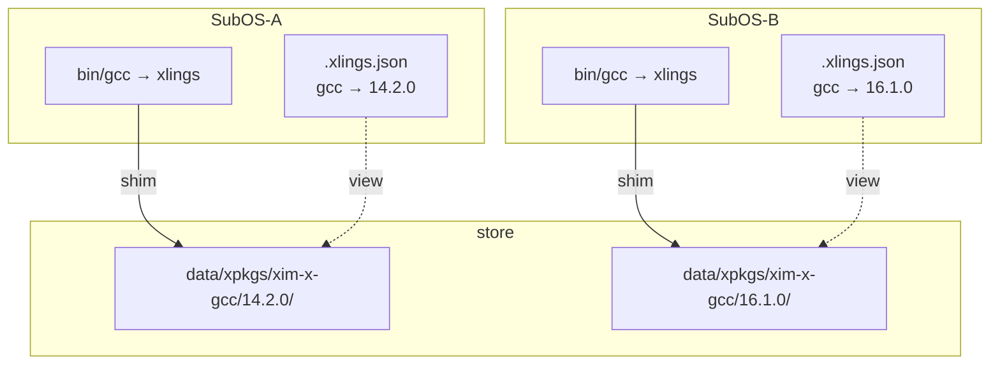

# Packages and Versions

**English** | [简体中文](zh/03-packages-and-versions.md)

Any number of versions of a tool live side by side; each environment (SubOS)
chooses its own active one, and the payloads are stored once and shared.

## Install a version

```bash
xlings install gcc@14.2.0
xlings install gcc@16.1.0
```

Versions install next to each other. A payload lives at
`~/.xlings/data/xpkgs/<namespace>-x-<package>/<version>/`, for example
`xim-x-gcc/16.1.0/`. The namespace is the index the package comes from (`xim`
for the official one); it appears in the directory and in the coordinate on
the command line.

## Switch the active version

```bash
xlings use gcc 14.2.0
xlings use gcc@14.2.0     # the same
```

After the switch, `gcc` in this environment is 14.2.0. A package that belongs to
a release group (gcc provides `gcc`, `g++`, `cpp`, …) switches as a group.

**A program the new release does not have is named.** If the old release
registered `gcc-ar` and the new one does not, it stays pointing at the release
you left, and `use` says so:

```text
[xlings] gcc -> 16.1.0
[warn] 1 program(s) are not part of gcc@16.1.0 and still resolve to the release you switched away from:
[warn]     gcc-ar (still 14.2.0)
```

`--strict` refuses such a switch and changes nothing.

### Without a version: done when certain, listed when not

`xlings use <name>` without a version never opens an interactive picker:

| Versions installed in this SubOS | What happens | Exit |
|---|---|:---:|
| 1 | it switches to it | 0 |
| more than 1 | nothing changes; the candidates are listed with the exact command | 0 |
| 0 | an error, with the install command | 1 |

```bash
xlings use gcc            # one installed: switched; several: listed
xlings use gcc --all      # the candidates of every SubOS
```

Several candidates exit 0: leaving the version out is a question, and the
command answered it. To switch, name the version.

### `use` switches between installed versions only

`xlings use <name> <version>` requires the version to be installed **in this
SubOS**; in a new SubOS it refuses and points at `install`, even when another
SubOS has the version. Only `install` resolves and installs dependencies — a
gcc activated without its glibc would run and not compile.

### Coordinates: the namespace first

A package of another index is `<namespace>:<package>@<version>`:

```bash
xlings install local:mcpp@0.0.27
xlings install fromsource:freetype@2.13.2
```

`mcpp@local:0.0.27` would be read as a version named `local:0.0.27`. The
version argument of `use` is written as the version database stores it:

```bash
xlings use freetype fromsource:2.13.2
```

### What is installed

```bash
xlings list
```

## How it works

### Shims

A SubOS's `bin/` holds a link per program, to the xlings binary itself. Run as
`gcc`, xlings reads its own name, looks up the active version in the SubOS's
workspace and runs that version's program from its payload.

### Version views and reference counts

Every SubOS shares the payloads in `~/.xlings/data/xpkgs/` and records only its
own view of them. A payload is deleted when the last view that uses it lets go.

### Installing again, and `--reconfig`

A payload in the store is configured once per environment: its commands
registered, its sysroot links made, its environment recorded. Each environment's
`.xlings.json` records which packages it configured, at which recipe revision:

```bash
xlings install chatgpt          # downloads, installs and configures the closure
xlings install chatgpt          # installed and configured here: nothing runs again
xlings install chatgpt --reconfig   # configure the whole closure again
```

It configures again on its own when the package is first installed in another
SubOS, when the recipe raised its `revision`, and after a `remove` here. A
damaged environment is repaired with `--reconfig` or `xlings self doctor --fix`.

### Picture



### A local recipe (`--add-xpkg`)

`xlings config --add-xpkg <file>` copies a recipe into a local overlay index,
and it then installs like any package:

```bash
xlings config --add-xpkg ./mypkg.lua
xlings install mypkg@1.0.0
```

```bash
xlings config --list-xpkg              # every recipe in the local overlay
xlings config --remove-xpkg mypkg      # one of them
xlings config --clear-xpkg all         # all of them
xlings config --clear-xpkg stale       # those the index has caught up with
```

`--list-xpkg` says how each relates to the synced index: `unique` (only here),
`identical` (the index has the same bytes), `modified`, `behind` (the index has
a newer version). `stale` is `identical` and `behind`; `xlings update` removes
the `identical` ones on its own.

## Across SubOS

Each SubOS has its own workspace (`.xlings.json`): `use` in one does not change
another, and the same command may run a different version in each.

```bash
xlings subos new dev-legacy
xlings subos new dev-latest
xlings install gcc@14.2.0 --subos dev-legacy
xlings install gcc@16.1.0 --subos dev-latest
xlings subos exec dev-legacy -- gcc --version    # 14.2.0
xlings subos exec dev-latest -- gcc --version    # 16.1.0
```

## Removing

`xlings remove <package>` acts on the active version of this SubOS:

- `--all` — every installed version of it
- `--all-subos` — in every SubOS that has it
- `--subos <NAME>` — in that SubOS
- `--older-than <VERSION>` — every version older than that one that nothing
  uses, in every SubOS (`--dry-run` lists them)

```bash
xlings remove gcc --all-subos
xlings remove gcc --subos probe
xlings remove mcpp --older-than 2026.10.1 --dry-run
```

A payload another environment still uses is kept. `--older-than` lists what it
removes (with sizes) and what it keeps and why — active in a SubOS or a project,
the xlings that is running, linked by another package — then asks once.

A version is refused only when removing it breaks a package that depends on it:
one linked against that payload, or one that runs its programs and would have no
installed version left that meets its constraint. One that only runs the program
and still has another version is told which version stays. `--force` removes it
anyway.

## Platforms

Whether a package installs on your machine is the recipe's answer: a recipe
that lists its builds per architecture and has none for yours is refused before
the download. Linux x86_64 and aarch64 are covered best; on macOS and Windows
some recipes publish fewer builds.
