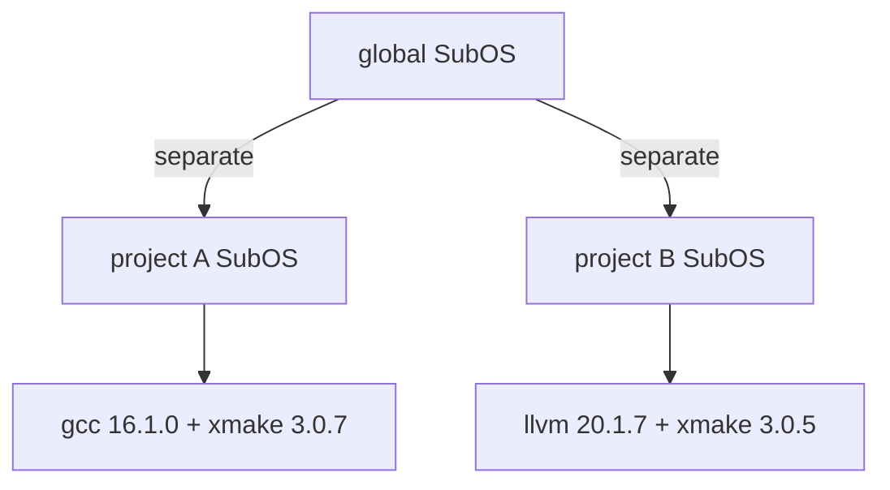

# Projects

**English** | [简体中文](zh/04-projects.md)

A project gets an environment of its own: the toolchain it declares, installed
into its own SubOS, invisible to the global environment and to other projects.

## The idea



A directory with a `.xlings.json` is a project root. In it (or below it), xlings
uses the project's SubOS; outside, the global one.

## `.xlings.json`

```json
{
  "workspace": {
    "xmake": "3.0.7",
    "gcc": { "linux": "16.1.0" },
    "llvm": { "macosx": "20.1.7", "windows": "19.1.0" }
  }
}
```

| Key | Meaning |
|---|---|
| `workspace` | the packages the project uses, and their versions |
| `"pkg": "ver"` | the same version on every platform |
| `"pkg": {"linux": "ver", …}` | a version per platform (`linux`, `macosx`, `windows`); other platforms skip it |
| `subos` (optional) | a named SubOS to use instead of the project's own |

Every key is in the [`.xlings.json` specification](specs/xlings-json.md).

## SubOS modes

| Mode | How | Where |
|---|---|---|
| anonymous | no `subos` key | `.xlings/subos/_/` in the project |
| named | `"subos": "<name>"` | the home's SubOS, shared with whatever else names it |

## Workflow

```bash
cat > .xlings.json << 'EOF'
{ "workspace": { "xmake": "3.0.7", "gcc": { "linux": "16.1.0" } } }
EOF
xlings install      # installs what the project declares
xmake build         # the project's toolchain is on PATH here
```

## With the global environment

- What the project declares wins inside it.
- What it does not declare comes from the global SubOS.
- `xlings install <pkg>` inside the project installs into the project.

## Typical uses

- **Two projects, two compilers** — one on gcc 14, one on gcc 16, side by side.
- **A team** — `.xlings.json` in version control; a clone plus `xlings install`
  gives everyone the same versions.
- **CI** — the same file drives the pipeline, so it builds with what developers
  build with.
