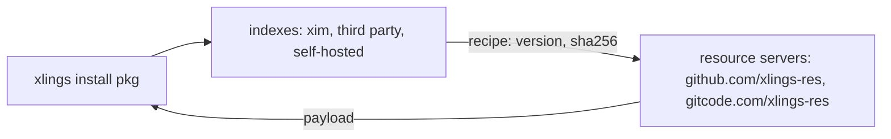

# Indexes and Mirrors

**English** | [简体中文](zh/05-indexes-and-mirrors.md)

Packages come from indexes — repositories of recipes — and their payloads from
resource servers. Both have a GitHub and a GitCode (China) address.

## Indexes

| Kind | What | Example namespace |
|---|---|---|
| official | `openxlings/xim-pkgindex`, built in | `xim` |
| sub-indexes | indexes the official one declares | `awesome`, `scode`, `d2x` |
| third party | a community's or an organisation's | `community` |
| self-hosted | a local path or a private Git repository | `internal` |



## Adding an index

```bash
xlings config --index-repo myteam:https://git.example.com/team/pkgindex.git
xlings update
xlings install myteam:tool@2.3.1
xlings config --rm-index-repo myteam
```

Or in `.xlings.json` (home or project):

```json
{
  "index_repos": [
    { "name": "myteam", "url": "https://git.example.com/team/pkgindex.git" },
    { "name": "local-dev", "url": "/home/user/my-local-index" }
  ]
}
```

- `name` — the index's namespace, its directory, and which index it downloads:
  the three are the same thing, so `data/<name>` holds only that index.
- `url` — a Git remote, or a local path (`file:///` and relative paths work).
- The entries are peers; their order changes nothing.

### An index published as an artifact

An index may publish its snapshots as artifacts (a pointer plus a tarball
checked by sha256), as the official one does; downloading one is faster and
more robust than a Git sync, and Git stays the fallback:

```json
{
  "index_repos": [
    { "name": "mcpplibs", "url": "https://github.com/mcpp-community/mcpp-index.git",
      "artifact": { "GLOBAL": "https://github.com/xlings-res/mcpp-index",
                    "CN": "https://gitcode.com/xlings-res/mcpp-index" },
      "source": "auto" }
  ]
}
```

- `artifact` — a base (GitHub/GitCode repository, a static HTTP directory, a
  local directory), or one per region. Regions are a chain: this mirror's region
  first, then GLOBAL, then the rest; Git only when all fail.
- `source` — `auto` (artifact, then Git), `artifact` (only), `git` (only).

```console
$ xlings index list
  ◆ mcpplibs
    artifact: https://gitcode.com/xlings-res/mcpp-index  [CN]
         then: https://github.com/xlings-res/mcpp-index  [GLOBAL]
```

What a publisher provides is in [31](31-hosting-an-index.md) and
[specs/index-distribution](specs/index-distribution.md).

### Pinning a snapshot

```bash
xlings index list xim          # the published snapshots
xlings index use xim 2026.10.11.1
```

## Mirrors

```bash
xlings config --mirror CN       # GitCode first
xlings config --mirror GLOBAL   # GitHub first
```

| Name | Address | For |
|---|---|---|
| GLOBAL | github.com/xlings-res | everywhere |
| CN | gitcode.com/xlings-res | mainland China |

A download that fails on one region is tried on the other. A failed download
says whose fault it was: the source (wrong bytes, HTTP error — the next
candidate is tried), the transfer (timeout, short read — retried), or this
machine (a full disk — nothing else is tried, and nobody is blamed).

## Namespaced packages

```bash
xlings install subos:py-ds@1.0.0
xlings install myteam:tool@2.3.1
xlings install gcc@14.2.0          # the official index: no namespace needed
```

A bare dependency inside a recipe means the package of that name **in the
index the recipe came from**; only a name that index lacks falls through.

## Commands

| Command | What |
|---|---|
| `xlings update` | refresh every index |
| `xlings search <pkg>` | search every index |
| `xlings info <pkg>` | a package's versions, platforms, source |
| `xlings why <pkg>` | why a dependency resolved to the version it did |
| `xlings install <ns>:<pkg>@<ver>` | a package of a given index |
