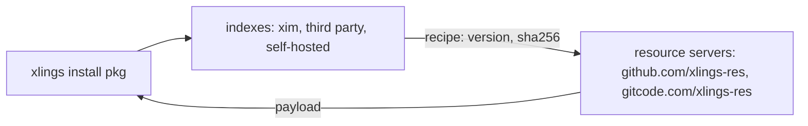

# Indexes and Mirrors

**English** | [简体中文](zh/05-indexes-and-mirrors.md)

Packages come from indexes — repositories of recipes — and their payloads from
resource servers. Both have a GitHub and a GitCode (China) address.

## Indexes

| Kind | What | Example namespace |
|---|---|---|
| official | `openxlings/xim-pkgindex`, built in | `xim` |
| sub-indexes | indexes the official one declares | `awesome`, `scode`, `d2x` |
| third party | a community's or an organisation's | `community` |
| self-hosted | a local path or a private Git repository | `internal` |



## Adding an index

```bash
xlings config --index-repo myteam:https://git.example.com/team/pkgindex.git
xlings update
xlings install myteam:tool@2.3.1
xlings config --rm-index-repo myteam
```

Or in `.xlings.json` (home or project):

```json
{
  "index_repos": [
    { "name": "myteam", "url": "https://git.example.com/team/pkgindex.git" },
    { "name": "local-dev", "url": "/home/user/my-local-index" }
  ]
}
```

- `name` — the index's namespace, its directory, and which index it downloads:
  the three are the same thing, so `data/<name>` holds only that index.
- `url` — a Git remote, or a local path (`file:///` and relative paths work).
- The entries are peers; their order changes nothing.

### An index published as an artifact

An index may publish its snapshots as artifacts (a pointer plus a tarball
checked by sha256), as the official one does; downloading one is faster and
more robust than a Git sync, and Git stays the fallback:

```json
{
  "index_repos": [
    { "name": "mcpplibs", "url": "https://github.com/mcpp-community/mcpp-index.git",
      "artifact": { "GLOBAL": "https://github.com/xlings-res/mcpp-index",
                    "CN": "https://gitcode.com/xlings-res/mcpp-index" },
      "source": "auto" }
  ]
}
```

- `artifact` — a base (GitHub/GitCode repository, a static HTTP directory, a
  local directory), or one per region. Regions are a chain: this mirror's region
  first, then GLOBAL, then the rest; Git only when all fail.
- `source` — `auto` (artifact, then Git), `artifact` (only), `git` (only).

```console
$ xlings index list
  ◆ mcpplibs
    artifact: https://gitcode.com/xlings-res/mcpp-index  [CN]
         then: https://github.com/xlings-res/mcpp-index  [GLOBAL]
```

What a publisher provides is in [31](31-hosting-an-index.md) and
[specs/index-distribution](specs/index-distribution.md).

### An index another program owns

A program that keeps its own index (mcpp's `mcpplibs`) names where its data and
payloads live, and xlings fetches and installs there:

```json
{ "name": "mcpplibs", "url": "...", "dir": "/home/u/.mcpp/indices/mcpplibs", "store": "/home/u/.mcpp/xpkgs" }
```

That program also refreshes it (`sync_index`), so it can check a new copy
before the one in use is replaced; `xlings update` fetches such an index only while it is absent.

A home can also install from read-only **upstreams** -- another home whose
payloads of the same identity are linked, never copied or written
(`upstreams`, [specs/xlings-json](specs/xlings-json.md)).

### Pinning a snapshot

```bash
xlings index list xim          # the published snapshots
xlings index use xim 2026.10.11.1
```

## Mirrors

```bash
xlings config --mirror CN       # GitCode first
xlings config --mirror GLOBAL   # GitHub first
```

| Name | Address | For |
|---|---|---|
| GLOBAL | github.com/xlings-res | everywhere |
| CN | gitcode.com/xlings-res | mainland China |

A download that fails on one region is tried on the other. A failed download
says whose fault it was: the source (wrong bytes, HTTP error — the next
candidate is tried), the transfer (timeout, short read — retried), or this
machine (a full disk — nothing else is tried, and nobody is blamed).

## Archive sources and machines without a network

An archive is identified by the sha256 its recipe states, not by its URL or
its file name. Each download asks its sources in order, and the first file
whose bytes have that digest is verified and installed as a downloaded one
would be:

1. the download cache (`data/runtimedir`, the file under the URL's name);
2. the directory of `install --from <dir>`;
3. the directories of `XLINGS_ARCHIVES` (separated like `PATH`);
4. the directories of `.xlings.json` `archives`;
5. the network: the recipe's URLs and the mirrors above.

### Archive directories

```bash
xlings config --add-archives /mnt/archives
xlings config --rm-archives /mnt/archives
```

An archive directory holds files under any names, at any depth. xlings keeps a
sha256 index of each directory in the home, by path, size and modification
time, so a file is hashed once and again only after it changes. A file whose
bytes do not have the stated digest is never taken, whatever it is called.

### Bundles

```bash
xlings download gcc@16.1.0 --to ./bundle --with-index   # on a machine with a network
xlings install --from ./bundle gcc@16.1.0               # on the machine without one
```

`download` writes every archive the packages' closures download on this host
(`--host <os>-<arch>` names another, such as `windows-x86_64`) into
`archives/<sha256>-<file name>`; with `--with-index`, a snapshot of every index
that resolved them into `index/<name>`; and the manifest `bundle.toml`. On
Linux the closure includes `xim:patchelf`, which an install on a host without
patchelf takes first. A directory that already holds a bundle is extended:
archives and snapshots are added or replaced, and tables of the manifest that
xlings does not know are kept.

`install --from` makes the bundle the first archive directory and its
snapshots the only indexes of that command: nothing is fetched to resolve or
to install, and the home's own indexes are not read. A directory without
snapshots is an archive directory only, resolved with the home's indexes. For
a recipe that states no sha256, the sha256 the manifest records for that
package, version and host names the archive. The manifest and its rules are
[specs/bundle](specs/bundle.md); the directories and variables,
[specs/xlings-json](specs/xlings-json.md).

### Without a network

A process for which `XLINGS_NET_UNREACHABLE` is set does not use the network:
xlings sets it when the index pointer finds no network, and a caller sets it to
say so beforehand. The archives no source has are then reported together, each
with its package, version, sha256 and URL, with the directories that were
asked and the commands that supply them; the same report follows downloads the
network did not answer.

## Namespaced packages

```bash
xlings install subos:py-ds@1.0.0
xlings install myteam:tool@2.3.1
xlings install gcc@14.2.0          # the official index: no namespace needed
```

A bare dependency inside a recipe means the package of that name **in the
index the recipe came from**; only a name that index lacks falls through.

An index may **reserve** its namespaces (`index-compat.json`:
`{"namespaces": {"reserved": ["xim", "luban"]}}`): a package another index
publishes in one of them is not taken, and xlings names that index's recipe.
The official index reserves `xim`, `luban`, `subos` and `config`; a namespace of
your own is yours the same way.

## Commands

| Command | What |
|---|---|
| `xlings update` | refresh every index |
| `xlings search <pkg>` | search every index |
| `xlings search --category <c>` | the packages a category lists (`luban-desktop`: the desktops) |
| `xlings info <pkg>` | a package's versions, platforms, source |
| `xlings why <pkg>` | why a dependency resolved to the version it did |
| `xlings install <ns>:<pkg>@<ver>` | a package of a given index |
| `xlings download <pkg> --to <dir> --with-index` | its archives and indexes, for a machine without a network |
| `xlings install --from <dir> <pkg>` | install from such a directory |
| `xlings config --add-archives <dir>` | a directory whose archives are taken by content |
