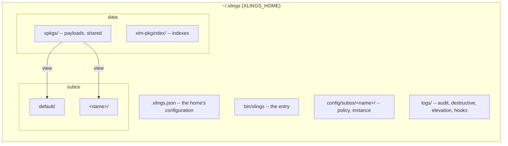

# Architecture

**English** | [简体中文](zh/91-architecture.md)

xlings is one static binary written in C++23 modules. This chapter is the map of
it: the packages it is built from, where it keeps things, and how an install and
a SubOS work inside.

## Packages

```text
modules/            linked into xlings, one per responsibility
  libs/             json, sha256, tinyhttps -- nothing of xlings
  runtime/          cancellation, guard (confirmation tokens), observe (audit, redaction)
  platform/         the OS boundary: every system header and call
  i18n/             the i18n mechanism: tr, the language, catalogues by domain, pick, the glossary
  ui/               theme, xlings' catalogues
  cli/              the command model: one declared tree, help by level, completion
  home/             the home: its format (layout, steps) and its payload store (GC roots, the retained ledger)
  subos/            the SubOS core: model, policy, intent, sandbox, views, session
  confine/          sandbox implementations (bwrap, proot, landlock, home redirect)
  carrier/          where a SubOS runs: local, wsl2, vz
luban/              the OS model and its tool: boot, stage0, machine, cli, image
apps/luban/         the luban binary (and stage-0 when started as luban-init)
src/                the frontend: cli, interface, core (config, xim, xvm, xself, subos)
```

Layers import downward only: `luban/` uses `modules/`; `modules/` never uses
`luban` or the frontend. System headers and calls live in `modules/platform` and
nowhere else; a platform is chosen with `if constexpr`, so every build compiles
every branch. These are build rules (`tools/lint_*.sh`), not conventions.

## Data layout



## Installing a package

```mermaid
sequenceDiagram
    participant U as user or agent
    participant R as resolver
    participant D as downloader
    participant I as installer
    participant V as xvm
    U->>R: xlings install gcc@16
    R->>R: the dependency graph, in order
    R->>D: what to fetch
    D->>D: parallel downloads, sha256 checked, failures attributed
    D->>I: archives
    I->>I: by type (package, script, subos); extract; install hook
    I->>V: register versions and programs; configure once per scope
    V->>U: done
```

A recipe's hooks run in a persistent Lua worker; on Linux with a strong
boundary only the target payload, scratch and the hook's log are writable.
Every hook's commands write to `<home>/logs/hooks/<pkg>.<hook>.log`.

## Versions: the database, the workspace, the shim

| | |
|---|---|
| version database | every target (program or library): its registered versions, their paths, bindings between members of a release |
| workspace | per scope (project > SubOS > global): the active version of each target, and what is installed there |
| shim | `bin/<program>` is a link to xlings; run under a program's name it looks up the active version and runs it from the payload |

A version not installed in a scope is invisible there, even when the database
knows it. The shim table is a derived table with one writer, rebuilt from the
workspace on every install, use and remove.

## A SubOS: content, view, carrier

| | |
|---|---|
| content | workspace, home, policy (`config/subos/<name>/policy.json`, outside the instance) |
| view | how a process sees it: the PATH overlay; the sandbox (policy → intent → a backend's argv); a root (`/usr` a generation of links); a machine (stage-0) |
| carrier | where it runs: this machine, a WSL2 distribution of the home's own, a VM |

Inside a sandbox, xlings reads locally and hands writes (`install`, `remove`,
`update`) to a broker outside, which decides by the same policy. Sessions are
supervised outside the sandbox; the audit is written where the sandbox cannot see it.

What may be done to a SubOS is one table (`roles::check(op, kind, role)`): a
running host is not removed, a boot entry is not removed, a view has no root to
export.

## Code map

| Where | What |
|---|---|
| `modules/subos/src/` | `model/`, `policy/`, `intent/`, `sandbox/` (spec, caps, the tool table, elevation, network, gpu), `views/root/` (generations, library cache), `session/` (supervisor, session-init, broker) |
| `modules/confine/src/` | the backends, the selector, the platform matrix (from the backends' own probes) |
| `modules/carrier/src/` | local, wsl2 (and its one-time setup), vz |
| `luban/src/` | `boot` (boot entries), `stage0` (the first process), `machine` (/etc, sysusers), `cli`, `image` (GPT, FAT, ISO, qcow2) |
| `src/core/subos/` | the `subos` commands: lifecycle, carrier routing, exec, config, audit, `root/` (projection, rollback, boot, export, pack) |
| `src/core/xim/` | resolver, downloader, installer, catalog, indexes |
| `src/core/xvm/` | version database, workspace, shims |
| `src/core/xself/` | self install, update, doctor |
| `tests/requirements.toml` | every behaviour's requirement ID; tests claim them with `covers` |

## Principles

1. **One binary** — no runtime dependency; the Linux release is static.
2. **Version views over one store** — N environments, one copy of each payload.
3. **One writer per derived table** — the shim table, generations, the store's roots.
4. **Could not read is never empty** — an unreadable file stops a deletion instead of meaning "nothing".
5. **User data is deleted only by the user** — a SubOS's home, asked and confirmed, recorded.
6. **Everything external from the index** — or from the operating system itself ([51](51-supported-platforms.md)).
