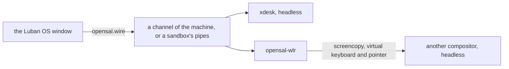

# The Desktop and the Luban OS Window

**English** | [简体中文](../zh/luban/08-desktop.md)

Luban OS is also a window: `luban-os` shows the environments of this home, then
one of them as a display shows a system — its console, or its desktop when it
has one. Everything else is in its management panel. The window runs nothing
the `luban` command could not: each thing it does is a `luban` command.

## Install and open it

```bash
xlings install luban-os          # the app, with its desktop entry
luban new desk --edition desktop # an environment with a desktop
luban enter desk --display window
```

`luban-os` opens on the list of environments; the default one is entered after a
countdown (10 seconds; any key or click stops it).

## The first time: quick start

With no environment yet the window opens on quick start (**New system** later),
in four groups:

| | |
|---|---|
| **Console** — small, yours to shape | `nano` (xlings and luban only: the base an edition of your own is built on; it has no shell, so it is made without going in), `tiny` (a shell and the basic tools), `tiny-musl`, `core` (a console to develop in, chosen by default), `agent workspace` |
| **xdesk** — Luban's own desktop | `xdesk classic` and `xdesk canvas · explore`: the desktop made for this window (below) |
| **Traditional desktops** — light → full | every desktop of the `luban-desktop` category but xdesk, by what it brings: Compositor (T1, windows only, the Luban OS window its shell), labwc (T2), LXQt (T3), KDE Plasma (T4); one without a tier last |
| **More systems** | an official system the window has no card for, and the systems of indexes you added |

A traditional desktop's card says how much it brings (four marks, `T1`–`T4`,
or *not rated*), where it comes from (*official*, *community · its index*,
*local*), how settled it is (*stable*, *preview*; a deprecated one is not
offered), what it wants of the GPU (*GPU better*, *GPU needed*) and its
version. Hover a name (Compositor, Wayland, a tier) for what it means. Choosing
one makes the same system as `luban new <name> --edition core --desktop <it>`:
**More options** changes its base (`tiny`, `core`, `desktop`), and it runs as a
machine and enters its desktop unless you choose otherwise. The panel says the
two versions it is made of (`System core 2026.10.19.1`, `Desktop LXQt 2.4.0`) —
the version shown is the version made; a newer one this xlings is too old for
is said beside it.

←→ moves within a group, ↑↓ between groups, Enter makes it. While the index is
read the group says *Reading the index…*; an index that cannot be read is said
with what to do (`xlings update`), never shown as an empty group.

Each card says what it is; the panel says what is in the chosen one, or why it
cannot be made here — not published yet, not built for this machine's
architecture, or a computer that cannot run Luban systems yet (what `luban
status` says: the reason and the next step). A name follows the card until you
type your own. **More options** also chooses sandbox or machine and, for a
console or xdesk, the desktop it is made with. The panel scrolls; **Create**
stays at its foot. Making it shows six steps — prepare, download, unpack,
configure, check, done — each one's current line as it goes, then goes in. A
system (or desktop) from another index is agreed to before it is made — Luban
does not check what it does.

The same as text: `luban search` (distributions, desktops by tier), `luban ls
<pattern>` (the systems here whose name matches).

**Import** a system someone exported (`luban export box box.luban`) from the
quick start's link, the list's last row, or by dropping the `.luban` file on the
window. The preview shows its edition, packages and isolation, and lists in
plain words what it may do beyond a new system (a clipboard grant, a host
mount, no isolation preset); that is agreed to before it is imported. It is
made from what the file carries: no network needed.

When a session ends with a failure, the window says what it said last and its
exit code, instead of only "off".

## The window

| | |
|---|---|
| a list | the environments, the default first, then by when each was used last; then a new one, and one from a file |
| the system | its console, or its desktop: the window is its screen, titled `Luban OS (<system>)` |
| the keyboard | a desktop holds it while the window has the focus: every key is the desktop's, the host's own chords too. **Ctrl+Alt+K** lets it go and takes it back (also in the menu); Settings → *Hold the keyboard in a desktop* turns it off. Holding it costs Emacs' `C-M-k` while it is held |
| the pointer | drawn by this computer, so it follows the hand with no delay: the shape the desktop asks for (a text field's I-beam, a link's hand, an edge's arrows), in the Luban pointer theme — the same on every system — or an image a program drew. A game that holds the pointer gets it until Ctrl+Alt+K |
| the Host key | Ctrl+Alt pressed and released alone (Ctrl+Option on macOS): the menu — back to the list, manage, full screen, a new window, the keyboard, power off |
| F2 or the gear | the management panel: every environment, its settings, what happened (`xlings self log`) |
| closing it on a machine | asks each time: keep it running or power it off — or confirm and make that the environment's default (`luban config desk --on-close background`) |
| a file dropped on a system | copied into its login user's `~/Downloads`, and the window says where (a `.luban` file is imported instead) |
| Ctrl+= / Ctrl+- / Ctrl+0 | the console's font size, kept per system |
| the pointer on a console | a program that takes the mouse (vim, htop, tmux) gets it; otherwise — or with Shift held — a drag selects and copies, two clicks a word, three a line, the middle button pastes the last selection, the right one opens Copy / Paste, the wheel scrolls back |
| an operation under way | its phases as it goes; it can be stopped, and one that failed can be tried again |

Every window is a process of its own; one more process, `luban-os __tray`,
holds the app's icon in the system's status area for all of them:
StatusNotifierItem on Linux (KDE, GNOME with its AppIndicator extension, and
most other desktops), the notification area on Windows, the menu bar on macOS.
Its menu lists the running systems (open, its console, power off, manage), a
new system, the window, the settings, and quit; it brings forward a window that
shows what was chosen, or opens one. Its picture shows how many run and whether
something is under way or failed. Closing a window ends it — the machines keep
running and the icon stays — unless it is making something: then it hides,
finishes, and says so. Quit asks once (keep the systems running, or power them
all off) and ends every window. Where there is no status area, a closed window
is minimized instead. **Always in the tray** (Settings) keeps the icon with
nothing running. A newer Luban OS installed takes over the icon by itself; a
window still open is the old one until it is opened again.

The window follows the screen's scale. Its console draws box and block
characters itself, so they join at any font size.

## xdesk

The desktop editions start **xdesk**, a desktop made for this window: a
compositor and its shell in one program (wlroots, rendering in software), which
speaks to the window directly — no bridge, no screen capture.

Each workspace arranges its windows one of three ways, and **Super+m** changes
it: hold Super, press m — three cards show the workspace laid out each way, m
again for the next, let Super go to take it, Esc to keep it as it was. Each way
remembers its own layout, so tile → canvas → tile comes back to the same
columns.

| | |
|---|---|
| **Tile** | windows in columns side by side; one or two share the screen, more scroll with the focused one in view; a column can hold several, one above another |
| **Stack** | windows where you put them, overlapping, kept on the screen; maximized, or snapped to a half or a quarter |
| **Canvas** | windows on a plane that pans and zooms; put one against another's edge and they become a tiled group, moved and zoomed as one |

| Keys (Super, or Alt where the host keeps Super) | Tile | Stack | Canvas |
|---|---|---|---|
| Super alone, Space or D | the applications | the same | the same |
| ←→ ↑↓ (or H J K L) | the next column / in the column | the nearest window that way | the same |
| Shift+←→ ↑↓ | move to the next column / up and down in it | halves, quarters, the whole, back | move by a quarter of the view |
| [ / ] | into the column on the left / out to a column of its own | — | into the group beside / out of it |
| R / Shift+R | the column's width (⅓, ½, ⅔, all) / the window's height in it (equal, ⅔, ⅓) | — | the same in a group |
| - / = | narrower / wider | smaller / larger | zoom out / in |
| F | float, or put back | the whole screen, and back | float, or put back |
| Shift+T | always on top | the same | the same, and fixed in the view |
| M | tile, stack, canvas (held) | the same | the same |
| Tab | the windows (held: Tab for the next, let go to go there) | the same | the same |
| O | — | — | the overview; a click goes in to a window |
| 1 … 4 / Shift+1 … 4 | a workspace / send the window there | the same | the same |
| Return, or Ctrl+Alt+T / Q / / | a terminal / close the window / these keys | the same | the same |

**Super+/** shows these keys, only those that mean something in the
arrangement you are in. The first time, a line at the bottom says so.

Drag a window by its title (or anywhere with Super held): it follows the
pointer, see-through, and a box shows where it will land — in a column, above
or below another window, in its place, at the screen's edge (a new first or
last column; stacked: a half, a quarter, the whole), against another window on
the canvas (a group). Rest on a new column for a moment and its widths are
offered (⅓, ½, ⅔, all); let go and it glides there. Shift while dragging: it
floats where you let go. Drag the gap between two columns to resize both;
click it twice to make them equal. Rest on the title bar's maximize button for
the layouts it offers — halves, ⅔ and ⅓, one and two, thirds — of this window
and the ones used before it; click it to maximize.

The title bar's other button (or its right-click) opens the window's menu:
maximize or restore, float or put back, always on top, on every workspace, to
a workspace, and the application's rules — always floating, always on this
workspace, remember its size and place — kept for next time. A window's title
bar says its application's name (from its desktop entry), then its own title.

On the canvas, drag the background (or a window with Super) to pan; the wheel
on the background (or anywhere with Super) zooms around the pointer, so what is
under it stays put. The overview leaves you exactly where you were.

The input method of the host types into the desktop's windows (what it
composes is shown there), and the clipboard is shared — each way as far as
the environment's grants allow: `clipboard` (copying out of it) and
`clipboard-paste` (pasting into it); an environment made before policies
shares both. The pointer is the window's to draw (above); for a window that
does not draw one (an older Luban OS), xdesk draws it into the picture.

### Sessions and settings

| Session | |
|---|---|
| `xdesk` (the `desktop` edition's) | each workspace as you left it; tile the first time |
| `xdesk-classic` | a workspace not yet set starts tiled; a panel across the top |
| `xdesk-canvas` | a workspace not yet set starts as a canvas; a pill at the bottom with the zoom and the overview |

xdesk reads `<session>.ini` (`xdesk.ini`, `classic.ini`, `canvas.ini`): its own
defaults, then a system's `/etc/xdg/xdesk/`, then yours in `~/.config/xdesk/`,
each later one winning key by key.

```ini
[desktop]
terminal = foot
autostart = foot
gap = 8
workspaces = 4

[theme]
accent = #5e9cff
background = #1b1e25

[keyboard]
layout = us        # another xkb layout needs xkeyboard-config
repeat_rate = 30
repeat_delay = 500
```

With no `terminal` the system's default terminal is used (its
`share/xdg-terminals` entry); either way an application that runs in a terminal
opens with its own title and identity (`foot --title=Neovim --app-id=nvim nvim`).
A line it cannot read is logged and skipped; the desktop still starts.

What you set is yours, in `~/.config/xdesk/`: `state.json` keeps each
workspace's arrangement and the applications' rules, `keys.json` the keys you
rebind — an action's chords (`{"terminal": ["Super+Return", "Ctrl+Alt+t"]}`);
the action names are those Super+/ lists. An upgrade never rewrites them; one
that cannot be read is said, the desktop starts as new, and the file is left as
it is.

## Desktops

A desktop is a package that brings a session — a file in
`share/wayland-sessions/` — into a system; several can live in one system.
Luban's own are in the `luban:` namespace (packages listing `luban-desktop` in
their categories), from the lightest to the fullest:

| Desktop | Session | What it is |
|---|---|---|
| `luban:compositor` | `compositor` | windows without a desktop: labwc, the Luban OS window is its shell (below) |
| `luban:labwc` | `labwc` | labwc with a panel, a launcher, a background — light |
| `luban:lxqt` | `lxqt` | LXQt on labwc: a panel, a desktop and file manager, settings — traditional |
| `luban:kde` | `kde` | KDE Plasma, nested in labwc (preview) — the complete desktop |
| `luban:xdesk` | `xdesk`, `xdesk-classic`, `xdesk-canvas` | Luban's own: each workspace tiled, stacked or a canvas (above) |

The terminal of each is the default one (`luban:foot`), found through
`xdg-terminal-exec`; X11 programs run on `luban:xwayland`. Every one brings the
Luban pointer theme (`luban:cursors`), the one the window draws on this
computer: the same pointer in the system as outside it. LXQt and KDE share
one Qt (`luban:qt-runtime`), installed once.

```bash
luban new desk --edition desktop --desktop lxqt   # made with LXQt, and starting it
luban enter desk --desktop kde                    # another desktop, this once (installed already)
luban config desk --desktop xdesk-canvas          # which session it starts
luban config desk --desktop none                  # its console instead
luban config desk --enter console                 # what going in shows first
```

Without a setting, the edition's session is started (the first the root
declares, when it names none). The window's Host-key menu lists the system's
desktops and its console: switching changes the session, not the machine. A
desktop renamed keeps answering to its old name (`labwc-desktop` is `labwc`).

A session file says how it is shown:

```ini
[Desktop Entry]
Name=xdesk (classic)
Exec=xdesk --profile classic
X-Opensal-Native=true
X-Opensal-Interfaces=surface pointer keyboard mode
X-Luban-Shell=own
```

| Key | |
|---|---|
| `X-Opensal-Native=true` | the program speaks to the window itself (xdesk); any other compositor is shown through opensal-wlr (below) |
| `X-Luban-Shell` | `own`: the desktop has its shell; `none`: the Luban OS window is its shell |
| `X-Luban-App-Exec` | how it runs one program alone (`luban run --display window`, below) |
| `X-Luban-Aliases` | the names it answered to before |

A session that leaves its shell to the window (`X-Luban-Shell=none`, Luban's
`compositor`) gets a bar under the desktop: **Applications** lists what the
session can start (the `share/applications` entries of its data directories,
yours included; one with `Terminal=true` opens in the default terminal), and a
button for each of its windows brings that one forward.

## One program in a window

```bash
luban run desk --display window -- gimp
```

runs one graphical program of a system alone, in a window of its own titled
by the program; the window goes when the program ends. It is run by a session
that says how (`X-Luban-App-Exec=`, the command appended as one word):
Luban's `compositor` desktop does (`labwc -S`). A system without one says so —
`xlings install luban:compositor --subos desk`.

## What a desktop edition is ready with

`desktop` is core and a desktop, and the tools people reach for, as tool
sets: `luban:tools-cli` (ripgrep, fd, fzf, jq, tmux, htop), `luban:tools-dev`
(node, python with uv, bun) and `luban:tools-agent` (claude, codex, pi,
opencode; dsh on x86_64). git defaults to `main`; npm, pip, uv and bun use
registries near you when xlings uses its CN mirror (whatever you set yourself
wins). No credentials are in it. On aarch64 the desktop edition starts labwc
until xdesk is released there.

## Your own desktop

On nano, tiny or core, install a compositor and declare its session. Any
compositor that has the wlroots protocols is shown in the window: screencopy
(the picture), virtual keyboard and virtual pointer (the input), and output
management (the window's size). The bridge between them, opensal-wlr, speaks
only those standard protocols; it is part of luban and starts with the session.

```bash
xlings install --subos box luban:labwc      # any desktop package, Luban's or another index's
luban config box --desktop labwc
```

A desktop of your own is a package that places its session and follows the
same conventions (its defaults in its own `etc/xdg`, the default terminal, its
checks in `share/luban/checks.d`); listing `luban-desktop` in its categories
offers it where a desktop is chosen. Luban's are the examples: the index's
[Luban packages](https://github.com/openxlings/xim-pkgindex/blob/main/docs/12-luban-packages.md)
chapter says how they are built.

## How it runs



- **As a machine** (`luban config desk --mode machine`, the desktop editions'
  default): the machine's agent starts the session headless, with software
  rendering, on a channel of the machine. A machine's `/run` and `/tmp` are its
  own and go when it stops.
- **In a sandbox**: the same session, started with `xlings subos use desk --cmd`,
  on two pipes. The desktop is the same; only where it runs differs.
- The window asks for its own size; the desktop follows it. It sends the next
  picture only once the window has shown the last, so a slow channel does not
  pile pictures up.
- The pointer is this computer's to draw: xdesk says which shape or image;
  opensal-wlr passes on another compositor's own when that compositor can show
  it apart from the picture (ext-image-copy-capture's cursor session, wlroots
  0.19 and later), and leaves it in the picture otherwise.
- Sound: with the `audio` grant a machine's Pulse clients reach this host's
  PipeWire or PulseAudio ([Environments](03-environments.md)).
- A machine keeps the log of its sessions in its own `/var/log/luban/desktop.log`.

## What it does not do yet

- A GPU: rendering is in software, the same on every host.
- X11 programs in xdesk (Xwayland); they run in the labwc session.
- The window on Linux needs X11 (Xwayland counts); a native Wayland window is
  not supported yet. On macOS and Windows the window shows a system's console
  and desktop, as a sandbox or as a machine, from the Luban host machine.
- xdesk on aarch64.
