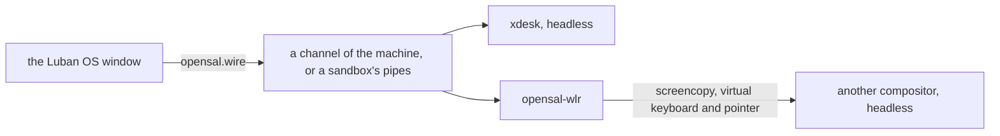

# The Desktop and the Luban OS Window

**English** | [简体中文](../zh/luban/08-desktop.md)

Luban OS is also a window: `luban-os` shows the environments of this home, then
one of them as a display shows a system — its console, or its desktop when it
has one. Everything else is in its management panel. The window runs nothing
the `luban` command could not: each thing it does is a `luban` command.

## Install and open it

```bash
xlings install luban-os          # the app, with its desktop entry
luban new desk --edition desktop # an environment with a desktop
luban enter desk --display window
```

`luban-os` opens on the list of environments; the default one is entered after a
countdown (10 seconds; any key or click stops it).

## The first time: quick start

With no environment yet the window opens on quick start (**New system** later),
in four groups:

| | |
|---|---|
| **Console** — small, yours to shape | `nano` (xlings and luban only: the base an edition of your own is built on; it has no shell, so it is made without going in), `tiny` (a shell and the basic tools), `tiny-musl`, `core` (a console to develop in, chosen by default), `agent workspace` |
| **xdesk** — Luban's own desktop | `Luban desktop`: workspaces on WuXian, the desktop made for this window (below) |
| **Traditional desktops** — light → full (folded until opened: click its heading, or → on it) | every desktop of the `luban-desktop` category but xdesk, by what it brings (the four marks on its picture): Compositor (T1, windows only, the Luban OS window its shell), labwc (T2), LXQt (T3), KDE Plasma (T4); one without a tier last |
| **More systems** | an official system the window has no card for, and the systems of indexes you added |

A traditional desktop's card says how much it brings (four marks, `T1`–`T4`,
or *not rated*), where it comes from (*official*, *community · its index*,
*local*), how settled it is (*stable*, *preview*; a deprecated one is not
offered), what it wants of the GPU (*GPU better*, *GPU needed*) and its
version. Hover a name (Compositor, Wayland, a tier) for what it means. Choosing
one makes the same system as `luban new <name> --edition core --desktop <it>`:
**More options** changes its base (`tiny`, `core`, `desktop`), and it runs as a
machine and enters its desktop unless you choose otherwise. The panel says the
two versions it is made of (`System core 2026.10.19.1`, `Desktop LXQt 2.4.0`) —
the version shown is the version made; a newer one this xlings is too old for
is said beside it.

←→ moves within a group, ↑↓ between groups, Enter makes it. While the index is
read the group says *Reading the index…*; an index that cannot be read is said
with what to do (`xlings update`), never shown as an empty group.

Each card says what it is; the panel says what is in the chosen one, or why it
cannot be made here — not published yet, not built for this machine's
architecture, or a computer that cannot run Luban systems yet (what `luban
status` says: the reason and the next step). A name follows the card until you
type your own. **More options** also chooses sandbox or machine and, for a
console or xdesk, the desktop it is made with. The panel scrolls; **Create**
stays at its foot. Making it shows the stages it has — fetch, unpack,
configure, start (a machine) and verify — with one bar for all of it, a second
for the stage it is in (how far, or a moving bar and the time when it has no
measure), what it is doing, and its latest line with how long ago; it says
*Ready* a moment, then goes in. A
system (or desktop) from another index is agreed to before it is made — Luban
does not check what it does.

The same as text: `luban search` (distributions, desktops by tier), `luban ls
<pattern>` (the systems here whose name matches).

**Import** a system someone exported (`luban export box box.luban`) from the
quick start's link, the list's last row, or by dropping the `.luban` file on the
window. The preview shows its edition, packages and isolation, and lists in
plain words what it may do beyond a new system (a clipboard grant, a host
mount, no isolation preset); that is agreed to before it is imported. It is
made from what the file carries: no network needed.

When a session ends with a failure, the window says what it said last and its
exit code, instead of only "off".

## The window

| | |
|---|---|
| a list | the environments, the default first, then by when each was used last; then a new one, and one from a file |
| the system | its console, or its desktop: the window is its screen, titled `Luban OS (<system>)` |
| the keyboard | a desktop holds it while the window has the focus: every key is the desktop's, the host's own chords too. **Ctrl+Alt+K** lets it go and takes it back (also in the menu); Settings → *Hold the keyboard in a desktop* turns it off. Holding it costs Emacs' `C-M-k` while it is held |
| the pointer | drawn by this computer, so it follows the hand with no delay: the shape the desktop asks for (a text field's I-beam, a link's hand, an edge's arrows), in the Luban pointer theme — the same on every system — or an image a program drew. A game that holds the pointer gets it until Ctrl+Alt+K |
| the Host key | Ctrl+Alt pressed and released alone (Ctrl+Option on macOS): the menu — back to the list, manage, full screen, a new window, the keyboard, power off |
| F2 or the gear | the management panel: every environment, its settings, what happened (`xlings self log`) |
| closing it on a machine | asks each time: keep it running or power it off — or confirm and make that the environment's default (`luban config desk --on-close background`) |
| a file dropped on a system | copied into its login user's `~/Downloads`, and the window says where (a `.luban` file is imported instead) |
| Ctrl+= / Ctrl+- / Ctrl+0 | the console's font size, kept per system |
| the pointer on a console | a program that takes the mouse (vim, htop, tmux) gets it; otherwise — or with Shift held — a drag selects and copies, two clicks a word, three a line, the middle button pastes the last selection, the right one opens Copy / Paste, the wheel scrolls back |
| an operation under way | its phases as it goes; it can be stopped, and one that failed can be tried again |

Every window is a process of its own; one more process, `luban-os __tray`,
holds the app's icon in the system's status area for all of them:
StatusNotifierItem on Linux (KDE, GNOME with its AppIndicator extension, and
most other desktops), the notification area on Windows, the menu bar on macOS.
Its menu lists the running systems (open, its console, power off, manage), a
new system, the window, the settings, and quit; it brings forward a window that
shows what was chosen, or opens one. Its picture shows how many run and whether
something is under way or failed. Closing a window ends it — the machines keep
running and the icon stays — unless it is making something: then it hides,
finishes, and says so. Quit asks once (keep the systems running, or power them
all off) and ends every window. Where there is no status area, a closed window
is minimized instead. **Always in the tray** (Settings) keeps the icon with
nothing running. A newer Luban OS installed takes over the icon by itself; a
window still open is the old one until it is opened again.

The window follows the screen's scale. Its console draws box and block
characters itself, so they join at any font size.

A second window on a desktop that is already shown (the menu's *New window*,
then the same system) is another display of it: it mirrors the first — the
same picture at the first window's size, whatever its own, its shape kept as
you resize it; its title says `display 2 (mirroring display 1)`. Keys and the
pointer in either window are the desktop's. When the first window closes, an
xdesk desktop goes on in the others, and the next one is the primary: the
desktop takes its size. A bridged desktop (labwc, KDE, LXQt) ends with its
first window.

A machine's sound plays on this computer. Its desktop starts a sound server
with the session (luban:audio: PipeWire, and its Pulse server for programs
that speak Pulse), whose default output, `luban`, the window plays through
this computer's own (PipeWire, PulseAudio or ALSA; Core Audio; WASAPI). That
is the system's `audio` grant: a system made with a desktop has it, and
`luban config box --disallow audio` takes it back. A sandbox's programs use
this computer's sound server directly, with the same grant. The microphone
is not carried yet.

## xdesk

The desktop editions start **xdesk**, a desktop made for this window: a
compositor and its shell in one program (wlroots), which speaks to the window
directly — no bridge, no screen capture. It draws with the GPU when the system
has one it can use (GLES on a render node) and in software otherwise; its
*About* page says which and why.

### WuXian and its workspaces

The desktop is one infinite plane, **WuXian**. Workspaces are regions on it —
numbered 1–9, each with a name, a colour and a rule — and windows live in a
workspace or, as *free windows*, on WuXian itself. You work in one workspace at
a time (the **workspace view**, always at 100 %) and step back to the whole
plane (the **WuXian view**, Super+O) for what happens between them: moving a
window to another workspace, laying workspaces out, finding something. The
camera glides from one to the other (at once with *reduce motion*).

A workspace's **rule** is how it arranges its windows; **Super+M** changes it
(hold Super, press M — two cards show the workspace each way; let Super go to
take it, Esc to keep it):

| | |
|---|---|
| **Tile** | windows in columns side by side, 4 pixels apart; the columns share the screen equally until each would be narrower than 480, then they scroll with the focused one in view; a column can hold several, one above another; a workspace can run its columns downwards (`flow = vertical`). A tiled window is told so and takes its size exactly |
| **Stack** | windows where you put them, overlapping, partly off the screen if you like (the title bar stays on it); maximized, or snapped to a half or a quarter -- drag one to an edge or a corner, drag it away to have its size back |

A window **floats** in its workspace (Super+Shift+Space: above the
arrangement, moving with it — dialogs do by themselves); a **free window** is
on WuXian, outside every workspace (Super+Shift+0, or dropped on the plane).

In the WuXian view each workspace is a plate with a coloured border and a label
above it — `● 2 · code · ▥` (its colour, number, name, and ▥ tiled or ❐
stacked). Workspaces can be moved (drag the label), scaled (the label's
corner handle, or 50 % / 100 % on its menu; their contents keep their layout)
and can overlap: the one on top is the one hit. A new window goes to the
current workspace in the workspace view; in the WuXian view, to the workspace
in the middle of the view, or onto WuXian when the middle is empty.

**Workspaces are made** with Super+Ctrl+N (the lowest free number, at the far
right), from the WuXian view's right-click menu (a tiled or stacked one where
you clicked), or by going to a number that has none (Super+5) — one made that
way, left unnamed and empty, goes again when you leave it. **Removed** from its
label's menu (or Delete on a selected label): an empty one at once; one with
windows asks — make them free windows (Enter), close them all (after a
five-second countdown), or cancel. The last workspace stays.

The status bar shows the current workspace (its colour, number, name and
rule) and the others as small marks you can click (*the others* can be
turned off); its WuXian button goes to the WuXian view and says how many free
windows there are.

| Keys (with Super) | Workspace view | WuXian view |
|---|---|---|
| Super alone, or Space | the applications — and the settings' pages and every action, by name, with its keys | the same |
| O | the WuXian view | back to the workspace in focus (Esc too, when no window has the focus) |
| 1 … 9 / Shift+1 … 9 | that workspace (made if there is none) / send the window there | the camera on it / the same |
| Shift+0 | the window onto WuXian, free | the same |
| Ctrl+N / Ctrl+0 | a new workspace, and into it / — | a new one, framed / everything in view |
| Ctrl+← → or PageUp / PageDown (with Shift: the window too) | the workspace before or after | the camera on it |
| M | tile or stack (held) | the rule of the workspace in focus |
| ←→ ↑↓ (or H J K L) | the next window that way, by the rule | the nearest window that way, anywhere |
| Shift+←→ ↑↓ | move it, by the rule (tile: columns; stack: halves, quarters, the whole) | a free window by an eighth of the screen |
| [ / ] | into the column on the left / out to a column of its own | — |
| R / Shift+R | the column's width (⅓, ½, ⅔, all) / the window's height in it | — |
| - / = / 0 | narrower / wider / equal widths | zoom out / in / the focused window at 100 % |
| F / Shift+F | maximize, and back / full screen, and back | the same |
| P / Shift+P | always on top / on every workspace | the same |
| S | — | collapse, and back: a free window to its title bar, else the workspace in focus to its label |
| C / V | copy / paste — Ctrl+Shift+C/V in a terminal, Ctrl+C/V elsewhere | the same |
| Tab / Shift+Tab | the applications, the most recent first (held: Tab for the next; held half a second on one, its windows spread) | the same |
| ` (above Tab) / Shift+` | the application's other window / the one before | the same |
| Return, or Ctrl+Alt+T / Q, or Alt+F4 | a terminal / close the window | the same |
| I / / | the settings / its keys page | the same |

The first time, the desktop gives a **tour**: ten steps at the bottom right —
the applications, a terminal, switching, workspaces, WuXian, moving between
them, bookmarks, collapsing, every key, the settings — each done by doing it,
each skippable (or the whole ended). Again any time: *Tour of the desktop* in
the applications, or `xdesk msg tour start`.

Every key, as the desktop has it, is in [the generated table](../generated/xdesk-keys.md).
**Super+/** opens the settings at their keys page: every action by group,
searched as you type; Enter on one, then the new chord, gives it that chord
(one another action had is taken from it, and said so); Delete puts it back.
The keys come as a set — Luban, or Luban without hjkl, for those whose
applications want those letters — and what you change is kept in
`~/.config/xdesk/keys.json`. Hold Super a second for the keys used most.

**Alt+Tab** shows every window of the workspace where it is to the others,
scaled to fit the screen, the chosen one larger and the rest dimmed: Tab goes
by how recently you used them (Shift: back), the arrows by place, the pointer
by pointing; let Alt go to go there, Esc to stay. A quick Alt+Tab goes straight
to the window used before. The window you go to stays lit a moment while the
others are dimmed, so you see where you landed (*Switchers* in the settings:
how long, how dim, or not at all). Alt+Tab is xdesk's while the window holds
the keyboard (Ctrl+Alt+K), the host's otherwise.

The same gestures in both views:

| | Workspace view | WuXian view |
|---|---|---|
| drag the title bar, or anywhere with Super held | move the window | move it — into another workspace, or onto WuXian |
| Super with the right button, or a border or corner | resize it (stacked, floating) | the same, free windows too |
| drag the background, or hold Super+Space and drag anywhere (a hand) | tile: scroll the columns | pan |
| the wheel on the background / Super with the wheel | tile: scroll, faster the faster you turn it, landing on a column | pan (Shift: sideways) / zoom around the pointer |
| the middle button | the application's (it pastes the selection) | drag the background: pan |
| right-click the background | terminal, settings, the WuXian view | new workspace, line the workspaces up, show everything |
| a workspace's label: drag / its handle / right-click / double-click | — | move / scale / menu (name, rule, colour, scale, collapse, remove) / go in |
| double-click a title bar | maximize, and back | a free window: collapse, and back |
| zoomed far out (windows are pictures) | — | drag a window anywhere to move it; double-click: it at 100 % |
| the minimap | — | drag its view box: pan; click a workspace or window: it in the middle; drag one: move it (into a workspace where it lands) |

Dragging a tiled window freezes the layout: nothing moves while you drag; a
dashed box marks where the window was, and the box under the pointer shows
what letting go will do — its own place (nothing), the middle third of
another window (swap), the ends (a new column before or after, its width
picked with the wheel or 1–4), the top or bottom quarter (above or below it in
its column), a gap or the screen's edge (a new column). Shift while dragging:
it floats where you let go. Then everything moves once to where it goes. A
window dragged across workspaces in the WuXian view keeps its size on screen
and settles at the target's scale; dropped on the plane it is a free window at
its full size; another free window's edge lines it up. A stacked or floating
window keeps at least a little of its title bar on the screen (64 pixels, or a
quarter of it), never above the top or under the status bar.

Nothing is lost under something else: a workspace or a free window that is
entirely covered — or, in a stacked workspace, a window under another — has a
**bookmark** on the right edge of what covers it (its title; a workspace's
colour and name; five at most, then "+N" with the list). Point at one to see
the outline of what it is for, click it to bring that forward. They are hidden
while you drag or pan, and can be turned off (*WuXian* in the settings, or
`[wuxian] bookmarks = off`); agents use `xdesk msg bookmark N` (the state says
which there are). A collapsed workspace is only its label, a collapsed free
window only its title bar, marked ▸ (▾ when open) and darker, with *collapsed*
after its name: click the mark, double-click (or Super+S) to open it again, at
the size it had wherever it was moved.

The input method of the host types into the desktop's windows, and the
clipboard is shared — each way as far as the environment's grants allow:
`clipboard` (copying out of it) and `clipboard-paste` (pasting into it). A
desktop system made in the Luban OS window has both (its settings turn them
off); one made by `luban new` or an agent has neither until given
(`luban config <system> --allow clipboard,clipboard-paste`). **Super+C** and
**Super+V** copy and paste in any window — a terminal's Ctrl+Shift+C/V or
everyone else's Ctrl+C/V, xdesk knows which; in a terminal Ctrl+C still
interrupts.

The pointer is the window's to draw: the Luban pointer theme, drawn from
vectors at exactly your screen's density. Shake the mouse to find it and it
grows — up to four times, filled with the accent — then shrinks back
(*Appearance*: off, bigger, or bigger and coloured; up to 2, 3 or 4 times).
For a window that does not draw one (an older Luban OS), xdesk draws it into
the picture.

### Settings and sessions

**Super+I** opens the settings: the displays (each window showing the
desktop, below), the layout (the new workspace's rule, which way columns run,
the gaps, the narrowest column, the status bar's other workspaces, the
switchers, the wheel), the appearance (the accent, the background, *reduce
motion*, the shaken pointer, the renderer), the keys, and *About* — the
system, xdesk, the kernel, the renderer (and why), the displays, CPU and
memory, the files it keeps, and *Copy* for a report. A row says whether it is
as it came, changed by you, or set by the system; each page has *as it came*,
and the settings' first page *everything as it came* (undone with Ctrl+Z for
ten seconds). A change takes effect at once and is kept in
`~/.config/xdesk/xdesk.ini`. The launcher finds each page by name. Scripts and
agents use the same through `xdesk msg` (in the desktop):

```bash
xdesk msg keys list                        # every action, its keys (JSON)
xdesk msg keys bind maximize Super+Shift+m # and back: xdesk msg keys unbind maximize
xdesk msg keys set luban-no-hjkl
xdesk msg settings keys                    # the settings, at that page
```

What the desktop is and does, for scripts, agents and a bug report:

```bash
xdesk msg state                            # output, view, workspaces, windows, overlays, the frames' cost (JSON)
xdesk msg subscribe                        # what happens from now on, a line each (focus, open, close, ...)
xdesk msg debug hud [on|off]               # the frames' parts drawn in the top left; alone, toggled
xdesk msg telemetry metrics                # counters and histograms (xdesk.frame.compose_ns, ...)
xdesk msg telemetry profile on             # then `telemetry trace`: a trace any trace viewer opens (Perfetto)
xdesk msg telemetry dump                   # all of it, with the last moments recorded
```

When the system has an openbus router, the desktop is also on the bus: `xbus ls`
shows `service/xdesk/state`, `service/xdesk/control` (the same requests as
`xdesk msg`), `topic/xdesk/events` and its telemetry; `xbus dump PATH` and
`xbus profile PATH` read it from anywhere the bus reaches.

The session is `xdesk` (`xdesk-classic` and `xdesk-canvas`, the names of
before, start the same desktop). It reads `xdesk.ini`: its own defaults, then
a system's `/etc/xdg/xdesk/`, then yours in `~/.config/xdesk/`, each later one
winning key by key. Your `classic.ini` (or `canvas.ini`) of before becomes your
`xdesk.ini` the first time, and is left where it was.

```ini
[desktop]
terminal = foot
autostart = foot
rule = tile            # a new workspace's: tile or stack
inner_gap = 4          # between windows
outer_gap = 0          # between windows and the screen's edges
min_column_width = 480 # tiled columns share the screen until narrower than this, then scroll
flow = horizontal      # tiled columns side by side; vertical: one under another
status_others = on     # the status bar shows the other workspaces

[wuxian]
minimap = on           # the WuXian view's map of everything
snap = on              # a moved window lines up with another's edge

[switchers]
hold_ms = 500          # Super+Tab held this long on an application: its windows
highlight_ms = 500     # the window chosen stays lit this long (0: not at all)
dim = 0.5              # what the others are dimmed to meanwhile

[scroll]
speed = medium         # slow, medium or fast
snap = on              # a tiled strip's scroll lands on a column

[theme]
accent = #5e9cff
background = #1b1e25

[appearance]
reduce_motion = off
renderer = auto        # auto (the GPU when there is one) or software
pointer_locate = grow-color   # off, grow or grow-color
pointer_max = 4

[keyboard]
layout = us            # another xkb layout needs xkeyboard-config
repeat_rate = 30
repeat_delay = 500
```

With no `terminal` the system's default terminal is used (its
`share/xdg-terminals` entry). A line it cannot read is logged and skipped; the
desktop still starts.

What you set is yours, in `~/.config/xdesk/`: `wuxian.json` keeps the
workspaces (where they are, their names, colours, rules and scale) and where
each window was, `state.json` the applications' rules, `keys.json` the keys
you rebind. An upgrade never rewrites them; one that cannot be read is said,
the desktop starts as new, and the file is kept beside it as it was.

## Desktops

A desktop is a package that brings a session — a file in
`share/wayland-sessions/` — into a system; several can live in one system.
Luban's own are in the `luban:` namespace (packages listing `luban-desktop` in
their categories), from the lightest to the fullest:

| Desktop | Session | What it is |
|---|---|---|
| `luban:compositor` | `compositor` | windows without a desktop: labwc, the Luban OS window is its shell (below) |
| `luban:labwc` | `labwc` | labwc with a panel, a launcher, a background — light |
| `luban:lxqt` | `lxqt` | LXQt on labwc: a panel, a desktop and file manager, settings — traditional |
| `luban:kde` | `kde` | KDE Plasma, nested in labwc (preview) — the complete desktop |
| `luban:xdesk` | `xdesk` (`xdesk-classic`, `xdesk-canvas`: the same) | Luban's own: workspaces on WuXian, each tiled or stacked (above) |

The terminal of each is the default one (`luban:foot`), found through
`xdg-terminal-exec`; X11 programs run on `luban:xwayland`. Every one brings the
Luban pointer theme (`luban:cursors`), the one the window draws on this
computer: the same pointer in the system as outside it. LXQt and KDE share
one Qt (`luban:qt-runtime`), installed once.

```bash
luban new desk --edition desktop --desktop lxqt   # made with LXQt, and starting it
luban enter desk --desktop kde                    # another desktop, this once (installed already)
luban config desk --desktop xdesk                 # which session it starts
luban config desk --desktop none                  # its console instead
luban config desk --enter console                 # what going in shows first
```

Without a setting, the edition's session is started (the first the root
declares, when it names none). The window's Host-key menu lists the system's
desktops and its console: switching changes the session, not the machine. A
desktop renamed keeps answering to its old name (`labwc-desktop` is `labwc`).

A session file says how it is shown:

```ini
[Desktop Entry]
Name=xdesk (classic)
Exec=xdesk --profile classic
X-Opensal-Native=true
X-Opensal-Interfaces=surface pointer keyboard mode
X-Luban-Shell=own
```

| Key | |
|---|---|
| `X-Opensal-Native=true` | the program speaks to the window itself (xdesk); any other compositor is shown through opensal-wlr (below) |
| `X-Luban-Shell` | `own`: the desktop has its shell; `none`: the Luban OS window is its shell |
| `X-Luban-App-Exec` | how it runs one program alone (`luban run --display window`, below) |
| `X-Luban-Aliases` | the names it answered to before |

A session that leaves its shell to the window (`X-Luban-Shell=none`, Luban's
`compositor`) gets a bar under the desktop: **Applications** lists what the
session can start (the `share/applications` entries of its data directories,
yours included; one with `Terminal=true` opens in the default terminal), and a
button for each of its windows brings that one forward.

## A desktop with no monitor

A desktop does not need a window: on a virtual display it runs in the
background, and any display may come to it later -- the Luban OS window, as the
primary (the desktop takes its size) or a mirror. Closing that window leaves
the desktop running on its virtual display.

```bash
luban enter box --display virtual              # 1920x1080; or virtual=2560x1440@1.5
luban display box                              # its displays: 0 virtual primary ...
luban display box capture shot.png             # a picture of it, from the display itself
luban display box record 10 frames/            # every frame for 10 seconds, as PNG
luban display box input '[{"key": "Super"}]'   # input, as a window gives it (an agent's way)
luban enter box --display window               # show it in the Luban OS window
luban display box end
```

Everything here is a path on the bus ([The bus](09-bus.md)): `luban display`
is one client of it, `xbus call` another; tests and agents use the same paths.

## One program in a window

```bash
luban run desk --display window -- gimp
```

runs one graphical program of a system alone, in a window of its own titled
by the program; the window goes when the program ends. It is run by a session
that says how (`X-Luban-App-Exec=`, the command appended as one word):
Luban's `compositor` desktop does (`labwc -S`). A system without one says so —
`xlings install luban:compositor --subos desk`.

## What a desktop edition is ready with

`desktop` is core and a desktop, and the tools people reach for, as tool
sets: `luban:tools-cli` (ripgrep, fd, fzf, jq, tmux, htop), `luban:tools-dev`
(node, python with uv, bun) and `luban:tools-agent` (claude, codex, pi,
opencode; dsh on x86_64). git defaults to `main`; npm, pip, uv and bun use
registries near you when xlings uses its CN mirror (whatever you set yourself
wins). No credentials are in it. On aarch64 the desktop edition starts labwc
until xdesk is released there.

## Your own desktop

On nano, tiny or core, install a compositor and declare its session. Any
compositor that has the wlroots protocols is shown in the window: screencopy
(the picture), virtual keyboard and virtual pointer (the input), and output
management (the window's size). The bridge between them, opensal-wlr, speaks
only those standard protocols; it is part of luban and starts with the session.

```bash
xlings install --subos box luban:labwc      # any desktop package, Luban's or another index's
luban config box --desktop labwc
```

A desktop of your own is a package that places its session and follows the
same conventions (its defaults in its own `etc/xdg`, the default terminal, its
checks in `share/luban/checks.d`); listing `luban-desktop` in its categories
offers it where a desktop is chosen. Luban's are the examples: the index's
[Luban packages](https://github.com/openxlings/xim-pkgindex/blob/main/docs/12-luban-packages.md)
chapter says how they are built.

## How it runs



- **As a machine** (`luban config desk --mode machine`, the desktop editions'
  default): the machine's agent starts the session headless on a channel of the
  machine. A machine's `/run` and `/tmp` are its own and go when it stops.
- **Its GPU, as a machine**: on a Linux x86_64 host with a render node, a
  system with the `gpu` grant (a desktop's) gets a virtio-gpu, its OpenGL drawn
  on this computer's GPU (virgl). The first such machine installs
  `qemu-system-gl` (qemu with OpenGL, on the graphics stack: Mesa, or NVIDIA's
  driver through `nvidia-gl-host-link`); `luban status <name>` says
  `virgl on /dev/dri/renderD128 (nvidia)`, or why there is no GPU. Should that
  qemu not start on the render node, the same machine starts in software.
- **In a sandbox**: the same session, started with `xlings subos use desk --cmd`,
  on two pipes. The desktop is the same; only where it runs differs.
- The window asks for its own size; the desktop follows it. It sends the next
  picture only once the window has shown the last, so a slow channel does not
  pile pictures up.
- The pointer is this computer's to draw: xdesk says which shape or image;
  opensal-wlr passes on another compositor's own when that compositor can show
  it apart from the picture (ext-image-copy-capture's cursor session, wlroots
  0.19 and later), and leaves it in the picture otherwise.
- Sound: with the `audio` grant a machine's Pulse clients reach this host's
  PipeWire or PulseAudio ([Environments](03-environments.md)).
- A machine keeps the log of its sessions in its own `/var/log/luban/desktop.log`.

## What it does not do yet

- The GPU in a machine on macOS, on Windows and on an aarch64 Linux host: a
  machine's desktop draws in software there. On a Linux x86_64 host a machine
  has virgl and a sandbox the render node (the `gpu` grant); both draw in
  software when the host has no GPU.
- X11 programs in xdesk (Xwayland); they run in the labwc session.
- The window on Linux needs X11 (Xwayland counts); a native Wayland window is
  not supported yet. On macOS and Windows the window shows a system's console
  and desktop, as a sandbox or as a machine, from the Luban host machine.
- xdesk on aarch64.
