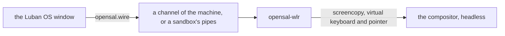

# The Desktop and the Luban OS Window

**English** | [简体中文](../zh/luban/08-desktop.md)

Luban OS is also a window: `luban-os` shows the environments of this home, then
one of them as a display shows a system — its console, or its desktop when it
has one. Everything else is in its management panel. The window runs nothing
the `luban` command could not: each thing it does is a `luban` command.

## Install and open it

```bash
xlings install luban-os          # the app, with its desktop entry
luban new desk --edition desktop # an environment with a desktop
luban enter desk --display window
```

`luban-os` opens on the list of environments; the default one is entered after a
countdown (10 seconds; any key or click stops it). With no environment yet it
opens on quick start: nano, tiny, core or desktop, a name, and one button that
makes it and goes in, showing each step as it happens.

## The window

| | |
|---|---|
| a list | the environments, the default first, then by when each was used last |
| the system | its console, or its desktop: the window is its screen |
| the Host key | Ctrl+Alt pressed and released alone (Ctrl+Option on macOS): the menu — back to the list, manage, full screen, a new window, power off |
| F2 or the gear | the management panel: every environment, its settings, what happened (`xlings self log`) |
| closing it on a machine | asks each time: keep it running or power it off — or confirm and make that the environment's default (`luban config desk --on-close background`) |

The title bar says what the Host key does now. Each window is one process; a new
window shows another environment, or the same one again.

## Desktops

A desktop is a session the environment declares the freedesktop way: a file in
`share/wayland-sessions/`, with one key of opensal's.

```ini
[Desktop Entry]
Name=Luban Desktop (labwc)
Exec=labwc
X-Opensal-Interfaces=surface pointer keyboard mode
```

The `desktop` edition brings `labwc-desktop`: labwc with a panel, a launcher
(fuzzel), a terminal (foot), Xwayland and fonts for Latin and CJK text, in one
tree that needs nothing of the root but its kernel. Alt+Return (or Super+Return)
opens a terminal; a click on the background opens the menu.

```bash
luban config desk --desktop labwc-desktop   # which session it starts
luban config desk --desktop none            # its console instead
```

Without a setting, the first session the root declares is started.

## Your own desktop

On nano, tiny or core, install a compositor and declare its session. Any
compositor that has the wlroots protocols is shown in the window: screencopy
(the picture), virtual keyboard and virtual pointer (the input), and output
management (the window's size). The bridge between them, opensal-wlr, speaks
only those standard protocols; it is part of luban and starts with the session.

```bash
xlings install --subos box labwc-desktop
luban config box --desktop labwc-desktop
```

## How it runs



- **As a machine** (`luban config desk --mode machine`, the desktop edition's
  default): the machine's agent starts the session headless, with software
  rendering, and bridges it on a channel of the machine. A machine's `/run` and
  `/tmp` are its own and go when it stops.
- **In a sandbox**: the same session, started with `xlings subos use desk --cmd`,
  bridged on two pipes. The desktop is the same; only where it runs differs.
- The window asks for its own size; the compositor's output follows it.
- Sound: with the `audio` grant a machine's Pulse clients reach this host's
  PipeWire or PulseAudio ([Environments](03-environments.md)).
- A machine keeps the log of its sessions in its own `/var/log/luban/desktop.log`.

## What it does not do yet

- The input method of the host on Linux, and the host's clipboard inside the
  desktop.
- A GPU: rendering is in software, the same on every host.
- The window on Linux needs X11 (Xwayland counts); a native Wayland window, and
  the window on macOS and Windows, are not supported yet.
- The experimental desktop line (`desktop-xdesk`): it is not published.
