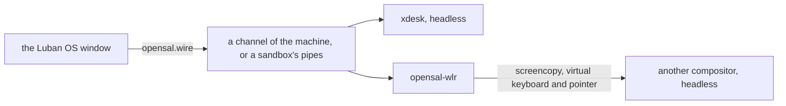

# The Desktop and the Luban OS Window

**English** | [简体中文](../zh/luban/08-desktop.md)

Luban OS is also a window: `luban-os` shows the environments of this home, then
one of them as a display shows a system — its console, or its desktop when it
has one. Everything else is in its management panel. The window runs nothing
the `luban` command could not: each thing it does is a `luban` command.

## Install and open it

```bash
xlings install luban-os          # the app, with its desktop entry
luban new desk --edition desktop # an environment with a desktop
luban enter desk --display window
```

`luban-os` opens on the list of environments; the default one is entered after a
countdown (10 seconds; any key or click stops it).

## The first time: quick start

With no environment yet the window opens on quick start, in two groups:

| | |
|---|---|
| **Console** — small, yours to shape | `nano` (xlings and luban only: the base an edition of your own is built on; it has no shell, so it is made without going in), `tiny` (a shell and the basic tools), `core` (a console to develop in, chosen by default) |
| **Desktop** — ready to use | `Classic desktop` (preview, recommended: windows side by side, a panel, a launcher) and `xdesk canvas` (to explore: windows on an infinite canvas) |

Each card says what it is; the line under the cards says what is in the chosen
one, or why it cannot be made here — not published yet, not built for this
machine's architecture, or a computer that cannot run Luban systems yet (what
`luban status` says: the reason and the next step). A name follows the edition until you type
your own; **More options** chooses sandbox or machine. One button makes it,
showing each step, and goes in.

**Import** a system someone exported (`luban export box box.luban`) from the
quick start's link, the list's last row, or by dropping the `.luban` file on the
window. The preview shows its edition, packages and isolation, and lists in
plain words what it may do beyond a new system (a clipboard grant, a host
mount, no isolation preset); that is agreed to before it is imported.

When a session ends with a failure, the window says what it said last and its
exit code, instead of only "off".

## The window

| | |
|---|---|
| a list | the environments, the default first, then by when each was used last; then a new one, and one from a file |
| the system | its console, or its desktop: the window is its screen |
| the Host key | Ctrl+Alt pressed and released alone (Ctrl+Option on macOS): the menu — back to the list, manage, full screen, a new window, power off |
| F2 or the gear | the management panel: every environment, its settings, what happened (`xlings self log`) |
| closing it on a machine | asks each time: keep it running or power it off — or confirm and make that the environment's default (`luban config desk --on-close background`) |

## xdesk

The desktop editions start **xdesk**, a desktop made for this window: a
compositor and its shell in one program (wlroots, rendering in software), which
speaks to the window directly — no bridge, no screen capture. It has two
profiles:

| | `xdesk-classic` (`desktop`) | `xdesk-canvas` (`desktop-xdesk`) |
|---|---|---|
| windows | side by side; one or two share the screen, more scroll with the focused one in view | where you put them, on a canvas that pans and zooms |
| the shell | a panel across the top: applications, workspaces, the focused window's title, a clock | a pill at the bottom: applications, workspaces, the zoom, the overview |

| Keys (Super, or Alt where the host keeps Super) | |
|---|---|
| Return | a terminal (foot) |
| Space or D | the launcher: type to search the installed applications, Enter starts one |
| Q | close the focused window |
| arrows or H J K L | focus that way; with Shift, move the window that way |
| 1 … 4 | a workspace; with Shift, send the window there |
| F | float or tile the focused window |
| R | classic: the column's width (a third, a half, two thirds, all) |
| O | canvas: the overview (everything at once); a click goes in to a window |
| Tab | Alt+Tab: the window used before |

On the canvas, drag the background (or anywhere with Super) to pan; the wheel
on the background (or anywhere with Super) zooms around the pointer, so what is
under it stays put. The overview leaves you exactly where you were; a click in
it goes in to that window. A window moves by its title bar, and title bars
have a close button.

The input method of the host types into the desktop's windows (what it
composes is shown there), and the clipboard is shared — each way as far as
the environment's grants allow: `clipboard` (copying out of it) and
`clipboard-paste` (pasting into it); an environment made before policies
shares both.

### Settings

xdesk reads `<profile>.ini` (`classic.ini`, `canvas.ini`): its own defaults,
then a system's `/etc/xdg/xdesk/`, then yours in `~/.config/xdesk/`, each later
one winning key by key.

```ini
[desktop]
terminal = foot
autostart = foot
gap = 8
workspaces = 4

[theme]
accent = #5e9cff
background = #1b1e25

[keyboard]
layout = us        # another xkb layout needs xkeyboard-config
repeat_rate = 30
repeat_delay = 500
```

A line it cannot read is logged and skipped; the desktop still starts.

## Desktops

A desktop is a session the environment declares the freedesktop way: a file in
`share/wayland-sessions/`, with keys of opensal's.

```ini
[Desktop Entry]
Name=xdesk (classic)
Exec=xdesk --profile classic
X-Opensal-Native=true
X-Opensal-Interfaces=surface pointer keyboard mode
```

`X-Opensal-Native=true` says the program speaks to the window itself (xdesk);
any other compositor is shown through opensal-wlr (below). The desktop
editions also bring `labwc-desktop` — labwc with a panel, a launcher, a
terminal, Xwayland and fonts — as another session.

```bash
luban config desk --desktop xdesk-canvas    # which session it starts
luban config desk --desktop labwc-desktop
luban config desk --desktop none            # its console instead
```

Without a setting, the edition's session is started (the first the root
declares, when it names none).

## What a desktop edition is ready with

`desktop` and `desktop-xdesk` are core and a desktop, and the tools people
reach for: node, python (with uv), bun, ripgrep, fd, fzf, jq, tmux, htop, and
the agents claude, codex, pi and opencode (dsh on x86_64). git defaults to
`main`; npm, pip, uv and bun use registries near you when xlings uses its CN
mirror (whatever you set yourself wins). No credentials are in it. On aarch64
the desktop edition starts labwc until xdesk is released there, and the canvas
edition says it is not built for it.

## Your own desktop

On nano, tiny or core, install a compositor and declare its session. Any
compositor that has the wlroots protocols is shown in the window: screencopy
(the picture), virtual keyboard and virtual pointer (the input), and output
management (the window's size). The bridge between them, opensal-wlr, speaks
only those standard protocols; it is part of luban and starts with the session.

```bash
xlings install --subos box xdesk            # or labwc-desktop
luban config box --desktop xdesk-classic
```

## How it runs



- **As a machine** (`luban config desk --mode machine`, the desktop editions'
  default): the machine's agent starts the session headless, with software
  rendering, on a channel of the machine. A machine's `/run` and `/tmp` are its
  own and go when it stops.
- **In a sandbox**: the same session, started with `xlings subos use desk --cmd`,
  on two pipes. The desktop is the same; only where it runs differs.
- The window asks for its own size; the desktop follows it. It sends the next
  picture only once the window has shown the last, so a slow channel does not
  pile pictures up.
- Sound: with the `audio` grant a machine's Pulse clients reach this host's
  PipeWire or PulseAudio ([Environments](03-environments.md)).
- A machine keeps the log of its sessions in its own `/var/log/luban/desktop.log`.

## What it does not do yet

- A GPU: rendering is in software, the same on every host.
- X11 programs in xdesk (Xwayland); they run in the labwc session.
- The window on Linux needs X11 (Xwayland counts); a native Wayland window is
  not supported yet. On macOS and Windows the window shows a system's console
  and desktop, as a sandbox or as a machine, from the Luban host machine.
- xdesk on aarch64.
