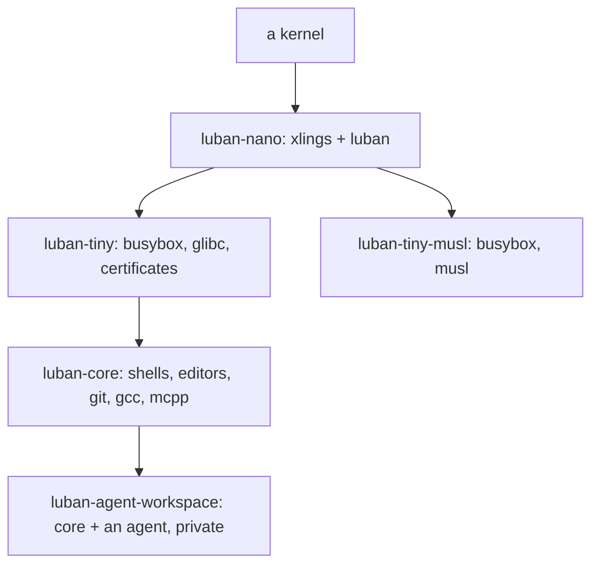

# Luban

**English** | [简体中文](../zh/luban/README.md)

Luban is the smallest operating system model that holds together: a kernel, and
on top of it only two things that must be there — **xlings** (packages) and
**luban** (the system). Everything else is chosen: the libc, the init, the tools,
the policy. The same environment runs on your machine as a sandbox, becomes an
image, and boots a machine.

## The model

An **edition** is a template: a list of packages, a policy, how it boots. Each
starts `from` the one below it, and each version is dated and never changes once
published. An **environment** is made from an edition and then lives its own
life: install into it, roll it back, move it to the edition's newest.

## luban and xlings

`luban` is one implementation over xlings, not a second one. Each environment
command is the xlings command it names — `luban <command> --help` says which —
and installing software stays `xlings install`. What luban adds is what exists
only when an environment is a system: editions by name, images, drives, the
machine's boot.

## What runs where

| | x86_64 Linux | aarch64 Linux | macOS | Windows |
|---|---|---|---|---|
| environments (nano, tiny, tiny-musl, core, agent-workspace) | yes | yes | through `vz` (not yet published) | through `wsl2` |
| the private agent workspace | yes | yes | — | through `wsl2` |
| images: ISO, drive, qcow2, tar | yes | yes | — | — |
| boot: BIOS and UEFI | yes | UEFI | — | — |
| `luban try` (a local VM) | yes | yes (emulated without KVM) | — | — |
| boot profiles | `generic` (machines), `virt` (VMs) | `virt` | — | — |

On the host, Linux needs nothing but its kernel and, on Ubuntu 23.10 and later,
a one-time setup ([07](07-host-support.md)); every tool an image or a VM needs
comes from the index.

## Read in this order

- [00 — What Luban Is](00-what-luban-is.md) — the model, and what it is for
- [01 — Getting Started](01-getting-started.md) — make, enter, run, list
- [02 — Editions](02-editions.md) — what each has, and how a version is chosen
- [03 — Environments](03-environments.md) — settings, grants, upgrade, rollback
- [04 — The Agent Workspace](04-agent-workspace.md) — a private place for an agent
- [05 — Images](05-images.md) — ISO, drive, qcow2, tar; boot profiles; `try`; writing a drive
- [06 — The Machine](06-machine.md) — Luban as a machine's system: stage-0, boot entries, rollback at boot
- [07 — Host Support](07-host-support.md) — which hosts, the one-time setup, what to do when it fails
- [91 — Architecture](91-architecture.md) — for developers: how it is built

Every luban command and option: [the generated reference](../generated/luban-command-reference.md).
Writing an edition: the index's [Luban packages](https://github.com/openxlings/xim-pkgindex/blob/main/docs/12-luban-packages.md).
