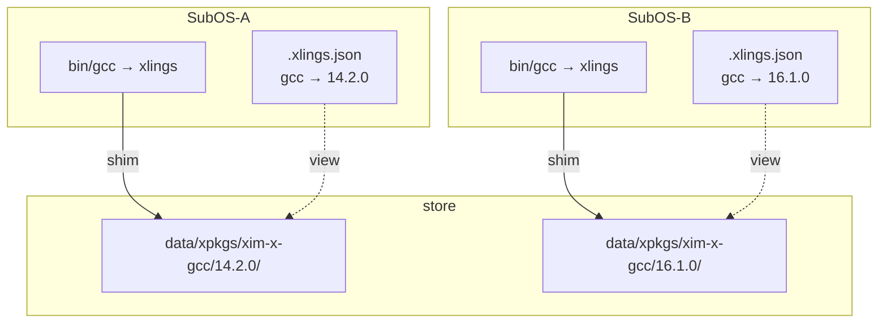

# 包与版本

[English](../03-packages-and-versions.md) | **简体中文**

同一工具的任意多个版本并存；每个环境（SubOS）各自选择活跃版本，payload 只存一份并共享。

## 安装指定版本

```bash
xlings install gcc@14.2.0
xlings install gcc@16.1.0
```

多个版本并行安装，互不冲突。payload 位于 `~/.xlings/data/xpkgs/<namespace>-x-<package>/<version>/`，
例如 `xim-x-gcc/16.1.0/`。命名空间是包所属的索引（官方索引为 `xim`），它同时出现在目录名和命令行坐标里。

## 切换活跃版本

```bash
xlings use gcc 14.2.0
xlings use gcc@14.2.0     # the same
```

切换后，这个环境里的 `gcc` 就是 14.2.0。属于一个发布组的包（gcc 提供 `gcc`、`g++`、`cpp` 等）整组一起切换。

**新版本没有的程序会被点名。** 如果旧 release 注册了 `gcc-ar` 而新的没有，它继续指向你离开的那个 release，`use` 会说出来：

```text
[xlings] gcc -> 16.1.0
[warn] 1 program(s) are not part of gcc@16.1.0 and still resolve to the release you switched away from:
[warn]     gcc-ar (still 14.2.0)
```

`--strict` 拒绝这种切换，不做任何改动。

### 省略版本号：确定就执行，有歧义就列出

`xlings use <name>` 不带版本时从不弹出交互选择框：

| 当前 SubOS 已安装的版本数 | 行为 | 退出码 |
|---|---|:---:|
| 1 | 直接切换到它 | 0 |
| 多于 1 | 不做改动，列出候选并给出确切命令 | 0 |
| 0 | 报错，并给出安装命令 | 1 |

```bash
xlings use gcc            # one installed: switched; several: listed
xlings use gcc --all      # the candidates of every SubOS
```

多个候选时返回 0：不写版本是在提问，命令已经回答了。要切换就写出版本号。

### `use` 只在已安装的版本之间切换

`xlings use <name> <version>` 要求这个版本**在当前 SubOS 里装过**；新的 SubOS 里即使别的 SubOS 装过同一版本，
它也会拒绝并指向 `install`。只有 `install` 会解析并安装依赖——一个没带上 glibc 就被激活的 gcc 能运行、却编译不了。

### 坐标写法：命名空间在最前面

其他索引的包写成 `<namespace>:<package>@<version>`：

```bash
xlings install local:mcpp@0.0.27
xlings install fromsource:freetype@2.13.2
```

`mcpp@local:0.0.27` 会被解析成一个叫 `local:0.0.27` 的版本号。`use` 的版本参数用版本数据库里的写法：

```bash
xlings use freetype fromsource:2.13.2
```

### 查看已安装的包

```bash
xlings list
```

## 工作原理

### Shim

SubOS 的 `bin/` 里每个程序一个链接，指向 xlings 二进制本身。以 `gcc` 的名字运行时，xlings 读出自己的名字，
在 SubOS 的 workspace 里查到活跃版本，运行该版本 payload 中的程序。

### 版本视图与引用计数

所有 SubOS 共享 `~/.xlings/data/xpkgs/` 里的 payload，各自只记录自己的视图。最后一个使用者放手时 payload 才被删除。

### 重复安装与 `--reconfig`

store 里的 payload 在每个环境里配置一次：注册命令、建立 sysroot 链接、记录环境声明。每个环境的 `.xlings.json`
记下哪些包已按哪个配方 revision 配置过：

```bash
xlings install chatgpt          # downloads, installs and configures the closure
xlings install chatgpt          # installed and configured here: nothing runs again
xlings install chatgpt --reconfig   # configure the whole closure again
```

以下情况会自动重新配置：在另一个 SubOS 里第一次安装；配方提升了 `revision`；在本环境 `remove` 后再装回来。
环境被弄坏时用 `--reconfig` 或 `xlings self doctor --fix` 修复。

### 示意图



### 本地配方（`--add-xpkg`）

`xlings config --add-xpkg <file>` 把配方复制进本地 overlay 索引，之后它就和其他包一样安装：

```bash
xlings config --add-xpkg ./mypkg.lua
xlings install mypkg@1.0.0
```

```bash
xlings config --list-xpkg              # every recipe in the local overlay
xlings config --remove-xpkg mypkg      # one of them
xlings config --clear-xpkg all         # all of them
xlings config --clear-xpkg stale       # those the index has caught up with
```

`--list-xpkg` 说明每条与已同步索引的关系：`unique`（只有这里有）、`identical`（索引里字节相同）、`modified`、
`behind`（索引里版本更新）。`stale` 指 `identical` 与 `behind`；`xlings update` 会自动删除 `identical` 的副本。

## 跨 SubOS

每个 SubOS 有自己的 workspace（`.xlings.json`）：在一个里 `use` 不影响另一个，同一条命令在两边可能运行不同版本。

```bash
xlings subos new dev-legacy
xlings subos new dev-latest
xlings install gcc@14.2.0 --subos dev-legacy
xlings install gcc@16.1.0 --subos dev-latest
xlings subos exec dev-legacy -- gcc --version    # 14.2.0
xlings subos exec dev-latest -- gcc --version    # 16.1.0
```

## 卸载

`xlings remove <package>` 作用于当前 SubOS 的活跃版本：

- `--all` —— 它的每一个已安装版本
- `--all-subos` —— 每一个装了它的 SubOS
- `--subos <NAME>` —— 指定的那个 SubOS

```bash
xlings remove gcc --all-subos
xlings remove gcc --subos probe
```

仍被其他环境使用的 payload 会保留。

## 平台

包能否装在你的机器上由配方决定：配方按架构列出产物且其中没有你的架构时，下载之前就被拒绝。
Linux x86_64 与 aarch64 覆盖最完整；macOS 与 Windows 上一些配方发布的产物较少。
