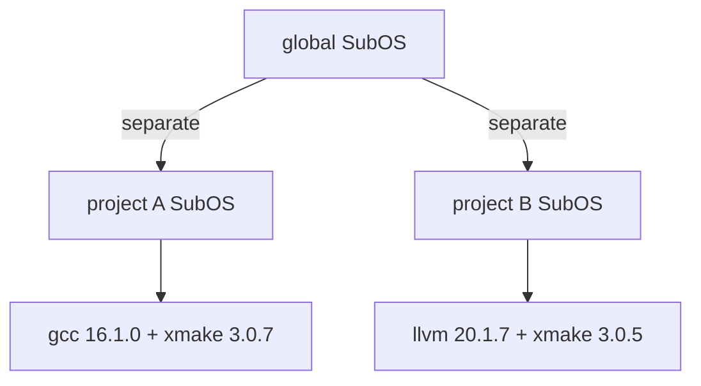

# 项目

[English](../04-projects.md) | **简体中文**

一个项目有自己的环境：它声明的工具链装进它自己的 SubOS，全局环境和其他项目都看不到。

## 思路



有 `.xlings.json` 的目录是项目根。在其中（或其子目录里）xlings 使用项目的 SubOS；离开后使用全局的。

## `.xlings.json`

```json
{
  "workspace": {
    "xmake": "3.0.7",
    "gcc": { "linux": "16.1.0" },
    "llvm": { "macosx": "20.1.7", "windows": "19.1.0" }
  }
}
```

| 字段 | 含义 |
|---|---|
| `workspace` | 项目使用的包及其版本 |
| `"pkg": "ver"` | 所有平台同一版本 |
| `"pkg": {"linux": "ver", …}` | 按平台指定版本（`linux`、`macosx`、`windows`）；其他平台跳过 |
| `subos`（可选） | 使用一个命名的 SubOS，而不是项目自己的 |

全部字段见 [`.xlings.json` 规范](../specs/xlings-json.md)。

## SubOS 模式

| 模式 | 方式 | 位置 |
|---|---|---|
| 匿名 | 不写 `subos` | 项目里的 `.xlings/subos/_/` |
| 命名 | `"subos": "<name>"` | home 里的 SubOS，与其他同名引用者共享 |

## 工作流

```bash
cat > .xlings.json << 'EOF'
{ "workspace": { "xmake": "3.0.7", "gcc": { "linux": "16.1.0" } } }
EOF
xlings install      # installs what the project declares
xmake build         # the project's toolchain is on PATH here
```

## 与全局环境的关系

- 项目声明的在项目里优先。
- 项目没声明的来自全局 SubOS。
- 在项目里 `xlings install <pkg>` 装进项目。

## 常见用法

- **两个项目，两个编译器**——一个用 gcc 14，一个用 gcc 16，并存。
- **团队**——`.xlings.json` 纳入版本控制；克隆后 `xlings install`，每个人得到相同的版本。
- **CI**——流水线用同一个文件，构建所用的就是开发者所用的。
