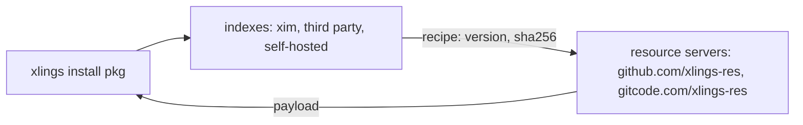

# 索引与镜像

[English](../05-indexes-and-mirrors.md) | **简体中文**

包来自索引——配方的仓库——payload 来自资源服务器。两者都有 GitHub 和 GitCode（中国大陆）两个地址。

## 索引

| 类别 | 是什么 | 命名空间示例 |
|---|---|---|
| 官方 | `openxlings/xim-pkgindex`，内置 | `xim` |
| 子索引 | 官方索引声明的索引 | `awesome`、`scode`、`d2x` |
| 第三方 | 社区或组织维护的 | `community` |
| 自托管 | 本地路径或私有 Git 仓库 | `internal` |



## 添加索引

```bash
xlings config --index-repo myteam:https://git.example.com/team/pkgindex.git
xlings update
xlings install myteam:tool@2.3.1
xlings config --rm-index-repo myteam
```

或写在 `.xlings.json`（home 或项目）里：

```json
{
  "index_repos": [
    { "name": "myteam", "url": "https://git.example.com/team/pkgindex.git" },
    { "name": "local-dev", "url": "/home/user/my-local-index" }
  ]
}
```

- `name`——索引的命名空间、它的目录、以及它下载哪一份索引：三者是同一件事，所以 `data/<name>` 只装这个索引。
- `url`——Git 远程地址，或本地路径（支持 `file:///` 和相对路径）。
- 各条目是平级的，顺序不影响任何行为。

### 以 artifact 发布的索引

索引可以像官方索引一样把快照发布为 artifact（指针加按 sha256 校验的 tarball）；下载 artifact 比 Git 同步更快、更稳，
Git 作为回退：

```json
{
  "index_repos": [
    { "name": "mcpplibs", "url": "https://github.com/mcpp-community/mcpp-index.git",
      "artifact": { "GLOBAL": "https://github.com/xlings-res/mcpp-index",
                    "CN": "https://gitcode.com/xlings-res/mcpp-index" },
      "source": "auto" }
  ]
}
```

- `artifact`——一个 base（GitHub/GitCode 仓库、静态 HTTP 目录、本地目录），或每个区域一个。区域是一条候选链：
  当前镜像的区域在前，然后是 GLOBAL，再是其余区域；全部失败才走 Git。
- `source`——`auto`（先 artifact 后 Git）、`artifact`（只用 artifact）、`git`（只用 Git）。

```console
$ xlings index list
  ◆ mcpplibs
    artifact: https://gitcode.com/xlings-res/mcpp-index  [CN]
         then: https://github.com/xlings-res/mcpp-index  [GLOBAL]
```

发布方需要提供什么，见 [31](31-hosting-an-index.md) 与 [specs/index-distribution](../specs/index-distribution.md)。

### 由其他程序持有的索引

自己维护索引的程序（mcpp 的 `mcpplibs`）指定索引数据与 payload 的位置，xlings 在那里拉取与安装：

```json
{ "name": "mcpplibs", "url": "...", "dir": "/home/u/.mcpp/indices/mcpplibs", "store": "/home/u/.mcpp/xpkgs" }
```

这类索引也由该程序刷新（`sync_index`），以便在替换正在使用的副本之前检查新副本；`xlings update` 只在它尚不存在时拉取。

home 还可以从只读的**上游**安装：另一个 home 中身份一致的 payload 以链接条目发布，不复制、不写入
（`upstreams`，见 [specs/xlings-json](../specs/xlings-json.md)）。

### 固定一个快照

```bash
xlings index list xim          # the published snapshots
xlings index use xim 2026.10.11.1
```

## 镜像

```bash
xlings config --mirror CN       # GitCode first
xlings config --mirror GLOBAL   # GitHub first
```

| 名称 | 地址 | 适用 |
|---|---|---|
| GLOBAL | github.com/xlings-res | 全球 |
| CN | gitcode.com/xlings-res | 中国大陆 |

在一个区域下载失败会去另一个区域重试。下载失败时会说明是谁的问题：源（字节不对、HTTP 错误——换下一个候选）、
传输（超时、读不全——重试）、还是本机（磁盘满——不再尝试其他候选，也不怪罪任何一方）。

区域决定 xlings 自己的资源从哪里取。配方中的 GitHub 地址（发布资产、原始文件、源码归档、git 源）另行处理：候选是
该地址本身与第三方 GitHub 代理（原始文件不超过 50 MB 时的 `cdn.jsdelivr.net`、`ghfast.top`、`ghproxy.net`、
`kkgithub.com`；`~/.xlings/data/github-mirrors.json` 替换这份列表）。配方写明归档的 sha256 时，候选按测得的连接
延迟排序，因此在任一区域代理都可能排在最前；没有 sha256 时地址本身保持在最前。传输停滞的主机在本进程余下的时间里
排到最后。包索引从不经代理获取。`.xlings.json` 的 `mirror_fallback`（或 `XLINGS_MIRROR_FALLBACK`）设定这一行为：
`auto`（缺省）、`off`（只用配方的地址）、`force`（只用代理）。

## 归档的来源与没有网络的机器

一个归档的身份是其配方给出的 sha256，而不是它的 URL 或文件名。每次下载按顺序询问各来源，第一个字节具有该摘要的文件经校验后，
按下载所得的文件安装：

1. 下载缓存（`data/runtimedir`，以 URL 的文件名存放的文件）；
2. `install --from <dir>` 的目录；
3. `XLINGS_ARCHIVES` 中的目录（分隔方式与 `PATH` 相同）；
4. `.xlings.json` 的 `archives` 中的目录；
5. 网络：配方的 URL 与上述镜像。

### 归档目录

```bash
xlings config --add-archives /mnt/archives
xlings config --rm-archives /mnt/archives
```

归档目录中的文件可以使用任意名字、位于任意层级。xlings 在 home 中为每个目录保存 sha256 的索引，按路径、大小与修改时间记录，
因此一个文件只计算一次，改变之后才再次计算。字节不具有所给摘要的文件，无论叫什么名字，都不会被采用。

### Bundle

```bash
xlings download gcc@16.1.0 --to ./bundle --with-index   # on a machine with a network
xlings install --from ./bundle gcc@16.1.0               # on the machine without one
```

`download` 把这些包的依赖闭包在本宿主上下载的每个归档（`--host <os>-<arch>` 指定另一个宿主，例如 `windows-x86_64`）
写入 `archives/<sha256>-<文件名>`；给出 `--with-index` 时，把解析出它们的每个索引的快照写入 `index/<name>`；并写出清单
`bundle.toml`。在 Linux 上，闭包包含 `xim:patchelf`，没有 patchelf 的宿主上的安装会先安装它。已含有 bundle 的目录会被扩充：
归档与快照被加入或替换，清单中 xlings 不认识的表被保留。

`install --from` 使 bundle 成为第一个归档目录，并使其中的快照成为这条命令唯一的索引：解析时不获取任何索引，
也不读取 home 自己的索引。bundle 缺少的归档仍会被下载，除非不使用网络（见下）。没有快照的目录只是一个归档目录，由 home 的索引解析。对于没有给出 sha256 的配方，清单为该包、
版本与宿主记录的 sha256 即是归档的身份。清单及其规则见 [specs/bundle](../specs/bundle.md)；目录与环境变量见
[specs/xlings-json](../specs/xlings-json.md)。

### 没有网络时

设置了 `XLINGS_NET_UNREACHABLE` 的进程不使用网络：xlings 在索引的 pointer 发现没有网络时设置它，调用者也可以事先设置它。
此时所有来源都没有的归档被一次列出，每个都给出包、版本、sha256 与 URL，并列出询问过的目录与提供它们的命令。
询问过网络而失败的下载由它的包报告一次，并给出失败的原因。

## 带命名空间的包

```bash
xlings install subos:py-ds@1.0.0
xlings install myteam:tool@2.3.1
xlings install gcc@14.2.0          # the official index: no namespace needed
```

配方里不带命名空间的依赖，指的是**配方所在索引**里的同名包；只有该索引没有这个名字时才按全局规则查找。

索引可以**保留**自己的命名空间（`index-compat.json`：`{"namespaces": {"reserved": ["xim", "luban"]}}`）：
别的索引在这些命名空间里发布的包不被采用，xlings 会指出那个索引的配方。官方索引保留 `xim`、`luban`、`subos`、`config`；
你自己的命名空间也可以这样保留。

## 命令

| 命令 | 作用 |
|---|---|
| `xlings update` | 刷新所有索引 |
| `xlings search <pkg>` | 跨索引搜索 |
| `xlings search --category <c>` | 某个分类下的包（`luban-desktop`：桌面） |
| `xlings info <pkg>` | 包的版本、平台、来源 |
| `xlings why <pkg>` | 依赖为什么解析到这个版本 |
| `xlings install <ns>:<pkg>@<ver>` | 安装指定索引的包 |
| `xlings download <pkg> --to <dir> --with-index` | 它的归档与索引，供没有网络的机器使用 |
| `xlings install --from <dir> <pkg>` | 从这样的目录安装 |
| `xlings config --add-archives <dir>` | 一个按内容取归档的目录 |
