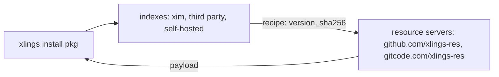

# 索引与镜像

[English](../05-indexes-and-mirrors.md) | **简体中文**

包来自索引——配方的仓库——payload 来自资源服务器。两者都有 GitHub 和 GitCode（中国大陆）两个地址。

## 索引

| 类别 | 是什么 | 命名空间示例 |
|---|---|---|
| 官方 | `openxlings/xim-pkgindex`，内置 | `xim` |
| 子索引 | 官方索引声明的索引 | `awesome`、`scode`、`d2x` |
| 第三方 | 社区或组织维护的 | `community` |
| 自托管 | 本地路径或私有 Git 仓库 | `internal` |



## 添加索引

```bash
xlings config --index-repo myteam:https://git.example.com/team/pkgindex.git
xlings update
xlings install myteam:tool@2.3.1
xlings config --rm-index-repo myteam
```

或写在 `.xlings.json`（home 或项目）里：

```json
{
  "index_repos": [
    { "name": "myteam", "url": "https://git.example.com/team/pkgindex.git" },
    { "name": "local-dev", "url": "/home/user/my-local-index" }
  ]
}
```

- `name`——索引的命名空间、它的目录、以及它下载哪一份索引：三者是同一件事，所以 `data/<name>` 只装这个索引。
- `url`——Git 远程地址，或本地路径（支持 `file:///` 和相对路径）。
- 各条目是平级的，顺序不影响任何行为。

### 以 artifact 发布的索引

索引可以像官方索引一样把快照发布为 artifact（指针加按 sha256 校验的 tarball）；下载 artifact 比 Git 同步更快、更稳，
Git 作为回退：

```json
{
  "index_repos": [
    { "name": "mcpplibs", "url": "https://github.com/mcpp-community/mcpp-index.git",
      "artifact": { "GLOBAL": "https://github.com/xlings-res/mcpp-index",
                    "CN": "https://gitcode.com/xlings-res/mcpp-index" },
      "source": "auto" }
  ]
}
```

- `artifact`——一个 base（GitHub/GitCode 仓库、静态 HTTP 目录、本地目录），或每个区域一个。区域是一条候选链：
  当前镜像的区域在前，然后是 GLOBAL，再是其余区域；全部失败才走 Git。
- `source`——`auto`（先 artifact 后 Git）、`artifact`（只用 artifact）、`git`（只用 Git）。

```console
$ xlings index list
  ◆ mcpplibs
    artifact: https://gitcode.com/xlings-res/mcpp-index  [CN]
         then: https://github.com/xlings-res/mcpp-index  [GLOBAL]
```

发布方需要提供什么，见 [31](31-hosting-an-index.md) 与 [specs/index-distribution](../specs/index-distribution.md)。

### 由其他程序持有的索引

自己维护索引的程序（mcpp 的 `mcpplibs`）指定索引数据与 payload 的位置，xlings 在那里拉取与安装：

```json
{ "name": "mcpplibs", "url": "...", "dir": "/home/u/.mcpp/indices/mcpplibs", "store": "/home/u/.mcpp/xpkgs" }
```

这类索引也由该程序刷新（`sync_index`），以便在替换正在使用的副本之前检查新副本；`xlings update` 只在它尚不存在时拉取。

home 还可以从只读的**上游**安装：另一个 home 中身份一致的 payload 以链接条目发布，不复制、不写入
（`upstreams`，见 [specs/xlings-json](../specs/xlings-json.md)）。

### 固定一个快照

```bash
xlings index list xim          # the published snapshots
xlings index use xim 2026.10.11.1
```

## 镜像

```bash
xlings config --mirror CN       # GitCode first
xlings config --mirror GLOBAL   # GitHub first
```

| 名称 | 地址 | 适用 |
|---|---|---|
| GLOBAL | github.com/xlings-res | 全球 |
| CN | gitcode.com/xlings-res | 中国大陆 |

在一个区域下载失败会去另一个区域重试。下载失败时会说明是谁的问题：源（字节不对、HTTP 错误——换下一个候选）、
传输（超时、读不全——重试）、还是本机（磁盘满——不再尝试其他候选，也不怪罪任何一方）。

## 带命名空间的包

```bash
xlings install subos:py-ds@1.0.0
xlings install myteam:tool@2.3.1
xlings install gcc@14.2.0          # the official index: no namespace needed
```

配方里不带命名空间的依赖，指的是**配方所在索引**里的同名包；只有该索引没有这个名字时才按全局规则查找。

## 命令

| 命令 | 作用 |
|---|---|
| `xlings update` | 刷新所有索引 |
| `xlings search <pkg>` | 跨索引搜索 |
| `xlings info <pkg>` | 包的版本、平台、来源 |
| `xlings why <pkg>` | 依赖为什么解析到这个版本 |
| `xlings install <ns>:<pkg>@<ver>` | 安装指定索引的包 |
