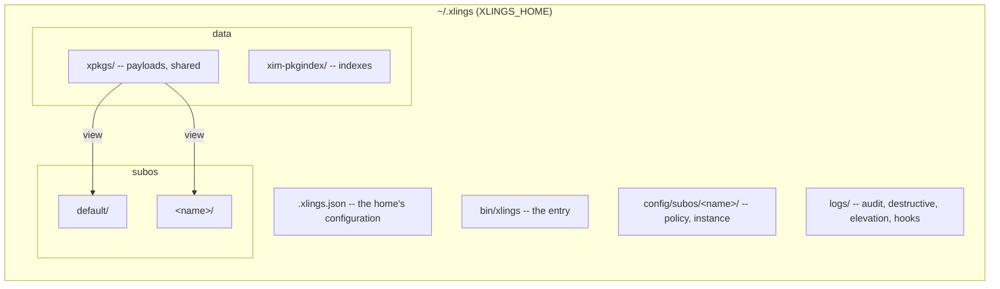

# 架构

[English](../91-architecture.md) | **简体中文**

xlings 是一个用 C++23 模块写成的静态二进制。本章是它的地图：由哪些包构成、东西放在哪里、安装和 SubOS 在内部怎样工作。

## 包

```text
modules/            linked into xlings, one per responsibility
  libs/             json, sha256, tinyhttps -- nothing of xlings
  runtime/          cancellation, guard (confirmation tokens), observe (audit, redaction)
  platform/         the OS boundary: every system header and call
  i18n/             the i18n mechanism: tr, the language, catalogues by domain, pick, the glossary
  ui/               theme, xlings' catalogues
  cli/              the command model: one declared tree, help by level, completion
  home/             the home: its format (layout, steps) and its payload store (GC roots, the retained ledger)
  subos/            the SubOS core: model, policy, intent, sandbox, views, session
  confine/          sandbox implementations (bwrap, proot, landlock, home redirect)
  carrier/          where a SubOS runs: local, wsl2, vz
luban/              Luban OS: specs/ (contracts), kits/ (reusable components), xdesk/ (the desktop:
                    base, layout, compositor, app), apps/ (programs in a system), os/ (system, service,
                    vm, cli, compat, window)
apps/               programs on the host: luban (and stage-0 as luban-init), luban-os, gui, xdev
src/                the frontend: cli, interface, core (config, xim, xvm, xself, subos)
```

各层只向下依赖：`luban/` 使用 `modules/`；`modules/` 从不使用 `luban` 或前端。系统头文件和系统调用只在
`modules/platform` 里；平台用 `if constexpr` 选择，所以每次构建都会编译每个分支。这些是构建规则（`tools/lint_*.sh`），不是约定。

## 数据布局



## 安装一个包

```mermaid
sequenceDiagram
    participant U as user or agent
    participant R as resolver
    participant D as downloader
    participant I as installer
    participant V as xvm
    U->>R: xlings install gcc@16
    R->>R: the dependency graph, in order
    R->>D: what to fetch
    D->>D: parallel downloads, sha256 checked, failures attributed
    D->>I: archives
    I->>I: by type (package, script, subos); extract; install hook
    I->>V: register versions and programs; configure once per scope
    V->>U: done
```

配方的钩子在一个常驻 Lua worker 里运行；Linux 上有强边界时，只有目标 payload、scratch 和该钩子的日志可写。
每个钩子执行的命令写到 `<home>/logs/hooks/<pkg>.<hook>.log`。

## 版本：数据库、workspace、shim

| | |
|---|---|
| 版本数据库 | 每个目标（程序或库）：已注册的版本、路径、同一发布组成员之间的绑定 |
| workspace | 按作用域（项目 > SubOS > 全局）：每个目标的活跃版本，以及那里装了什么 |
| shim | `bin/<program>` 是指向 xlings 的链接；以某个程序名运行时，它查到活跃版本并从 payload 运行它 |

在某个作用域里没有安装的版本，在那里不可见，即使数据库知道它。shim 表是只有一个写入者的派生表，每次 install、use、remove 时由 workspace 重建。

## SubOS：内容、视图、承载

| | |
|---|---|
| 内容 | workspace、home、策略（`config/subos/<name>/policy.json`，在实例之外） |
| 视图 | 进程怎样看到它：PATH 叠加；沙箱（策略 → intent → 后端的 argv）；根（`/usr` 是一代链接）；机器（stage-0） |
| 承载 | 它在哪里运行：本机、这个 home 专属的 WSL2 发行版、虚拟机 |

沙箱里 xlings 在本地读，把写操作（`install`、`remove`、`update`）交给外面的 broker，由同一份策略判定。
会话在沙箱外被托管；审计写在沙箱看不到的地方。

能对一个 SubOS 做什么由一张表决定（`roles::check(op, kind, role)`）：正在运行的宿主不能删除，启动项不能删除，视图没有可导出的根。

## 代码地图

| 位置 | 内容 |
|---|---|
| `modules/subos/src/` | `model/`、`policy/`、`intent/`、`sandbox/`（spec、caps、工具表、elevation、network、gpu）、`views/root/`（代、库缓存）、`session/`（supervisor、session-init、broker） |
| `modules/confine/src/` | 各后端、选择器、平台矩阵（来自各后端自己的探测） |
| `modules/carrier/src/` | local、wsl2（及其一次性设置）、vz |
| `luban/src/` | `boot`（启动项）、`stage0`（第一个进程）、`machine`（/etc、sysusers）、`cli`、`image`（GPT、FAT、ISO、qcow2） |
| `src/core/subos/` | `subos` 命令：生命周期、承载路由、exec、config、审计、`root/`（投影、rollback、boot、export、pack） |
| `src/core/xim/` | 解析器、下载器、安装器、目录、索引 |
| `src/core/xvm/` | 版本数据库、workspace、shim |
| `src/core/xself/` | 自安装、升级、体检 |
| `tests/requirements.toml` | 每项行为的需求 ID；测试用 `covers` 认领 |

## 原则

1. **一个二进制**——没有运行时依赖；Linux 发布版是静态的。
2. **同一个 store 上的版本视图**——N 个环境，每个 payload 一份。
3. **派生表只有一个写入者**——shim 表、代、store 的根。
4. **读不出不等于空**——读不出的文件会阻止删除，而不是被当成"什么都没有"。
5. **用户数据只由用户删除**——SubOS 的 home，经询问和确认，并有记录。
6. **一切外部的东西来自索引**——或者来自操作系统本身（[51](51-supported-platforms.md)）。
