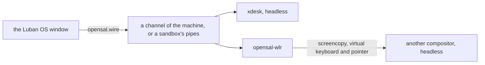

# 桌面与 Luban OS 窗口

[English](../../luban/08-desktop.md) | **简体中文**

Luban OS 也是一个窗口：`luban-os` 列出这个 home 的环境，然后像一台显示器一样显示其中一个系统——它的控制台，或者它有桌面时
显示它的桌面。其余的一切都在管理面板里。窗口做不了 `luban` 命令做不了的事：它做的每件事都是一条 `luban` 命令。

## 安装与打开

```bash
xlings install luban-os          # the app, with its desktop entry
luban new desk --edition desktop # an environment with a desktop
luban enter desk --display window
```

`luban-os` 打开时是环境列表；倒计时（10 秒；任意按键或点击停止）后进入默认的那个。

## 第一次：快速开始

还没有环境时，窗口打开快速开始（之后是**新建系统**），分四组：

| | |
|---|---|
| **控制台** — 精简，自己定制 | `nano`（只有 xlings 与 luban：自己定制 edition 的基础；没有 shell，因此只创建、不进入）、`tiny`（shell 与基础工具）、`tiny-musl`、`core`（开发用的控制台，默认选中）、`agent workspace` |
| **xdesk** — Luban 自己的桌面 | `xdesk 经典` 与 `xdesk 画布 · 探索`：为这个窗口做的桌面（见下文） |
| **传统桌面** — 轻 → 完整 | `luban-desktop` 类别里除 xdesk 外的每一个，按带来的多少排：Compositor（T1，只有窗口，Luban OS 窗口就是外壳）、labwc（T2）、LXQt（T3）、KDE Plasma（T4）；未分级的在最后 |
| **更多系统** | 窗口没有卡片的官方系统，以及你添加的 index 里的系统 |

传统桌面的卡片写出它带来多少（四格，`T1`–`T4`，或*未分级*）、来自哪里（*官方*、*社区 · 它的 index*、*本地*）、
有多稳定（*稳定*、*预览*；已弃用的不列出）、对 GPU 的期望（*GPU 更好*、*需要 GPU*）与版本。把指针停在名字上（Compositor、Wayland、T 级）
就会显示它的意思。选中一张，创建的系统与 `luban new <名字> --edition core --desktop <它>` 相同：**更多选项**可以改它的底座
（`tiny`、`core`、`desktop`），默认作为机器运行并进入桌面。面板写出它由哪两个版本组成（`系统 core 2026.10.19.1`、`桌面 LXQt 2.4.0`）——
显示的版本就是建出的版本；当前 xlings 太旧而用不了的更新版本会写在旁边。

←→ 在组内移动，↑↓ 换组，Enter 创建。读 index 时组里写*正在读 index…*；读不了时写明该怎么做（`xlings update`），不会显示成空组。

每张卡片写着它是什么；面板说明选中的那个里面有什么，或者为什么这里不能创建——尚未发布、没有本机架构的版本，
或者这台电脑暂时还不能运行 Luban 系统（`luban status` 给出的原因与下一步）。名字跟随卡片，直到你自己输入。
**更多选项**还选择沙箱或机器，以及（控制台与 xdesk）用哪个桌面创建。面板可以滚动，**创建**固定在底部。创建时显示六步——
准备、下载、解压、配置、自检、完成——当前一步的文字一直显示，然后进入。来自其他 index 的系统（或桌面）先经你同意才创建——Luban 不检查它做什么。

同样的内容也有文字版：`luban search`（发行版、按 T 级排列的桌面）、`luban ls <模式>`（这里名字匹配的系统）。

**导入**别人导出的系统（`luban export box box.luban`）：快速开始里的链接、列表的最后一行，或者把 `.luban` 文件拖进窗口。
预览显示它的 edition、软件包与隔离方式，并用平常的话列出它比新系统多能做的事（剪贴板授权、挂载宿主目录、没有隔离预设）；
同意之后才导入。它从文件里带的内容建出来：不需要网络。

会话以失败结束时，窗口显示它最后的输出与退出码，而不只是"已关机"。

## 窗口

| | |
|---|---|
| 列表 | 所有环境，默认的在最前，其余按上次使用时间排序；然后是新建，以及从文件导入 |
| 系统 | 它的控制台或桌面：窗口就是它的屏幕，标题为 `Luban OS (<系统名>)` |
| 键盘 | 窗口获得焦点时桌面锁定键盘：所有按键都给桌面，宿主自己的组合键也是。**Ctrl+Alt+K** 释放并重新锁定（菜单里也有）；设置 → *进入桌面时锁定键盘*可以关掉。锁定时 Emacs 的 `C-M-k` 用不了 |
| 指针 | 由这台电脑画，跟手、没有延迟：桌面要的形状（文本框的 I 形、链接的手形、边缘的双箭头），用 Luban 指针主题——在每个系统上都一样——或程序自己画的图像。锁定指针的游戏一直拿着它，直到 Ctrl+Alt+K |
| Host 键 | 单独按下再松开 Ctrl+Alt（macOS 上是 Ctrl+Option）：菜单——回到列表、管理、全屏、新窗口、键盘、关机 |
| F2 或齿轮 | 管理面板：所有环境、它们的设置、发生过什么（`xlings self log`） |
| 关闭机器的窗口 | 每次都会问：继续运行还是关机——或者确认并设为这个环境的默认（`luban config desk --on-close background`） |
| 拖到系统上的文件 | 复制到它登录用户的 `~/Downloads`，窗口说明放在哪里（`.luban` 文件则是导入） |
| Ctrl+= / Ctrl+- / Ctrl+0 | 控制台字号，按系统分别保存 |
| 控制台上的鼠标 | 接管鼠标的程序（vim、htop、tmux）收到鼠标；否则——或按住 Shift——拖动选择并复制，双击选词，三击选行，中键粘贴上次选中的内容，右键打开复制 / 粘贴，滚轮回看 |
| 进行中的操作 | 逐步显示各阶段；可以中止，失败的可以重试 |

每个窗口是一个独立的进程；另有一个进程 `luban-os __tray` 为所有窗口在系统状态栏里保留应用的图标：Linux 上是 StatusNotifierItem
（KDE、装有 AppIndicator 扩展的 GNOME，以及大多数其他桌面），Windows 上是通知区域，macOS 上是菜单栏。它的菜单列出运行中的系统
（打开、控制台、关机、管理）、新建系统、窗口、设置与退出；选中的项会把显示它的窗口带到前面，没有就打开一个。图标显示运行的数量，
以及是否有操作进行中或失败。关闭窗口就结束它——机器继续运行，图标保留——除非它正在创建什么：那时它隐藏、做完并通知。
退出只问一次（让系统继续运行，或全部关机），然后结束所有窗口。没有状态栏的地方，关闭窗口改为最小化。设置中的**常驻状态栏**让图标在没有系统运行时也保留。
装上更新版本的 Luban OS 后，图标自己换成新版本；还开着的窗口仍是旧版本，重新打开即是新版本。

窗口跟随屏幕的缩放。控制台自己绘制制表符与块字符，因此在任何字号下都能衔接。

## xdesk

桌面 edition 启动 **xdesk**：为这个窗口做的桌面，合成器与外壳在一个程序里（wlroots，软件渲染），直接与窗口通信——
不经桥、不截屏。

每个工作区用三种方式之一排布窗口，**Super+m** 切换：按住 Super 按 m——三张卡片显示这个工作区按每种方式排好的样子，再按 m 换下一个，
松开 Super 确定，Esc 保持原样。每种方式各自记住自己的摆法，平铺 → 画布 → 平铺回到同样的列。

| | |
|---|---|
| **平铺** | 窗口按列并排；一两个平分屏幕，更多时横向滚动，焦点窗口始终可见；一列里可以上下放多个 |
| **层叠** | 窗口放在哪里就在哪里，可以重叠，限制在屏幕内；可以最大化，或吸附到半屏、四分之一屏 |
| **画布** | 窗口在可平移、缩放的平面上；把一个窗口靠到另一个的边上，它们组成平铺组，作为整体移动与缩放 |

| 按键（Super，或宿主占用 Super 时用 Alt） | 平铺 | 层叠 | 画布 |
|---|---|---|---|
| 单按 Super、Space 或 D | 应用 | 同 | 同 |
| ←→ ↑↓（或 H J K L） | 相邻的列 / 列内 | 那个方向最近的窗口 | 同 |
| Shift+←→ ↑↓ | 移到相邻列 / 列内上下 | 半屏、四分之一屏、全屏、还原 | 移动四分之一视野 |
| [ / ] | 并进左边一列 / 拆出成单独一列 | — | 并进旁边的组 / 拆出 |
| R / Shift+R | 列宽（⅓、½、⅔、全宽）/ 列内高度（平分、⅔、⅓） | — | 组内同平铺 |
| - / = | 变窄 / 变宽 | 缩小 / 放大 | 缩小 / 放大视野 |
| F | 浮动，或放回 | 全屏，或还原 | 浮动，或放回 |
| Shift+T | 置顶 | 同 | 同，并固定在视野里 |
| M | 平铺、层叠、画布（按住） | 同 | 同 |
| Tab | 窗口（按住：Tab 下一个，松开即切过去） | 同 | 同 |
| O | — | — | 全览；点击一个窗口进入 |
| 1 … 4 / Shift+1 … 4 | 切换工作区 / 把窗口送过去 | 同 | 同 |
| Return 或 Ctrl+Alt+T / Q / / | 终端 / 关闭窗口 / 这张按键表 | 同 | 同 |

**Super+/** 显示这些按键，只列出当前排布下有意义的。第一次进入时底部会有一行提示。

拖动标题栏（按住 Super 时任何地方）移动窗口：它半透明地跟着指针，一个框显示它会落在哪里——一列里、另一个窗口的上方或下方、
它的位置、屏幕边缘（新的第一列或最后一列；层叠：半屏、四分之一屏、全屏）、画布上另一个窗口旁（组）。在新列上停一下，会提供宽度选项
（⅓、½、⅔、全宽）；松开后它滑过去。拖动时按住 Shift：在松开的地方浮动。拖动两列之间的缝隙同时调整两边；双击缝隙恢复平分。
把指针停在标题栏的最大化按钮上，会弹出它提供的布局——左右各半、⅔ 与 ⅓、一大两小、三列——作用于这个窗口与之前用过的窗口；点击则最大化。

标题栏的另一个按钮（或右键）打开窗口菜单：最大化或还原、浮动或放回、置顶、在所有工作区显示、移到工作区，以及应用的规则——
总是浮动、总在这个工作区打开、记住大小和位置——下次仍然生效。窗口的标题栏写着应用名（来自它的桌面条目），然后是它自己的标题。

在画布上，拖动背景（按住 Super 时拖动窗口）平移；在背景上滚动滚轮（按住 Super 时任何地方）以指针为中心缩放，指针下的东西不动。
离开全览回到进入之前的位置。

宿主的输入法可以在桌面的窗口里打字（组合中的文字显示在那里），剪贴板双向共享——各自受环境授权约束：`clipboard`（从里面复制出来）
与 `clipboard-paste`（粘贴进去）；策略出现之前创建的环境两者都共享。指针由窗口来画（见上文）；对不画指针的窗口（旧版 Luban OS），xdesk 把它画进画面。

### 会话与设置

| 会话 | |
|---|---|
| `xdesk`（`desktop` edition 的） | 每个工作区保持你离开时的样子；第一次是平铺 |
| `xdesk-classic` | 还没设置过的工作区从平铺开始；顶部面板 |
| `xdesk-canvas` | 还没设置过的工作区从画布开始；底部药丸，带缩放与全览 |

xdesk 读取 `<会话>.ini`（`xdesk.ini`、`classic.ini`、`canvas.ini`）：先是它自带的默认，然后是系统的 `/etc/xdg/xdesk/`，最后是你的
`~/.config/xdesk/`，后面的逐键覆盖前面的。

```ini
[desktop]
terminal = foot
autostart = foot
gap = 8
workspaces = 4

[theme]
accent = #5e9cff
background = #1b1e25

[keyboard]
layout = us        # another xkb layout needs xkeyboard-config
repeat_rate = 30
repeat_delay = 500
```

不写 `terminal` 时用系统的默认终端（它的 `share/xdg-terminals` 条目）；两种情况下，在终端里运行的应用都带着自己的标题与身份打开
（`foot --title=Neovim --app-id=nvim nvim`）。读不了的行记入日志并跳过；桌面照样启动。

你设置的都是你的，在 `~/.config/xdesk/`：`state.json` 保存每个工作区的排布与应用的规则，`keys.json` 保存你改过的按键——
一个动作的组合键（`{"terminal": ["Super+Return", "Ctrl+Alt+t"]}`）；动作名就是 Super+/ 列出的那些。升级从不改写它们；
读不了时会说明，桌面按新的启动，文件保持原样。

## 桌面

桌面是把会话——`share/wayland-sessions/` 里的一个文件——带进系统的包；一个系统里可以有多个。Luban 自己的位于 `luban:` 命名空间
（`categories` 含 `luban-desktop` 的包），从最轻到最全：

| 桌面 | 会话 | 是什么 |
|---|---|---|
| `luban:compositor` | `compositor` | 只有窗口、没有桌面：labwc，Luban OS 窗口作它的外壳（见下） |
| `luban:labwc` | `labwc` | labwc 加面板、启动器、背景——轻量 |
| `luban:lxqt` | `lxqt` | labwc 上的 LXQt：面板、桌面与文件管理器、设置——传统桌面 |
| `luban:kde` | `kde` | KDE Plasma，嵌套在 labwc 中（preview）——完整桌面 |
| `luban:xdesk` | `xdesk`、`xdesk-classic`、`xdesk-canvas` | Luban 自己的：每个工作区平铺、层叠或画布（见上文） |

每个桌面的终端都是默认终端（`luban:foot`），经 `xdg-terminal-exec` 找到；X11 程序运行在 `luban:xwayland` 上。LXQt 与 KDE
共用一份 Qt（`luban:qt-runtime`），只装一次。
每个桌面都带着 Luban 指针主题（`luban:cursors`），也就是窗口在这台电脑上画的那一套：系统里外是同一个指针。

```bash
luban new desk --edition desktop --desktop lxqt   # made with LXQt, and starting it
luban enter desk --desktop kde                    # another desktop, this once (installed already)
luban config desk --desktop xdesk-canvas          # which session it starts
luban config desk --desktop none                  # its console instead
luban config desk --enter console                 # what going in shows first
```

没有设置时启动 edition 指定的会话（edition 没有指定时，启动根里声明的第一个）。窗口的 Host 键菜单列出系统的桌面与控制台：
切换只换会话，不重启机器。改名后的桌面仍认旧名（`labwc-desktop` 即 `labwc`）。

会话文件说明它怎样显示：

```ini
[Desktop Entry]
Name=xdesk (classic)
Exec=xdesk --profile classic
X-Opensal-Native=true
X-Opensal-Interfaces=surface pointer keyboard mode
X-Luban-Shell=own
```

| 键 | |
|---|---|
| `X-Opensal-Native=true` | 程序自己与窗口通信（xdesk）；其他合成器经 opensal-wlr 显示（见下） |
| `X-Luban-Shell` | `own`：桌面有自己的外壳；`none`：Luban OS 窗口作它的外壳 |
| `X-Luban-App-Exec` | 怎样单独运行一个程序（`luban run --display window`，见下） |
| `X-Luban-Aliases` | 它以前的名字 |

把外壳交给窗口的会话（`X-Luban-Shell=none`，Luban 的 `compositor`）在桌面下方有一条栏：**应用**列出会话里能启动的程序
（会话数据目录下的 `share/applications`，包括你自己的；`Terminal=true` 的在默认终端里打开），每个窗口一个按钮，点击即前置。

## 单个程序一个窗口

```bash
luban run desk --display window -- gimp
```

单独运行系统里的一个图形程序，作为一个独立窗口，标题就是程序名；程序结束，窗口随之关闭。由声明了运行方式的会话来跑
（`X-Luban-App-Exec=`，命令作为一个词接在后面）：Luban 的 `compositor` 桌面就是（`labwc -S`）。没有这样的会话的系统会说明——
`xlings install luban:compositor --subos desk`。

## 桌面 edition 里有什么

`desktop` 是 core 加一个桌面，以及常用工具，按工具集组织：`luban:tools-cli`（ripgrep、fd、fzf、jq、tmux、htop）、
`luban:tools-dev`（node、带 uv 的 python、bun）与 `luban:tools-agent`（claude、codex、pi、opencode；x86_64 上还有 dsh）。
git 默认分支是 `main`；xlings 使用 CN 镜像时，npm、pip、uv、bun 也使用离你近的源（你自己设置的优先）。里面没有任何凭据。
在 aarch64 上，桌面 edition 在 xdesk 发布到那里之前启动 labwc。

## 自己的桌面

在 nano、tiny 或 core 上安装一个合成器并声明它的会话。任何支持 wlroots 协议的合成器都能显示在窗口里：screencopy（画面）、
virtual keyboard 与 virtual pointer（输入）、output management（窗口的尺寸）。它们之间的桥 opensal-wlr 只说这些标准协议；
它是 luban 的一部分，随会话启动。

```bash
xlings install --subos box luban:labwc      # any desktop package, Luban's or another index's
luban config box --desktop labwc
```

自己的桌面就是一个放置会话并遵循同样约定的包（默认配置在它自己的 `etc/xdg`、默认终端、`share/luban/checks.d` 里的自检）；
`categories` 列出 `luban-desktop`，选择桌面时就会提供它。Luban 的桌面就是示例：index 的
[Luban 的包](https://github.com/openxlings/xim-pkgindex/blob/main/docs/zh/12-luban-packages.md)一章说明它们怎样构建。

## 如何运行



- **作为机器**（`luban config desk --mode machine`，桌面 edition 的默认）：机器里的 agent 以无头、软件渲染的方式启动会话，
  经机器的一个通道连接。机器的 `/run` 与 `/tmp` 是它自己的，停止时清空。
- **在沙箱里**：同样的会话，用 `xlings subos use desk --cmd` 启动，经两条管道连接。桌面一样，只是运行的位置不同。
- 窗口告诉它自己的尺寸；桌面跟随。窗口显示了上一帧之后才发下一帧，慢通道上画面不会堆积。
- 指针由这台电脑来画：xdesk 告诉它形状或图像；opensal-wlr 在别的合成器能把指针与画面分开给出时（ext-image-copy-capture 的指针会话，
  wlroots 0.19 起）转交它的指针，否则指针留在画面里。
- 声音：有 `audio` 授权时，机器里的 Pulse 客户端连到这台宿主的 PipeWire 或 PulseAudio（[环境](03-environments.md)）。
- 机器把会话的日志保存在它自己的 `/var/log/luban/desktop.log`。

## 还不支持的

- GPU：渲染用软件，所有宿主都一样。
- xdesk 里的 X11 程序（Xwayland）；它们在 labwc 会话里运行。
- 窗口在 Linux 上需要 X11（Xwayland 也算）；原生 Wayland 窗口还不支持。在 macOS 与 Windows 上，窗口从 Luban 宿主机里显示系统的控制台与桌面，
  无论它作为沙箱还是机器运行。
- aarch64 上的 xdesk。
