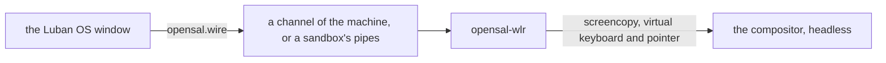

# 桌面与 Luban OS 窗口

[English](../../luban/08-desktop.md) | **简体中文**

Luban OS 也是一个窗口：`luban-os` 列出这个 home 的环境，然后像一台显示器一样显示其中一个系统——它的控制台，或者它有桌面时
显示它的桌面。其余的一切都在管理面板里。窗口做不了 `luban` 命令做不了的事：它做的每件事都是一条 `luban` 命令。

## 安装与打开

```bash
xlings install luban-os          # the app, with its desktop entry
luban new desk --edition desktop # an environment with a desktop
luban enter desk --display window
```

`luban-os` 打开时是环境列表；倒计时（10 秒；任意按键或点击停止）后进入默认的那个。还没有环境时，它打开快速开始：
nano、tiny、core 或 desktop，一个名字，一个"创建并进入"的按钮，每一步发生时都显示出来。

## 窗口

| | |
|---|---|
| 列表 | 所有环境，默认的在最前，其余按上次使用时间排序 |
| 系统 | 它的控制台或桌面：窗口就是它的屏幕 |
| Host 键 | 单独按下再松开 Ctrl+Alt（macOS 上是 Ctrl+Option）：菜单——回到列表、管理、全屏、新窗口、关机 |
| F2 或齿轮 | 管理面板：所有环境、它们的设置、发生过什么（`xlings self log`） |
| 关闭机器的窗口 | 每次都会问：继续运行还是关机——或者确认并设为这个环境的默认（`luban config desk --on-close background`） |

标题栏写着 Host 键此刻的作用。每个窗口是一个进程；新窗口可以显示另一个环境，也可以再显示同一个。

## 桌面

桌面是环境按 freedesktop 的方式声明的会话：`share/wayland-sessions/` 下的一个文件，加一个 opensal 的键。

```ini
[Desktop Entry]
Name=Luban Desktop (labwc)
Exec=labwc
X-Opensal-Interfaces=surface pointer keyboard mode
```

`desktop` edition 带来 `labwc-desktop`：labwc 加面板、启动器（fuzzel）、终端（foot）、Xwayland 以及拉丁文和中日韩
文字的字体，放在一棵除了内核之外不需要根里任何东西的树里。Alt+Return（或 Super+Return）打开终端；点击背景打开菜单。

```bash
luban config desk --desktop labwc-desktop   # which session it starts
luban config desk --desktop none            # its console instead
```

没有设置时，启动根里声明的第一个会话。

## 你自己的桌面

在 nano、tiny 或 core 上，装一个合成器并声明它的会话。任何具备 wlroots 协议的合成器都能显示在窗口里：screencopy（画面）、
virtual keyboard 与 virtual pointer（输入）、output management（窗口大小）。两者之间的桥 opensal-wlr 只使用这些
标准协议；它是 luban 的一部分，随会话启动。

```bash
xlings install --subos box labwc-desktop
luban config box --desktop labwc-desktop
```

## 它怎么运行



- **以机器方式**（`luban config desk --mode machine`，desktop edition 的默认）：机器的 agent 以无头方式、软件渲染
  启动会话，并在机器的一个通道上桥接它。机器的 `/run` 和 `/tmp` 是它自己的，停机即消失。
- **在沙箱里**：同一个会话，用 `xlings subos use desk --cmd` 启动，在两条管道上桥接。桌面是同一个，只是运行的地方不同。
- 窗口要求自己的大小；合成器的输出跟随它。
- 声音：有 `audio` 授权时，机器里的 Pulse 客户端连到本机的 PipeWire 或 PulseAudio（[环境](03-environments.md)）。
- 机器把会话的日志写在它自己的 `/var/log/luban/desktop.log`。

## 还不支持的

- Linux 宿主的输入法，以及桌面里使用宿主的剪贴板。
- GPU：渲染用软件完成，在每台宿主上都一样。
- Linux 上窗口需要 X11（Xwayland 也算）；原生 Wayland 窗口，以及 macOS 和 Windows 上的窗口，暂不支持。
- 实验桌面线（`desktop-xdesk`）：尚未发布。
