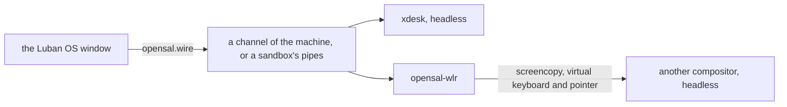

# 桌面与 Luban OS 窗口

[English](../../luban/08-desktop.md) | **简体中文**

Luban OS 也是一个窗口：`luban-os` 列出这个 home 的环境，然后像一台显示器一样显示其中一个系统——它的控制台，或者它有桌面时
显示它的桌面。其余的一切都在管理面板里。窗口做不了 `luban` 命令做不了的事：它做的每件事都是一条 `luban` 命令。

## 安装与打开

```bash
xlings install luban-os          # the app, with its desktop entry
luban new desk --edition desktop # an environment with a desktop
luban enter desk --display window
```

`luban-os` 打开时是环境列表；倒计时（10 秒；任意按键或点击停止）后进入默认的那个。

## 第一次：快速开始

还没有环境时，窗口打开快速开始，分两组：

| | |
|---|---|
| **控制台** — 精简，自己定制 | `nano`（只有 xlings 与 luban：自己定制 edition 的基础；没有 shell，因此只创建、不进入）、`tiny`（shell 与基础工具）、`core`（开发用的控制台，默认选中） |
| **桌面** — 开箱即用 | `经典桌面`（preview，推荐：窗口并排、面板、启动器）与 `xdesk 画布`（供探索：在无限画布上摆放窗口） |

每张卡片写着它是什么；卡片下的一行说明选中的那个里面有什么，或者为什么这里不能创建——尚未发布、没有本机架构的版本，
或者这台电脑暂时还不能运行 Luban 系统（`luban status` 给出的原因与下一步）。名字跟随 edition，直到你自己输入；
**更多选项**选择沙箱或机器，以及用哪个桌面创建：它自带的，或 index 提供的（`luban-desktop` 类别的包）。
一个按钮创建并进入，每一步都显示出来。

卡片下方的**更多**列出 index 里的其他系统：窗口没有卡片的官方系统，以及你添加的 index 里的系统，都标明来自哪个 index。
来自其他 index 的系统（或桌面）先经你同意才创建——Luban 不检查它做什么。

**导入**别人导出的系统（`luban export box box.luban`）：快速开始里的链接、列表的最后一行，或者把 `.luban` 文件拖进窗口。
预览显示它的 edition、软件包与隔离方式，并用平常的话列出它比新系统多能做的事（剪贴板授权、挂载宿主目录、没有隔离预设）；
同意之后才导入。

会话以失败结束时，窗口显示它最后的输出与退出码，而不只是"已关机"。

## 窗口

| | |
|---|---|
| 列表 | 所有环境，默认的在最前，其余按上次使用时间排序；然后是新建，以及从文件导入 |
| 系统 | 它的控制台或桌面：窗口就是它的屏幕 |
| Host 键 | 单独按下再松开 Ctrl+Alt（macOS 上是 Ctrl+Option）：菜单——回到列表、管理、全屏、新窗口、关机 |
| F2 或齿轮 | 管理面板：所有环境、它们的设置、发生过什么（`xlings self log`） |
| 关闭机器的窗口 | 每次都会问：继续运行还是关机——或者确认并设为这个环境的默认（`luban config desk --on-close background`） |
| 拖到系统上的文件 | 复制到它登录用户的 `~/Downloads`，窗口说明放在哪里（`.luban` 文件则是导入） |
| Ctrl+= / Ctrl+- / Ctrl+0 | 控制台字号，按系统分别保存 |
| 控制台上的鼠标 | 接管鼠标的程序（vim、htop、tmux）收到鼠标；否则——或按住 Shift——拖动选择并复制，双击选词，三击选行，中键粘贴上次选中的内容，右键打开复制 / 粘贴，滚轮回看 |
| 进行中的操作 | 逐步显示各阶段；可以中止，失败的可以重试 |

应用在系统状态栏中有一个图标：Linux 上是 StatusNotifierItem（KDE、装有 AppIndicator 扩展的 GNOME，以及大多数其他桌面），
Windows 上是通知区域，macOS 上是菜单栏。它的菜单列出运行中的系统（打开、控制台、关机、管理）、新建系统、窗口、设置与退出；
图标显示运行的数量，以及是否有操作进行中或失败。有系统运行时关闭窗口，系统继续运行，应用留在状态栏；没有状态栏的地方，窗口改为最小化。
设置中的**常驻状态栏**让图标在没有系统运行时也保留。

窗口跟随屏幕的缩放。控制台自己绘制制表符与块字符，因此在任何字号下都能衔接。

## xdesk

桌面 edition 启动 **xdesk**：为这个窗口做的桌面，合成器与外壳在一个程序里（wlroots，软件渲染），直接与窗口通信——
不经桥、不截屏。它有两种配置：

| | `xdesk-classic`（`desktop` edition 的） | `xdesk-canvas`（`--desktop xdesk-canvas`） |
|---|---|---|
| 窗口 | 并排；一两个平分屏幕，更多时横向滚动，焦点窗口始终可见 | 放在哪里就在哪里，画布可平移、缩放 |
| 外壳 | 顶部面板：应用、工作区、焦点窗口的标题、时钟 | 底部药丸：应用、工作区、缩放、全览 |

| 按键（Super，或宿主占用 Super 时用 Alt） | |
|---|---|
| Return | 终端（foot） |
| Space 或 D | 启动器：输入以搜索已安装的应用，Enter 启动 |
| Q | 关闭焦点窗口 |
| 方向键或 H J K L | 焦点移向那个方向；加 Shift，把窗口移过去 |
| 1 … 4 | 切换工作区；加 Shift，把窗口送过去 |
| F | 焦点窗口浮动或平铺 |
| R | 经典：列宽（三分之一、一半、三分之二、整屏） |
| O | 画布：全览（一眼看全）；点击一个窗口进入 |
| Tab | Alt+Tab：上一个使用的窗口 |

在画布上，拖动背景（按住 Super 时任何地方）平移；在背景上滚动滚轮（按住 Super 时任何地方）以指针为中心缩放，指针下的东西不动。
离开全览回到进入之前的位置；在全览里点一个窗口就进入它。拖动标题栏移动窗口，标题栏有关闭按钮。

宿主的输入法可以在桌面的窗口里打字（组合中的文字显示在那里），剪贴板双向共享——各自受环境授权约束：`clipboard`（从里面复制出来）
与 `clipboard-paste`（粘贴进去）；策略出现之前创建的环境两者都共享。

### 设置

xdesk 读取 `<profile>.ini`（`classic.ini`、`canvas.ini`）：先是它自带的默认，然后是系统的 `/etc/xdg/xdesk/`，最后是你的
`~/.config/xdesk/`，后面的逐键覆盖前面的。

```ini
[desktop]
terminal = foot
autostart = foot
gap = 8
workspaces = 4

[theme]
accent = #5e9cff
background = #1b1e25

[keyboard]
layout = us        # another xkb layout needs xkeyboard-config
repeat_rate = 30
repeat_delay = 500
```

读不懂的一行会写进日志并跳过；桌面照常启动。

## 桌面

桌面是把会话——`share/wayland-sessions/` 里的一个文件——带进系统的包；一个系统里可以有多个。Luban 自己的位于 `luban:` 命名空间
（`categories` 含 `luban-desktop` 的包），从最轻到最全：

| 桌面 | 会话 | 是什么 |
|---|---|---|
| `luban:compositor` | `compositor` | 只有窗口、没有桌面：labwc，Luban OS 窗口作它的外壳（见下） |
| `luban:labwc` | `labwc` | labwc 加面板、启动器、背景——轻量 |
| `luban:lxqt` | `lxqt` | labwc 上的 LXQt：面板、桌面与文件管理器、设置——传统桌面 |
| `luban:kde` | `kde` | KDE Plasma，嵌套在 labwc 中（preview）——完整桌面 |
| `luban:xdesk` | `xdesk-classic`、`xdesk-canvas` | Luban 自己的：窗口并排，或在无限画布上 |

每个桌面的终端都是默认终端（`luban:foot`），经 `xdg-terminal-exec` 找到；X11 程序运行在 `luban:xwayland` 上。LXQt 与 KDE
共用一份 Qt（`luban:qt-runtime`），只装一次。

```bash
luban new desk --edition desktop --desktop lxqt   # 创建时带上 LXQt，并启动它
luban enter desk --desktop kde                    # 这一次用另一个桌面（需已安装）
luban config desk --desktop xdesk-canvas          # 启动哪个会话
luban config desk --desktop none                  # 改为控制台
luban config desk --enter console                 # 进入时先看到什么
```

没有设置时启动 edition 指定的会话（edition 没有指定时，启动根里声明的第一个）。窗口的 Host 键菜单列出系统的桌面与控制台：
切换只换会话，不重启机器。改名后的桌面仍认旧名（`labwc-desktop` 即 `labwc`）。

会话文件说明它怎样显示：

```ini
[Desktop Entry]
Name=xdesk (classic)
Exec=xdesk --profile classic
X-Opensal-Native=true
X-Opensal-Interfaces=surface pointer keyboard mode
X-Luban-Shell=own
```

| 键 | |
|---|---|
| `X-Opensal-Native=true` | 程序自己与窗口通信（xdesk）；其他合成器经 opensal-wlr 显示（见下） |
| `X-Luban-Shell` | `own`：桌面有自己的外壳；`none`：Luban OS 窗口作它的外壳 |
| `X-Luban-App-Exec` | 怎样单独运行一个程序（`luban run --display window`，见下） |
| `X-Luban-Aliases` | 它以前的名字 |

把外壳交给窗口的会话（`X-Luban-Shell=none`，Luban 的 `compositor`）在桌面下方有一条栏：**应用**列出会话里能启动的程序
（会话数据目录下的 `share/applications`，包括你自己的；`Terminal=true` 的在默认终端里打开），每个窗口一个按钮，点击即前置。

## 单个程序一个窗口

```bash
luban run desk --display window -- gimp
```

单独运行系统里的一个图形程序，作为一个独立窗口，标题就是程序名；程序结束，窗口随之关闭。由声明了运行方式的会话来跑
（`X-Luban-App-Exec=`，命令作为一个词接在后面）：Luban 的 `compositor` 桌面就是（`labwc -S`）。没有这样的会话的系统会说明——
`xlings install luban:compositor --subos desk`。

## 桌面 edition 里有什么

`desktop` 是 core 加一个桌面，以及常用工具，按工具集组织：`luban:tools-cli`（ripgrep、fd、fzf、jq、tmux、htop）、
`luban:tools-dev`（node、带 uv 的 python、bun）与 `luban:tools-agent`（claude、codex、pi、opencode；x86_64 上还有 dsh）。
git 默认分支是 `main`；xlings 使用 CN 镜像时，npm、pip、uv、bun 也使用离你近的源（你自己设置的优先）。里面没有任何凭据。
在 aarch64 上，桌面 edition 在 xdesk 发布到那里之前启动 labwc。

## 自己的桌面

在 nano、tiny 或 core 上安装一个合成器并声明它的会话。任何支持 wlroots 协议的合成器都能显示在窗口里：screencopy（画面）、
virtual keyboard 与 virtual pointer（输入）、output management（窗口的尺寸）。它们之间的桥 opensal-wlr 只说这些标准协议；
它是 luban 的一部分，随会话启动。

```bash
xlings install --subos box luban:labwc      # 任何桌面包，Luban 的或其他 index 的
luban config box --desktop labwc
```

自己的桌面就是一个放置会话并遵循同样约定的包（默认配置在它自己的 `etc/xdg`、默认终端、`share/luban/checks.d` 里的自检）；
`categories` 列出 `luban-desktop`，选择桌面时就会提供它。Luban 的桌面就是示例：index 的
[Luban 的包](https://github.com/openxlings/xim-pkgindex/blob/main/docs/zh/12-luban-packages.md)一章说明它们怎样构建。

## 如何运行



- **作为机器**（`luban config desk --mode machine`，桌面 edition 的默认）：机器里的 agent 以无头、软件渲染的方式启动会话，
  经机器的一个通道连接。机器的 `/run` 与 `/tmp` 是它自己的，停止时清空。
- **在沙箱里**：同样的会话，用 `xlings subos use desk --cmd` 启动，经两条管道连接。桌面一样，只是运行的位置不同。
- 窗口告诉它自己的尺寸；桌面跟随。窗口显示了上一帧之后才发下一帧，慢通道上画面不会堆积。
- 声音：有 `audio` 授权时，机器里的 Pulse 客户端连到这台宿主的 PipeWire 或 PulseAudio（[环境](03-environments.md)）。
- 机器把会话的日志保存在它自己的 `/var/log/luban/desktop.log`。

## 还不支持的

- GPU：渲染用软件，所有宿主都一样。
- xdesk 里的 X11 程序（Xwayland）；它们在 labwc 会话里运行。
- 窗口在 Linux 上需要 X11（Xwayland 也算）；原生 Wayland 窗口还不支持。在 macOS 与 Windows 上，窗口从 Luban 宿主机里显示系统的控制台与桌面，
  无论它作为沙箱还是机器运行。
- aarch64 上的 xdesk。
