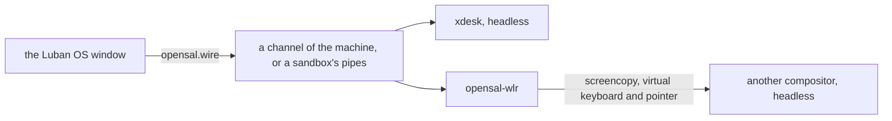

# 桌面与 Luban OS 窗口

[English](../../luban/08-desktop.md) | **简体中文**

Luban OS 也是一个窗口：`luban-os` 列出这个 home 的环境，然后像一台显示器一样显示其中一个系统——它的控制台，或者它有桌面时
显示它的桌面。其余的一切都在管理面板里。窗口做不了 `luban` 命令做不了的事：它做的每件事都是一条 `luban` 命令。

## 安装与打开

```bash
xlings install luban-os          # the app, with its desktop entry
luban new desk --edition desktop # an environment with a desktop
luban enter desk --display window
```

`luban-os` 打开时是环境列表；倒计时（10 秒；任意按键或点击停止）后进入默认的那个。

## 第一次：快速开始

还没有环境时，窗口打开快速开始（之后是**新建系统**），分四组：

| | |
|---|---|
| **控制台** — 精简，自己定制 | `nano`（只有 xlings 与 luban：自己定制 edition 的基础；没有 shell，因此只创建、不进入）、`tiny`（shell 与基础工具）、`tiny-musl`、`core`（开发用的控制台，默认选中）、`agent workspace` |
| **xdesk** — Luban 自己的桌面 | `Luban 桌面`：WuXian 上的工作区，为这个窗口做的桌面（见下文） |
| **传统桌面** — 轻 → 完整（默认折叠：点标题，或在标题上按 →） | `luban-desktop` 类别里除 xdesk 外的每一个，按带来的多少排（图标右上角的四格）：Compositor（T1，只有窗口，Luban OS 窗口就是外壳）、labwc（T2）、LXQt（T3）、KDE Plasma（T4）；未分级的在最后 |
| **更多系统** | 窗口没有卡片的官方系统，以及你添加的 index 里的系统 |

传统桌面的卡片写出它带来多少（四格，`T1`–`T4`，或*未分级*）、来自哪里（*官方*、*社区 · 它的 index*、*本地*）、
有多稳定（*稳定*、*预览*；已弃用的不列出）、对 GPU 的期望（*GPU 更好*、*需要 GPU*）与版本。把指针停在名字上（Compositor、Wayland、T 级）
就会显示它的意思。选中一张，创建的系统与 `luban new <名字> --edition core --desktop <它>` 相同：**更多选项**可以改它的底座
（`tiny`、`core`、`desktop`），默认作为机器运行并进入桌面。面板写出它由哪两个版本组成（`系统 core 2026.10.19.1`、`桌面 LXQt 2.4.0`）——
显示的版本就是建出的版本；当前 xlings 太旧而用不了的更新版本会写在旁边。

←→ 在组内移动，↑↓ 换组，Enter 创建。读 index 时组里写*正在读 index…*；读不了时写明该怎么做（`xlings update`），不会显示成空组。

每张卡片写着它是什么；面板说明选中的那个里面有什么，或者为什么这里不能创建——尚未发布、没有本机架构的版本，
或者这台电脑暂时还不能运行 Luban 系统（`luban status` 给出的原因与下一步）。名字跟随卡片，直到你自己输入。
**更多选项**还选择沙箱或机器，以及（控制台与 xdesk）用哪个桌面创建。面板可以滚动，**创建**固定在底部。创建时显示它有的阶段——
获取、解包、配置、启动（机器）、自检——一条进度条是全部，一条是当前阶段（有度量时是多少，没有时是动画与已用时间），写着正在做什么，
以及最近一行与"几秒前"；完成时显示"就绪"一会儿再进入。来自其他 index 的系统（或桌面）先经你同意才创建——Luban 不检查它做什么。

同样的内容也有文字版：`luban search`（发行版、按 T 级排列的桌面）、`luban ls <模式>`（这里名字匹配的系统）。

**导入**别人导出的系统（`luban export box box.luban`）：快速开始里的链接、列表的最后一行，或者把 `.luban` 文件拖进窗口。
预览显示它的 edition、软件包与隔离方式，并用平常的话列出它比新系统多能做的事（剪贴板授权、挂载宿主目录、没有隔离预设）；
同意之后才导入。它从文件里带的内容建出来：不需要网络。

会话以失败结束时，窗口显示它最后的输出与退出码，而不只是"已关机"。

## 窗口

| | |
|---|---|
| 列表 | 所有环境，默认的在最前，其余按上次使用时间排序；然后是新建，以及从文件导入 |
| 系统 | 它的控制台或桌面：窗口就是它的屏幕，标题为 `Luban OS (<系统名>)` |
| 键盘 | 窗口获得焦点时桌面锁定键盘：所有按键都给桌面，宿主自己的组合键也是。**Ctrl+Alt+K** 释放并重新锁定（菜单里也有）；设置 → *进入桌面时锁定键盘*可以关掉。锁定时 Emacs 的 `C-M-k` 用不了 |
| 指针 | 由这台电脑画，跟手、没有延迟：桌面要的形状（文本框的 I 形、链接的手形、边缘的双箭头），用 Luban 指针主题——在每个系统上都一样——或程序自己画的图像。锁定指针的游戏一直拿着它，直到 Ctrl+Alt+K |
| Host 键 | 单独按下再松开 Ctrl+Alt（macOS 上是 Ctrl+Option）：菜单——回到列表、管理、全屏、新窗口、键盘、关机 |
| F2 或齿轮 | 管理面板：所有环境、它们的设置、发生过什么（`xlings self log`） |
| 关闭机器的窗口 | 每次都会问：继续运行还是关机——或者确认并设为这个环境的默认（`luban config desk --on-close background`） |
| 拖到系统上的文件 | 复制到它登录用户的 `~/Downloads`，窗口说明放在哪里（`.luban` 文件则是导入） |
| Ctrl+= / Ctrl+- / Ctrl+0 | 控制台字号，按系统分别保存 |
| 控制台上的鼠标 | 接管鼠标的程序（vim、htop、tmux）收到鼠标；否则——或按住 Shift——拖动选择并复制，双击选词，三击选行，中键粘贴上次选中的内容，右键打开复制 / 粘贴，滚轮回看 |
| 进行中的操作 | 逐步显示各阶段；可以中止，失败的可以重试 |

每个窗口是一个独立的进程；另有一个进程 `luban-os __tray` 为所有窗口在系统状态栏里保留应用的图标：Linux 上是 StatusNotifierItem
（KDE、装有 AppIndicator 扩展的 GNOME，以及大多数其他桌面），Windows 上是通知区域，macOS 上是菜单栏。它的菜单列出运行中的系统
（打开、控制台、关机、管理）、新建系统、窗口、设置与退出；选中的项会把显示它的窗口带到前面，没有就打开一个。图标显示运行的数量，
以及是否有操作进行中或失败。关闭窗口就结束它——机器继续运行，图标保留——除非它正在创建什么：那时它隐藏、做完并通知。
退出只问一次（让系统继续运行，或全部关机），然后结束所有窗口。没有状态栏的地方，关闭窗口改为最小化。设置中的**常驻状态栏**让图标在没有系统运行时也保留。
装上更新版本的 Luban OS 后，图标自己换成新版本；还开着的窗口仍是旧版本，重新打开即是新版本。

窗口跟随屏幕的缩放。控制台自己绘制制表符与块字符，因此在任何字号下都能衔接。

在已经显示着的桌面上再开一个窗口（菜单里的*新窗口*，再选同一个系统），它就是这个桌面的另一块显示器：镜像第一块——
同一幅画面，按第一个窗口的大小，与它自己的大小无关；缩放时保持形状；标题写着 `显示器 2（镜像显示器 1）`。在任一窗口里的按键与指针
都给桌面。第一个窗口关闭后，xdesk 桌面在其余窗口里继续，下一个成为主屏：桌面采用它的大小。桥接的桌面（labwc、KDE、LXQt）
随第一个窗口结束。

机器的声音在这台电脑上播放。它的桌面随会话启动一个声音服务（luban:audio：PipeWire，以及给说 Pulse 的程序用的 Pulse 服务），
默认输出 `luban` 由窗口经这台电脑自己的声音系统（PipeWire、PulseAudio 或 ALSA；Core Audio；WASAPI）播放。这就是系统的 `audio` 授权：
带桌面建出的系统有它，`luban config box --disallow audio` 收回。沙箱里的程序在同一授权下直接用这台电脑的声音服务。麦克风还不经过这里。

## xdesk

桌面 edition 启动 **xdesk**：为这个窗口做的桌面，合成器与外壳在一个程序里（wlroots），直接与窗口通信——不经桥、不截屏。系统里有可用的
GPU 时用 GPU 绘制（render node 上的 GLES），否则用软件；**关于**页写明用的是哪个、为什么。

### WuXian 与工作区

桌面是一张无限的平面 **WuXian**。工作区是它上面的区域——编号 1–9，各有名字、颜色和规则——窗口在某个工作区里，或者作为**自由窗口**
直接在 WuXian 上。平时在一个工作区里工作（**工作区视图**，总是 100%），需要处理工作区之间的事——把窗口移到别的工作区、摆放工作区、
找东西——时退到整张平面（**WuXian 视图**，Super+O）。两者之间镜头连续滑动（**减少动态**时直接到位）。

工作区的**规则**是它排布窗口的方式，**Super+M** 切换（按住 Super 按 M——两张卡片显示两种排法；松开 Super 确定，Esc 保持原样）：

| | |
|---|---|
| **平铺** | 窗口按列并排，间隔 4 像素；各列平分屏幕，直到每列窄于 480 时开始滚动，焦点窗口始终可见；一列里可以上下放多个；也可以让列上下排（`flow = vertical`）。平铺的窗口会被告知，并按给定的大小绘制 |
| **层叠** | 窗口放在哪里就在哪里，可以重叠，可以部分移出屏幕（标题栏留在屏幕上）；可以最大化，或吸附到半屏、四分之一屏——拖到边或角上，拖开即回到原来的大小 |

窗口可以在工作区里**浮动**（Super+Shift+空格：浮在排布上方，随工作区移动——对话框自动如此）；**自由窗口**在 WuXian 上、不属于任何
工作区（Super+Shift+0，或拖到平面上放下）。

WuXian 视图里每个工作区是一块带彩色边框的底板，上方有标签——`● 2 · 编码 · ▥`（颜色、编号、名字，▥ 平铺、❐ 层叠）。工作区可以移动
（拖标签）、等比缩放（标签右下角的手柄，或标签菜单里的 50% / 100%；内容的排布不变），也可以重叠：命中最上面的那个。新窗口在工作区视图里
进入当前工作区；在 WuXian 视图里进入视野中心所在的工作区，中心是空白时成为自由窗口。

**新建工作区**：Super+Ctrl+N（最小的空号，放在最右边）、WuXian 视图空白处的右键菜单（在点击处新建平铺或层叠的），或者去一个还没有的编号
（Super+5）——这样顺带建的、没有名字、仍然空着的，离开时自动删除。**删除**：标签菜单（或选中标签后按 Delete）：空的直接删除；有窗口的会问——
变成自由窗口（回车）、关闭全部窗口（5 秒倒计时后可按）、取消。最后一个工作区不能删。

状态栏显示当前工作区（颜色、编号、名字、规则），其他工作区是可点击的小图形（**其他工作区**可以关掉）；它的 WuXian 按钮进入 WuXian 视图，
并写着有几个自由窗口。

| 按键（按住 Super） | 工作区视图 | WuXian 视图 |
|---|---|---|
| 单按 Super，或 Space | 应用——也能按名字找到设置的各页与每个操作，旁边写着它的键 | 同 |
| O | WuXian 视图 | 回到焦点所在的工作区（焦点不在窗口上时 Esc 也可以） |
| 1 … 9 / Shift+1 … 9 | 那个工作区（没有就新建）/ 把窗口送过去 | 镜头框住它 / 同 |
| Shift+0 | 把窗口放到 WuXian 上（自由窗口） | 同 |
| Ctrl+N / Ctrl+0 | 新建工作区并进入 / — | 新建并框住它 / 显示全部 |
| Ctrl+← → 或 PageUp / PageDown（加 Shift：带着窗口） | 上一个、下一个工作区 | 镜头框住它 |
| M | 平铺或层叠（按住） | 焦点所在工作区的规则 |
| ←→ ↑↓（或 H J K L） | 那个方向的下一个窗口（按规则） | 那个方向最近的窗口（任何地方） |
| Shift+←→ ↑↓ | 按规则移动（平铺：列；层叠：半屏、四分之一屏、全屏） | 自由窗口每次移动 1/8 屏 |
| [ / ] | 并进左边一列 / 拆出成单独一列 | — |
| R / Shift+R | 列宽（⅓、½、⅔、全宽）/ 列内高度 | — |
| - / = / 0 | 变窄 / 变宽 / 等宽 | 缩小 / 放大 / 以 100% 显示焦点窗口 |
| F / Shift+F | 最大化，再按还原 / 全屏，再按退出 | 同 |
| P / Shift+P | 置顶 / 在所有工作区显示 | 同 |
| S | — | 折叠与展开：自由窗口只留标题栏，否则焦点所在的工作区只留标签 |
| C / V | 复制 / 粘贴——终端里是 Ctrl+Shift+C/V，别处是 Ctrl+C/V | 同 |
| Tab / Shift+Tab | 应用，最近用的在前（按住：Tab 下一个；在一个上停半秒，展开它的窗口） | 同 |
| `（Tab 上方）/ Shift+` | 同一应用的另一个窗口 / 上一个 | 同 |
| Return 或 Ctrl+Alt+T / Q 或 Alt+F4 | 终端 / 关闭窗口 | 同 |
| I / / | 设置 / 设置的快捷键页 | 同 |

全部按键见[生成的键位表](../../generated/xdesk-keys.zh.md)，与桌面的行为一致。**Super+/** 打开设置的快捷键页：按分组列出每个操作，
输入即查找；在一项上按回车再按新的组合键即改为它（原属于别的操作的会从那里移走，并说明），Delete 恢复。键位按套提供——Luban，
以及不用 hjkl 的 Luban——你改的保存在 `~/.config/xdesk/keys.json`。按住 Super 一秒浮出最常用的键。

**Alt+Tab** 按位置显示这个工作区的全部窗口，缩放到屏幕里，选中的更大、其余变暗：Tab 按最近使用的顺序（Shift：反向），方向键按位置，
指针按指向；松开 Alt 即切过去，Esc 留在原处。快速按一下 Alt+Tab 直接回到上一个窗口。切到的窗口会亮一会儿、其余变暗，看清落在了哪里
（设置的**切换器**：多久、多暗，或者关掉）。窗口锁住键盘时（Ctrl+Alt+K）Alt+Tab 归 xdesk，否则归宿主。

两种视图里同样的手势：

| | 工作区视图 | WuXian 视图 |
|---|---|---|
| 拖标题栏，或按住 Super 拖任意处 | 移动窗口 | 移动——到另一个工作区，或放到 WuXian 上 |
| Super 加右键，或拖边框、角 | 调整大小（层叠、浮动） | 同，自由窗口也可以 |
| 拖空白处，或按住 Super+空格在任意处拖（手形） | 平铺：滚动各列 | 平移 |
| 空白处滚轮 / Super 加滚轮 | 平铺：滚动，转得越快走得越远，停在一列上 | 平移（Shift：横向）/ 以指针为中心缩放 |
| 中键 | 交给应用（粘贴选中的文字） | 拖空白处：平移 |
| 空白处右键 | 终端、设置、WuXian 视图 | 新建工作区、把工作区排成一行、显示全部 |
| 工作区标签：拖 / 拖手柄 / 右键 / 双击 | — | 移动 / 缩放 / 菜单（名字、规则、颜色、比例、折叠、删除）/ 进入 |
| 双击标题栏 | 最大化与还原 | 自由窗口：折叠与展开 |
| 缩得很小（窗口显示为图片） | — | 拖窗口任意处移动它；双击：100% 显示它 |
| 小地图 | — | 拖视口框：平移；点工作区或窗口：把它放到中间；拖它：移动（落在工作区上就进去） |

拖动平铺的窗口时布局冻结：拖动中什么都不动；虚线框标出窗口原来的位置，指针下的框显示松手后会怎样——自己的位置（不变）、另一个窗口的
中间三分之一（交换）、两端（在它前后新建一列，宽度用滚轮或 1–4 选）、上下四分之一（在它所在列的上方或下方）、间隙或屏幕边缘（新建一列）。
拖动时按住 Shift：松手处浮动。松手后所有窗口一次移到位。在 WuXian 视图里跨工作区拖动的窗口保持它在屏幕上的大小，落下后变到目标的比例；
放在平面上就是原大的自由窗口；靠近别的自由窗口的边会对齐。层叠或浮动的窗口总会在屏幕上留一段标题栏（64 像素，或它宽度的四分之一），
不会高过顶边，也不会压到状态栏下面。

被盖住的东西不会丢：完全被盖住的工作区或自由窗口——以及层叠工作区里被别的窗口盖住的窗口——会在盖住它的那一项右边缘伸出**书签**
（它的标题；工作区是颜色与名字；最多 5 个，其余合成"+N"，点开是列表）。指向书签会画出它所指的那一项的轮廓，点击就把它提到前面。
拖动或平移时书签先隐藏；设置的 *WuXian* 一节（或 `[wuxian] bookmarks = off`）可以关掉；Agent 用 `xdesk msg bookmark N`（状态里列出有哪些）。
折叠的工作区只剩标签，折叠的自由窗口只剩标题栏，左侧标着 ▸（展开时 ▾），颜色更深，名字后写着"已折叠"：点这个标记、双击（或 Super+S）
再展开，无论移到了哪里，都回到原来的大小。

宿主的输入法可以在桌面的窗口里输入，剪贴板也是共享的——每个方向按环境的授权：`clipboard`（从中复制出来）与 `clipboard-paste`
（粘贴进去）。在 Luban OS 窗口里新建的桌面系统两者都有（它的设置里可以关）；用 `luban new` 或 Agent 建的默认没有，需要时给
（`luban config <系统> --allow clipboard,clipboard-paste`）。**Super+C**、**Super+V** 在任何窗口里复制粘贴——终端的 Ctrl+Shift+C/V 还是
别处的 Ctrl+C/V，xdesk 知道该用哪个；终端里 Ctrl+C 仍是中断。

指针由窗口来画：Luban 指针主题，按你屏幕的实际密度从矢量画出。晃动鼠标找它时会放大——最多 4 倍，填上强调色——停下后缩回
（**外观**：关、放大、放大并变色；最大 2、3 或 4 倍）。对不画指针的窗口（旧版 Luban OS），xdesk 把它画进画面。

### 设置与会话

**Super+I** 打开设置：显示器（显示这个桌面的每个窗口，见下）、布局（新工作区的规则、列的方向、间隔、最窄的列、状态栏的其他工作区、
切换器、滚轮）、外观（强调色、背景、**减少动态**、晃动时的指针、渲染器）、快捷键，以及**关于**——系统、xdesk、内核、渲染器（及原因）、
显示器、CPU 与内存、它保存的文件，**复制**生成一份报告。每一行写明是默认的、你改过的，还是系统设的；每页有**恢复本页默认**，设置的首页有
**全部恢复默认**（10 秒内 Ctrl+Z 撤销）。修改立即生效，保存在 `~/.config/xdesk/xdesk.ini`。启动器能按名字找到每一页。脚本与 Agent
经 `xdesk msg`（在桌面里）做同样的事：

```bash
xdesk msg keys list                        # every action, its keys (JSON)
xdesk msg keys bind maximize Super+Shift+m # and back: xdesk msg keys unbind maximize
xdesk msg keys set luban-no-hjkl
xdesk msg settings keys                    # the settings, at that page
```

第一次进入时桌面会给一个**导览**：右下角十步——应用、终端、切换、工作区、WuXian、在它们之间移动、书签、折叠、所有快捷键、设置——
每一步都要真的做一次才往下走，每一步都可以跳过（或整个结束）。之后随时可以再看：应用里的"桌面导览"，或 `xdesk msg tour start`。

桌面现在是什么、做了什么，给脚本、Agent 和问题报告用：

```bash
xdesk msg state                            # output, view, workspaces, windows, overlays, the frames' cost (JSON)
xdesk msg subscribe                        # what happens from now on, a line each (focus, open, close, ...)
xdesk msg debug hud [on|off]               # the frames' parts drawn in the top left; alone, toggled
xdesk msg telemetry metrics                # counters and histograms (xdesk.frame.compose_ns, ...)
xdesk msg telemetry profile on             # then `telemetry trace`: a trace any trace viewer opens (Perfetto)
xdesk msg telemetry dump                   # all of it, with the last moments recorded
```

系统里有 openbus 路由时，桌面也在总线上：`xbus ls` 能看到 `service/xdesk/state`、`service/xdesk/control`（与 `xdesk msg`
同样的请求）、`topic/xdesk/events` 和它的 telemetry；`xbus dump 路径`、`xbus profile 路径` 在总线能到的任何地方读取。

会话是 `xdesk`（以前的名字 `xdesk-classic`、`xdesk-canvas` 启动的是同一个桌面）。它读 `xdesk.ini`：先是自带的默认，再是系统的
`/etc/xdg/xdesk/`，最后是你的 `~/.config/xdesk/`，后读的按键覆盖。你以前的 `classic.ini`（或 `canvas.ini`）第一次会成为你的
`xdesk.ini`，原文件保留。

```ini
[desktop]
terminal = foot
autostart = foot
rule = tile            # a new workspace's: tile or stack
inner_gap = 4          # between windows
outer_gap = 0          # between windows and the screen's edges
min_column_width = 480 # tiled columns share the screen until narrower than this, then scroll
flow = horizontal      # tiled columns side by side; vertical: one under another
status_others = on     # the status bar shows the other workspaces

[wuxian]
minimap = on           # the WuXian view's map of everything
snap = on              # a moved window lines up with another's edge

[switchers]
hold_ms = 500          # Super+Tab held this long on an application: its windows
highlight_ms = 500     # the window chosen stays lit this long (0: not at all)
dim = 0.5              # what the others are dimmed to meanwhile

[scroll]
speed = medium         # slow, medium or fast
snap = on              # a tiled strip's scroll lands on a column

[theme]
accent = #5e9cff
background = #1b1e25

[appearance]
reduce_motion = off
renderer = auto        # auto (the GPU when there is one) or software
pointer_locate = grow-color   # off, grow or grow-color
pointer_max = 4

[keyboard]
layout = us            # another xkb layout needs xkeyboard-config
repeat_rate = 30
repeat_delay = 500
```

不写 `terminal` 时用系统的默认终端（它的 `share/xdg-terminals` 条目）。读不了的行记入日志并跳过；桌面照样启动。

你设置的都是你的，在 `~/.config/xdesk/`：`wuxian.json` 保存工作区（位置、名字、颜色、规则、比例）与每个窗口在哪里，`state.json` 保存
应用的规则，`keys.json` 保存你改过的按键。升级从不改写它们；读不了时会说明，桌面按新的启动，原文件原样留在旁边。

## 桌面

桌面是把会话——`share/wayland-sessions/` 里的一个文件——带进系统的包；一个系统里可以有多个。Luban 自己的位于 `luban:` 命名空间
（`categories` 含 `luban-desktop` 的包），从最轻到最全：

| 桌面 | 会话 | 是什么 |
|---|---|---|
| `luban:compositor` | `compositor` | 只有窗口、没有桌面：labwc，Luban OS 窗口作它的外壳（见下） |
| `luban:labwc` | `labwc` | labwc 加面板、启动器、背景——轻量 |
| `luban:lxqt` | `lxqt` | labwc 上的 LXQt：面板、桌面与文件管理器、设置——传统桌面 |
| `luban:kde` | `kde` | KDE Plasma，嵌套在 labwc 中（preview）——完整桌面 |
| `luban:xdesk` | `xdesk`（`xdesk-classic`、`xdesk-canvas`：同一个） | Luban 自己的：WuXian 上的工作区，平铺或层叠（见上文） |

每个桌面的终端都是默认终端（`luban:foot`），经 `xdg-terminal-exec` 找到；X11 程序运行在 `luban:xwayland` 上。LXQt 与 KDE
共用一份 Qt（`luban:qt-runtime`），只装一次。
每个桌面都带着 Luban 指针主题（`luban:cursors`），也就是窗口在这台电脑上画的那一套：系统里外是同一个指针。

```bash
luban new desk --edition desktop --desktop lxqt   # made with LXQt, and starting it
luban enter desk --desktop kde                    # another desktop, this once (installed already)
luban config desk --desktop xdesk                 # which session it starts
luban config desk --desktop none                  # its console instead
luban config desk --enter console                 # what going in shows first
```

没有设置时启动 edition 指定的会话（edition 没有指定时，启动根里声明的第一个）。窗口的 Host 键菜单列出系统的桌面与控制台：
切换只换会话，不重启机器。改名后的桌面仍认旧名（`labwc-desktop` 即 `labwc`）。

会话文件说明它怎样显示：

```ini
[Desktop Entry]
Name=xdesk (classic)
Exec=xdesk --profile classic
X-Opensal-Native=true
X-Opensal-Interfaces=surface pointer keyboard mode
X-Luban-Shell=own
```

| 键 | |
|---|---|
| `X-Opensal-Native=true` | 程序自己与窗口通信（xdesk）；其他合成器经 opensal-wlr 显示（见下） |
| `X-Luban-Shell` | `own`：桌面有自己的外壳；`none`：Luban OS 窗口作它的外壳 |
| `X-Luban-App-Exec` | 怎样单独运行一个程序（`luban run --display window`，见下） |
| `X-Luban-Aliases` | 它以前的名字 |

把外壳交给窗口的会话（`X-Luban-Shell=none`，Luban 的 `compositor`）在桌面下方有一条栏：**应用**列出会话里能启动的程序
（会话数据目录下的 `share/applications`，包括你自己的；`Terminal=true` 的在默认终端里打开），每个窗口一个按钮，点击即前置。

## 没有显示器的桌面

桌面不需要窗口：在虚拟显示器上，它在后台运行，之后任何显示器都可以接进来——Luban OS 窗口作为主屏（桌面采用它的大小）或镜像。
关掉那个窗口，桌面继续在虚拟显示器上运行。

```bash
luban enter box --display virtual              # 1920x1080; or virtual=2560x1440@1.5
luban display box                              # its displays: 0 virtual primary ...
luban display box capture shot.png             # a picture of it, from the display itself
luban display box record 10 frames/            # every frame for 10 seconds, as PNG
luban display box input '[{"key": "Super"}]'   # input, as a window gives it (an agent's way)
luban enter box --display window               # show it in the Luban OS window
luban display box end
```

这里的一切都是总线上的路径（[总线](09-bus.md)）：`luban display` 是它的一个客户端，`xbus call` 是另一个；测试与 Agent 用的是同样的路径。

## 出了问题时

桌面里的程序说的话不会丢：它启动的每个程序都有自己的日志（系统里的 `~/.local/state/xdesk/apps/<应用>-<pid>.log`，每个应用保留最近五份），
它的退出是一个事件——崩溃的、或十秒内就失败的，会在桌面上提示，并说出日志在哪里。在宿主上：

```bash
luban logs box                         # the desktop's, its programs', the machine's, the window's: the last lines of each
luban logs box --app falkon            # one program's
luban logs box --since 10m
luban logs box --bundle box-logs.tar   # all of it with its status, to share (--with-screenshot adds a picture)
```

结束了的桌面会说出原因（"the desktop ended (124): a time limit ended it -- <它的日志>"）。

## 单个程序一个窗口

```bash
luban run desk --display window -- gimp
```

单独运行系统里的一个图形程序，作为一个独立窗口，标题就是程序名；程序结束，窗口随之关闭。由声明了运行方式的会话来跑
（`X-Luban-App-Exec=`，命令作为一个词接在后面）：Luban 的 `compositor` 桌面就是（`labwc -S`）。没有这样的会话的系统会说明——
`xlings install luban:compositor --subos desk`。

## 桌面 edition 里有什么

`desktop` 是 core 加一个桌面，以及常用工具，按工具集组织：`luban:tools-cli`（ripgrep、fd、fzf、jq、tmux、htop）、
`luban:tools-dev`（node、带 uv 的 python、bun）与 `luban:tools-agent`（claude、codex、pi、opencode；x86_64 上还有 dsh）。
git 默认分支是 `main`；xlings 使用 CN 镜像时，npm、pip、uv、bun 也使用离你近的源（你自己设置的优先）。里面没有任何凭据。
在 aarch64 上，桌面 edition 在 xdesk 发布到那里之前启动 labwc。

## 自己的桌面

在 nano、tiny 或 core 上安装一个合成器并声明它的会话。任何支持 wlroots 协议的合成器都能显示在窗口里：screencopy（画面）、
virtual keyboard 与 virtual pointer（输入）、output management（窗口的尺寸）。它们之间的桥 opensal-wlr 只说这些标准协议；
它是 luban 的一部分，随会话启动。

```bash
xlings install --subos box luban:labwc      # any desktop package, Luban's or another index's
luban config box --desktop labwc
```

自己的桌面就是一个放置会话并遵循同样约定的包（默认配置在它自己的 `etc/xdg`、默认终端、`share/luban/checks.d` 里的自检）；
`categories` 列出 `luban-desktop`，选择桌面时就会提供它。Luban 的桌面就是示例：index 的
[Luban 的包](https://github.com/openxlings/xim-pkgindex/blob/main/docs/zh/12-luban-packages.md)一章说明它们怎样构建。

## 如何运行



- **作为机器**（`luban config desk --mode machine`，桌面 edition 的默认）：机器里的 agent 以无头方式启动会话，
  经机器的一个通道连接。机器的 `/run` 与 `/tmp` 是它自己的，停止时清空。
- **机器的 GPU**：Linux x86_64 宿主有 render node 时，有 `gpu` 授权的系统（桌面的默认）得到一块 virtio-gpu，它的 OpenGL
  在这台电脑的 GPU 上绘制（virgl）。第一台这样的机器安装 `qemu-system-gl`（带 OpenGL 的 qemu，基于图形栈：Mesa，或经
  `nvidia-gl-host-link` 的 NVIDIA 驱动）；`luban status <名字>` 写 `virgl on /dev/dri/renderD128 (nvidia)`，或没有 GPU 的原因。
  这个 qemu 在 render node 上起不来时，同一台机器改用软件绘制启动。
- **在沙箱里**：同样的会话，用 `xlings subos use desk --cmd` 启动，经两条管道连接。桌面一样，只是运行的位置不同。
- 窗口告诉它自己的尺寸；桌面跟随。窗口显示了上一帧之后才发下一帧，慢通道上画面不会堆积。
- 指针由这台电脑来画：xdesk 告诉它形状或图像；opensal-wlr 在别的合成器能把指针与画面分开给出时（ext-image-copy-capture 的指针会话，
  wlroots 0.19 起）转交它的指针，否则指针留在画面里。
- 声音：有 `audio` 授权时，机器里的 Pulse 客户端连到这台宿主的 PipeWire 或 PulseAudio（[环境](03-environments.md)）。
- 机器把会话的日志保存在它自己的 `/var/log/luban/desktop.log`。

## 还不支持的

- macOS、Windows 与 aarch64 Linux 宿主上机器的 GPU：那里机器的桌面用软件绘制。Linux x86_64 宿主上机器有 virgl、沙箱有
  render node（`gpu` 授权）；宿主没有 GPU 时两者都用软件。
- xdesk 里的 X11 程序（Xwayland）；它们在 labwc 会话里运行。
- 窗口在 Linux 上需要 X11（Xwayland 也算）；原生 Wayland 窗口还不支持。在 macOS 与 Windows 上，窗口从 Luban 宿主机里显示系统的控制台与桌面，
  无论它作为沙箱还是机器运行。
- aarch64 上的 xdesk。
