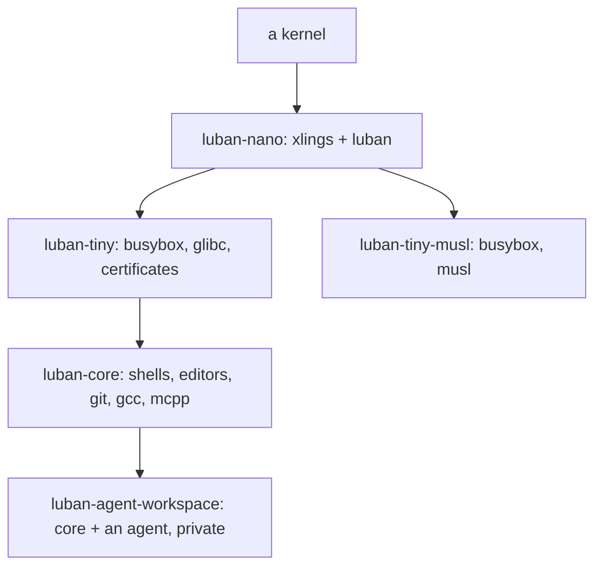

# Luban

[English](../../luban/README.md) | **简体中文**

Luban 是能成立的最小操作系统模型：一个内核，其上只有两样东西必须存在——**xlings**（包）和 **luban**（系统）。
其余都是选择：libc、init、工具、策略。同一个环境在你的机器上作为沙箱运行，变成镜像，也能启动一台机器。

## 模型

**edition** 是模板：一组包、一份策略、怎样启动。每个 edition `from` 它下面那一个，每个版本按日期编号，发布后永不改变。
**环境**由 edition 创建，之后有自己的生命：往里装东西、回滚、升到 edition 的最新版。

## luban 与 xlings

`luban` 是基于 xlings 的一种实现，不是第二套实现。它的每个环境命令就是它所对应的 xlings 命令——`luban <命令> --help`
会写明是哪一个——装软件仍然是 `xlings install`。luban 增加的是只有当环境是一个系统时才存在的东西：按名字选 edition、镜像、驱动器、机器的启动。

## 什么在哪里运行

| | x86_64 Linux | aarch64 Linux | macOS | Windows |
|---|---|---|---|---|
| 环境（nano、tiny、tiny-musl、core、agent-workspace） | 是 | 是 | 经 `vz`（尚未发布） | 经 `wsl2` |
| 私有的 agent 工作区 | 是 | 是 | — | 经 `wsl2` |
| 镜像：ISO、驱动器、qcow2、tar | 是 | 是 | — | — |
| 启动：BIOS 与 UEFI | 是 | UEFI | — | — |
| `luban try`（本地虚拟机） | 是 | 是（没有 KVM 时纯模拟） | — | — |
| 启动层 | `generic`（真机）、`virt`（虚拟机） | `virt` | — | — |

宿主上，Linux 除了内核之外什么都不需要，Ubuntu 23.10 及以后另需一次性设置（[07](07-host-support.md)）；
镜像或虚拟机需要的每个工具都来自索引。

## 阅读顺序

- [00 —— Luban 是什么](00-what-luban-is.md) —— 模型，以及它用来做什么
- [01 —— 快速开始](01-getting-started.md) —— 创建、进入、运行、列出
- [02 —— Edition](02-editions.md) —— 每个包含什么，版本怎样选择
- [03 —— 环境](03-environments.md) —— 设置、授权、升级、回滚
- [04 —— Agent 工作区](04-agent-workspace.md) —— 给 agent 的私有空间
- [05 —— 镜像](05-images.md) —— ISO、驱动器、qcow2、tar；启动层；`try`；写入驱动器
- [06 —— 机器](06-machine.md) —— Luban 作为一台机器的系统：stage-0、启动项、启动时回滚
- [07 —— 宿主支持](07-host-support.md) —— 哪些宿主、一次性设置、失败时怎么办
- [91 —— 架构](91-architecture.md) —— 给开发者：它是怎样构建的

全部 luban 命令和参数：[生成的参考](../../generated/luban-command-reference.md)。
编写 edition：索引的 [Luban 包](https://github.com/openxlings/xim-pkgindex/blob/main/docs/zh/12-luban-packages.md)。
